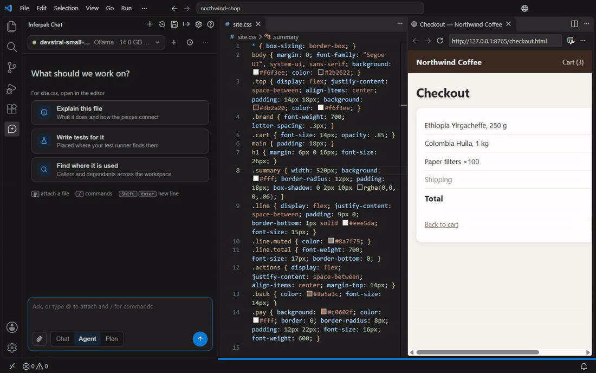
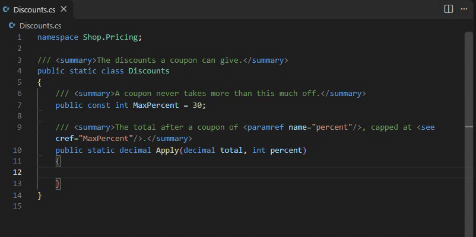
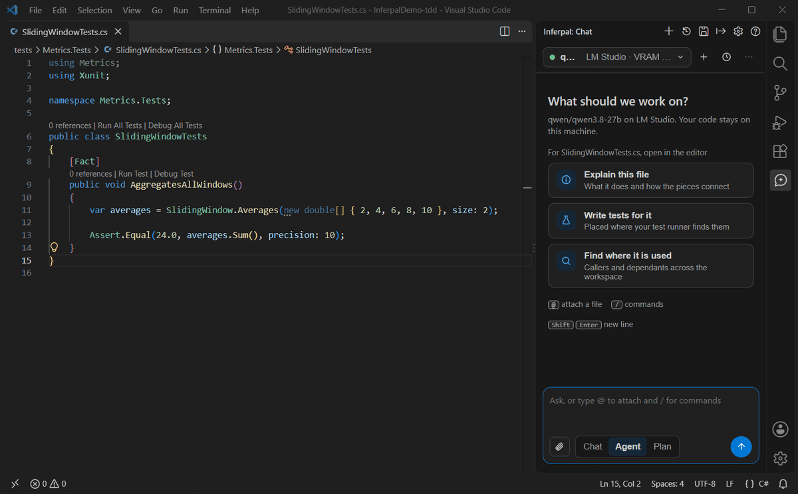
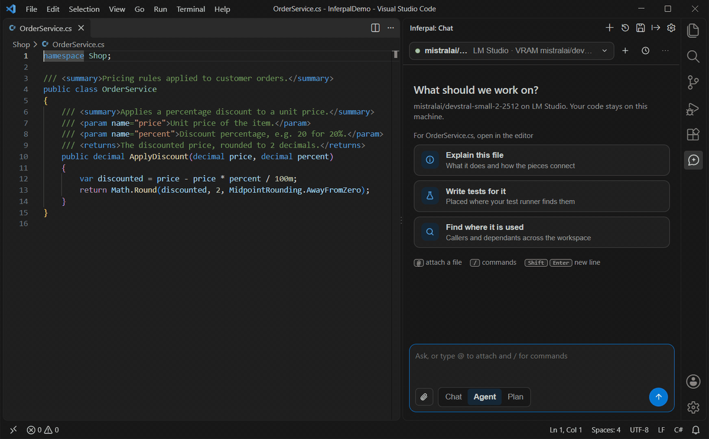

  

<h1 align="center">Inferpal</h1>

  <b>Your local AI coding agent, inside Visual Studio, VS Code and the editors you already use.</b> 
  It reads your code, edits it behind an approval that shows the real diff, then builds and runs your tests. 
  The model runs on your own hardware.

  No account · No telemetry · No API key · Works offline · Free and open source

  
  
  
  
  
  
  

  <a href="https://marketplace.visualstudio.com/items?itemName=EstaxNet.inferpal-vs"><b>Visual Studio 2026 / 2022</b></a> ·
  <a href="https://marketplace.visualstudio.com/items?itemName=EstaxNet.inferpal-vscode"><b>VS Code</b></a> and <a href="https://open-vsx.org/extension/EstaxNet/inferpal-vscode"><b>Open VSX</b></a> (VSCodium, Cursor; Windows x64, Linux x64, macOS on Apple Silicon and Intel) ·
  <a href="docs/acp.md"><b>Zed, JetBrains, Qt Creator, Neovim, Emacs</b></a>

  Website: <a href="https://inferpal.estaxnet.fr/"><b>inferpal.estaxnet.fr</b></a>

  
   
  "On a phone, customers cannot find the Pay button." It looks at the page at a phone's width, changes one line once you allow it, and looks again. Replayed in VS Code.

## See it work

  
   
  <b>Completions as you type</b>, from the model on your machine. Tab takes them. Replayed in VS Code.

  
   
  <b>A failing test, fixed with the debugger's view.</b> <code>/tdd</code> runs it again under the debugger and fixes from the real exception and local values.

  
   
  <b>"Add argument validation to this method and cover it with tests."</b> A real run on a local model (Devstral Small 2 in LM Studio), sped up.

  
  
   
  The same agent in <b>Visual Studio 2026 / 2022</b> and in <b>VS Code</b> on Windows, Linux and macOS. Conversations go from one editor to the other.

It also queries your CSV, Excel and JSON files with SQL, reads a log by level and time, calls the service you are
building to check a fix, measures before it says faster, reads PDFs, spreadsheets, notebooks, screenshots, screen recordings of a bug and static analysis reports, and
looks at the window of a desktop app it started. Zed, JetBrains IDEs, Qt Creator, Neovim and Emacs get the same agent
through the [Agent Client Protocol](docs/acp.md).

## Your code stays with you

The model runs on a server you choose — Ollama, LM Studio, llama.cpp, vLLM — on this computer or a GPU machine you own
([remote setup](docs/remote-inference.md)). No account, no telemetry, no hosted service. The only other things that go
out are the ones you set up or approve: the MCP servers you add, a documentation site you index, a web search or a page
the agent asks to read, and the name of a package it wants to add, checked on its public registry (one setting turns
that off).

## Which model for your graphics card

| Your card | Agent model | Real coding tasks solved, tests passing |
|---|---|---|
| 24 GB | Qwen3.8 27B | 14 / 14 |
| 12 – 16 GB | Gemma 4 12B, fast · Ternary Bonsai 2 27B, about 4× slower | 12 / 14 · 14 / 14 |
| 8 GB | Granite 4.2 8B | 14 / 14 |

Measured on our own bench. Any model that calls tools works. [All measurements](docs/models.md)

## Get started

1. **Install** for [Visual Studio](https://marketplace.visualstudio.com/items?itemName=EstaxNet.inferpal-vs) or
   [VS Code](https://marketplace.visualstudio.com/items?itemName=EstaxNet.inferpal-vscode)
   ([Open VSX](https://open-vsx.org/extension/EstaxNet/inferpal-vscode) for VSCodium and Cursor).
2. **Run a model server** — [Ollama](https://ollama.com) or [LM Studio](https://lmstudio.ai). On a 24 GB card:
   `ollama pull qwen3.8`.
3. **Open Inferpal** — *Tools → Inferpal → Inferpal Chat* in Visual Studio, the activity-bar icon in VS Code. It finds
   your model server and sets you up.

[Getting Started](docs/getting-started.md) · Coming from Continue or Roo Code? `/import` brings your setup over
([how](docs/coming-from-continue.md)).

## Learn more

[Feature tour](docs/features.md) — 44 built-in tools and any MCP server, more than 50 slash commands, `/check` reviews,
commit messages, background tasks, modes, your repository's `AGENTS.md`, an interface in 10 languages.

| Use it | Set it up | Under the hood |
|---|---|---|
| [Getting Started](docs/getting-started.md) · [Features](docs/features.md) · [Slash Commands](docs/slash-commands.md) · [Mentions](docs/mentions.md) · [Tools](docs/tools.md) · [File formats](docs/file-formats.md) | [Providers](docs/providers.md) · [Models](docs/models.md) · [Configuration](docs/configuration.md) · [Remote Inference](docs/remote-inference.md) · [Other editors (ACP)](docs/acp.md) · [Coming from Continue or Roo](docs/coming-from-continue.md) | [Architecture](docs/architecture.md) · [Search & Indexing](docs/search-and-indexing.md) · [MCP](docs/mcp.md) · [Rules & Checks](docs/rules-and-checks.md) · [Development](docs/development.md) |

Website: [inferpal.estaxnet.fr](https://inferpal.estaxnet.fr/) · Official sources: this repository's
[releases](https://github.com/EstaxNet/Inferpal/releases) and the
[Visual Studio](https://marketplace.visualstudio.com/items?itemName=EstaxNet.inferpal-vs),
[VS Code](https://marketplace.visualstudio.com/items?itemName=EstaxNet.inferpal-vscode) and
[Open VSX](https://open-vsx.org/extension/EstaxNet/inferpal-vscode) listings. Inferpal is an independent project by
EstaxNet, with no hosted version.

Contributions are welcome — see [Development](docs/development.md).
[GNU GPL v3](https://www.gnu.org/licenses/gpl-3.0) · Developed with the assistance of **Claude** (Anthropic).
