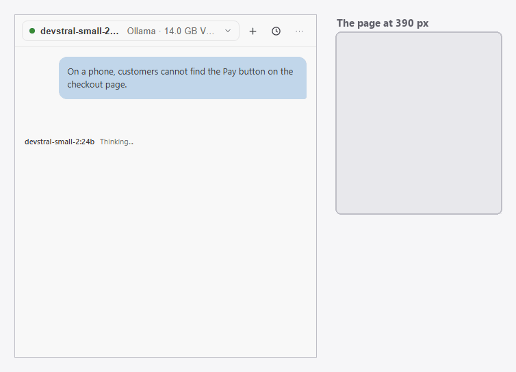
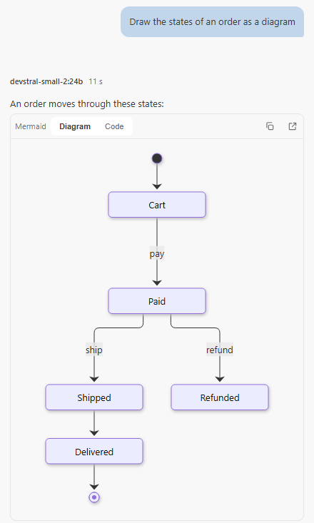
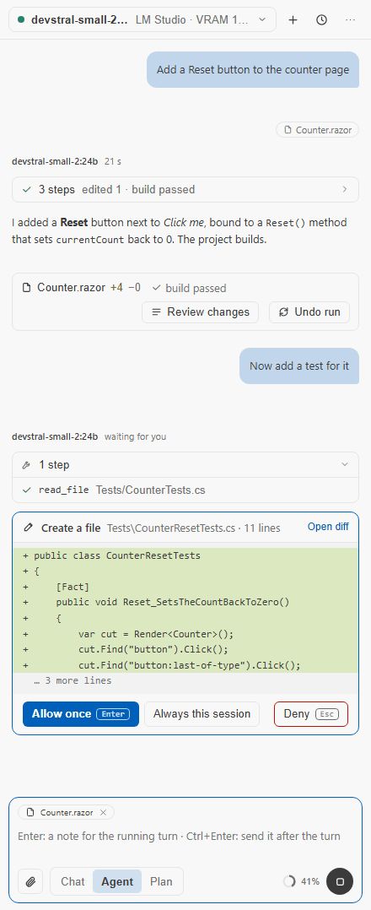
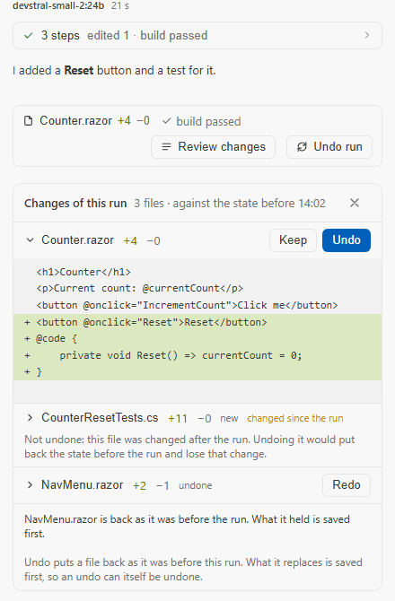
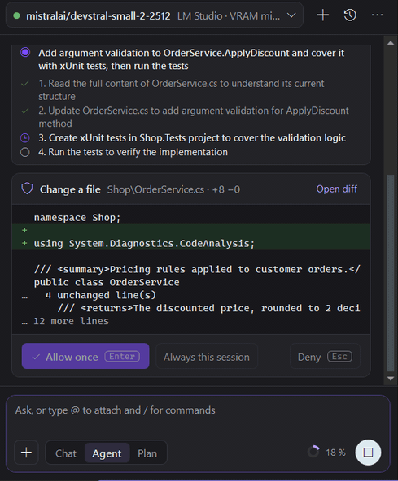

  

<h1 align="center">Inferpal</h1>

  <b>A coding agent for Visual Studio and VS Code that runs on your own hardware.</b> 
  It reads your code, proposes each change on the real diff, then builds and runs your tests.

  No account · No telemetry · No API key · Works offline · Free and open source

  
  
  
  
  
  

  
   
  "Add argument validation to this method and cover it with tests" — a real run on a local model (Devstral Small 2 in LM Studio), sped up.

## See it work

  
   
  <b>A failing test, fixed with the debugger's view.</b> <code>/tdd</code> runs it again under the debugger and fixes from the real exception and local values.

  <picture>
    <source media="(prefers-color-scheme: dark)" srcset="docs/assets/demo-viewpage-dark.gif">
    
  </picture>
   
  <b>It looks at your app.</b> <code>view_page</code> opens the page at a phone's width, sees the Pay button off the screen, fixes the CSS and looks again. Replayed step by step in the chat panel, beside the two pictures Inferpal took of the page.

<table>
  <tr>
    <td align="center" valign="top" width="50%">
      <picture>
        <source media="(prefers-color-scheme: dark)" srcset="docs/assets/features/documents-vs-dark.png">
        
      </picture>
       <b>Your spec is a PDF, your cases are in Excel.</b> Read on your machine, quoted page by page and row by row.
    </td>
    <td align="center" valign="top" width="50%">
      <picture>
        <source media="(prefers-color-scheme: dark)" srcset="docs/assets/features/diagram-vscode-dark.png">
        
      </picture>
       <b>Ask for a diagram, get it drawn.</b> Its Mermaid code one click away.
    </td>
  </tr>
  <tr>
    <td align="center" valign="top" width="50%">
      <picture>
        <source media="(prefers-color-scheme: dark)" srcset="docs/assets/features/editor-vscode-dark.png">
        
      </picture>
       <b>Nothing changes without you.</b> Every write and command waits on the real diff: Enter allows, Esc refuses.
    </td>
    <td align="center" valign="top" width="50%">
      <picture>
        <source media="(prefers-color-scheme: dark)" srcset="docs/assets/features/review-run-dark.png">
        
      </picture>
       <b>Undo the whole run, or each change on its own.</b> Every file is backed up before it is written.
    </td>
  </tr>
  <tr>
    <td align="center" valign="top" width="50%"> <b>Visual Studio 2026 / 2022</b></td>
    <td align="center" valign="top" width="50%"> <b>VS Code</b> on Windows, Linux and macOS — conversations go from one editor to the other</td>
  </tr>
</table>

It also opens your web app at phone width, looks at the window of a desktop app it started, calls your service, reads
logs, notebooks and archives, and works from a right-click on an error, a failing test or a selection. Zed, JetBrains
IDEs, Qt Creator, Neovim and Emacs get the same agent through the [Agent Client Protocol](docs/acp.md).

## Your code stays with you

The model runs on a server you choose — Ollama, LM Studio, llama.cpp, vLLM — on this computer or a GPU machine you own
([remote setup](docs/remote-inference.md)). No account, no telemetry, no hosted service. The only other things that go
out are the ones you set up or approve: the MCP servers you add, a documentation site you index, a web search or a page
the agent asks to read, and the name of a package it wants to add, checked on its public registry (one setting turns
that off).

## Which model for your graphics card

| Your card | Agent model | Real coding tasks solved, tests passing |
|---|---|---|
| 24 GB | Qwen3.8 27B | 14 / 14 |
| 12 – 16 GB | Gemma 4 12B, fast · Ternary Bonsai 2 27B, about 4× slower | 12 / 14 · 14 / 14 |
| 8 GB | Granite 4.2 8B | 14 / 14 |

Measured on our own bench. Any model that calls tools works. [All measurements](docs/models.md)

## Get started

1. **Install** for [Visual Studio](https://marketplace.visualstudio.com/items?itemName=EstaxNet.inferpal-vs) or
   [VS Code](https://marketplace.visualstudio.com/items?itemName=EstaxNet.inferpal-vscode)
   ([Open VSX](https://open-vsx.org/extension/EstaxNet/inferpal-vscode) for VSCodium and Cursor).
2. **Run a model server** — [Ollama](https://ollama.com) or [LM Studio](https://lmstudio.ai). On a 24 GB card:
   `ollama pull qwen3.8`.
3. **Open Inferpal** — *Tools → Inferpal → Inferpal Chat* in Visual Studio, the activity-bar icon in VS Code. It finds
   your model server and sets you up.

[Getting Started](docs/getting-started.md) · Coming from Continue or Roo Code? `/import` brings your setup over
([how](docs/coming-from-continue.md)).

## Learn more

[Feature tour](docs/features.md) — 41 built-in tools and any MCP server, more than 50 slash commands, `/check` reviews,
commit messages, background tasks, modes, your repository's `AGENTS.md`, an interface in 10 languages.

| Use it | Set it up | Under the hood |
|---|---|---|
| [Getting Started](docs/getting-started.md) · [Features](docs/features.md) · [Slash Commands](docs/slash-commands.md) · [Mentions](docs/mentions.md) · [Tools](docs/tools.md) · [File formats](docs/file-formats.md) | [Providers](docs/providers.md) · [Models](docs/models.md) · [Configuration](docs/configuration.md) · [Remote Inference](docs/remote-inference.md) · [Other editors (ACP)](docs/acp.md) · [Coming from Continue or Roo](docs/coming-from-continue.md) | [Architecture](docs/architecture.md) · [Search & Indexing](docs/search-and-indexing.md) · [MCP](docs/mcp.md) · [Rules & Checks](docs/rules-and-checks.md) · [Development](docs/development.md) |

Website: [inferpal.estaxnet.fr](https://inferpal.estaxnet.fr/) · Official sources: this repository's
[releases](https://github.com/EstaxNet/Inferpal/releases) and the
[Visual Studio](https://marketplace.visualstudio.com/items?itemName=EstaxNet.inferpal-vs),
[VS Code](https://marketplace.visualstudio.com/items?itemName=EstaxNet.inferpal-vscode) and
[Open VSX](https://open-vsx.org/extension/EstaxNet/inferpal-vscode) listings. Inferpal is an independent project by
EstaxNet, with no hosted version.

Contributions are welcome — see [Development](docs/development.md).
[GNU GPL v3](https://www.gnu.org/licenses/gpl-3.0) · Developed with the assistance of **Claude** (Anthropic).
