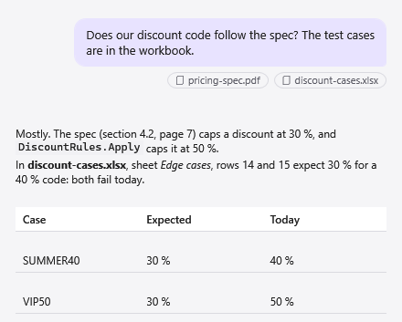
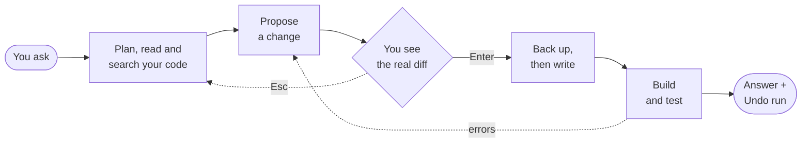
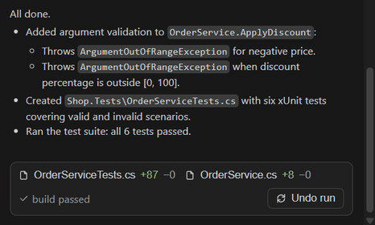
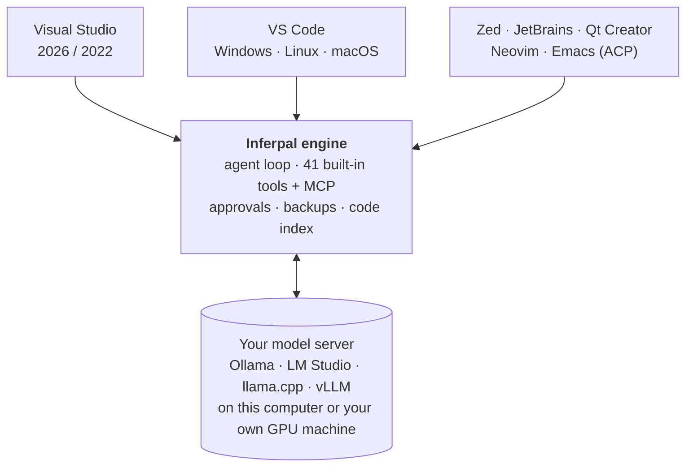
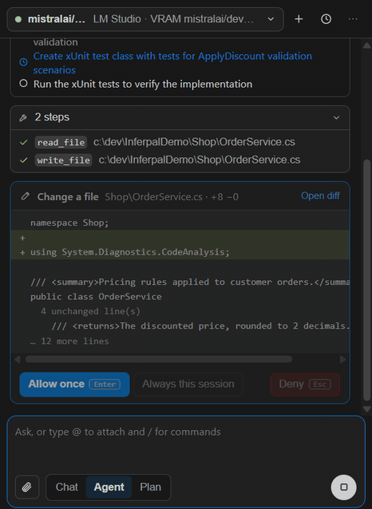

  

<h1 align="center">Inferpal</h1>

  <b>Your local AI coding agent, inside Visual Studio, VS Code and the editors you already use.</b> 
  It reads your code, edits it behind an approval that shows the real diff, then builds and runs your tests. 
  The model runs on your own hardware.

  No account · No telemetry · No API key · Works offline · Free and open source

  
  
  
  
  
  
  

  <a href="https://marketplace.visualstudio.com/items?itemName=EstaxNet.inferpal-vs"><b>Visual Studio 2026 / 2022</b></a> ·
  <a href="https://marketplace.visualstudio.com/items?itemName=EstaxNet.inferpal-vscode"><b>VS Code</b></a> and <a href="https://open-vsx.org/extension/EstaxNet/inferpal-vscode"><b>Open VSX</b></a> (VSCodium, Cursor; Windows x64, Linux x64, macOS on Apple Silicon and Intel) ·
  <a href="docs/acp.md"><b>Zed, JetBrains, Qt Creator, Neovim, Emacs</b></a>

  Website: <a href="https://inferpal.estaxnet.fr/"><b>inferpal.estaxnet.fr</b></a>

  
   
  A real run on a local model (Devstral Small 2 in LM Studio), sped up. Every write and command was approved in the chat.

---

## Show it what you are looking at

<table>
  <tr>
    <td align="center" valign="top" width="50%">
      <picture>
        <source media="(prefers-color-scheme: dark)" srcset="docs/assets/features/documents-vs-dark.png">
        
      </picture>
       Visual Studio: a PDF and a workbook, read as text on your machine.
    </td>
    <td align="center" valign="top" width="50%">
      <picture>
        <source media="(prefers-color-scheme: dark)" srcset="docs/assets/features/diagram-vscode-dark.png">
        
      </picture>
       VS Code: a Mermaid diagram drawn in the chat, its code one click away.
    </td>
  </tr>
</table>

The spec is a PDF, the test data lives in a spreadsheet, the error is on a screenshot. Hand them over as they are; everything is read on your machine.

| You have | Do | The model gets |
|---|---|---|
| A PDF, a Word or Excel file, a deck | `@file`, Browse, or drop it on the chat | Its text: each sheet under its name, each slide with its notes |
| A screenshot of an error or a mock-up | Paste it (Ctrl+V), or drop it on the chat | The image itself, for a model that sees images (Qwen3.8, Ornith, Gemma 4) |
| A file protected by a password | Attach it as usual | A card asks you for the password (Visual Studio and VS Code); the model gets the text, never the password |
| A question about a flow or a design | Ask for a diagram | A Mermaid diagram drawn in the chat, its code one click away |

Word (`.docx`, `.doc`), Excel (`.xlsx`, `.xls`, `.xlsb`), PowerPoint, OpenDocument, RTF, Jupyter notebooks and e-mails
(`.eml`, `.msg`) are read too, by you and by the agent's `read_file` and `search_in_files`. When the model that will
answer does not see images, the text written in the image goes instead, read on your machine by Inferpal's OCR. In Visual Studio, VS Code and ACP editors.
[How each format is read](docs/file-formats.md)

## It looks, it measures, it checks

A model that only reads source code has to imagine what the program does. Inferpal's agent can check instead: it
looks at what the code produces, measures it, and reads the files developers deal with every day.

| The agent can | What you get |
|---|---|
| Open a page of the web app you build, at desktop and phone widths, in a browser with no network access (`view_page`) | Layout and styling problems the source does not show — an invisible element, a layout that breaks on a phone — seen, not guessed |
| Look at the window of a desktop app it started, with every control's type, text, value and state (`view_window`) | A disabled button or an empty field noticed, even by a model that cannot read images |
| Start your web service, send it real HTTP requests and read the answers (`http_request`) | An error reproduced, fixed, then confirmed by calling the service again |
| Run a command several times after a warm-up and compare medians (`run_command` with `repeat`) | A change kept as "faster" only when the gain is beyond the normal variation between runs |
| Read a log by level and time range (`read_file`) | Only the entries that matter, each with its stack trace and line number |
| Answer one read-only SQL query on a CSV, TSV, JSON, Excel or SQLite file (`query_data`) | Counts, filters and sums on files too large to read |
| Read inside zip, 7z, RAR and tar archives and NuGet packages without extracting them | Logs and packages inspected where they are |
| Change one cell of a Jupyter notebook, then run the notebook on a copy (`edit_notebook`, `run_notebook`) | The failing cell fixed and its output checked, the rest of the notebook untouched |
| Ask MSBuild where a build setting is defined (`msbuild_property`) | A build error that comes from a setting fixed in the file that sets it |
| Change a text across many files in one approval (`replace_in_files`) | A rename across a project, all files or none, each backed up first |
| Read which commits touched a file and who last changed each line (`git_history`) | Code understood before it is changed |

The text of a screenshot or a scanned PDF is read by Inferpal's own OCR, in its ten languages, on Windows, Linux and
macOS, with nothing to install. When a request could mean several things, the agent asks you on a card instead of
guessing (Visual Studio and VS Code). Calling your app and running a command still ask you first; an *Always* covers
one local address and port. [Every tool, by what you ask](docs/tools.md)

## One turn, from question to green build

Ask in plain words, for example *"add argument validation to this method and cover it with tests"*. The agent plans,
reads, edits, builds and tests, and shows every step live. Nothing touches your disk until you have seen the change.

- **Every write, delete and command waits for you**, with the real diff. Enter allows, Esc denies — or pick a narrow
  rule such as *commands that start with `dotnet test`* (never a chain, a launcher or a program that deletes).
- **Every file is backed up before it changes.** **Undo run** puts the whole run back in one click — or **Review
  changes** keeps or undoes each change of a file on its own.
- **Steer it while it works.** Type a correction and press Enter: the agent reads it before its next step.
- **It checks its own work.** An edit that would break a file's syntax (C#, Razor, Python, JavaScript modules) is
  refused before you are asked; a build or typecheck after each edit (.NET, TypeScript, Rust, Go) feeds the errors
  straight back.
- **Invented packages are refused before you are asked.** Local models make up package names; each one is looked up
  on nuget.org, npm or PyPI first.

 

## Right-click, and it's on it

| Where you are | Visual Studio | VS Code |
|---|---|---|
| **Errors** | Error List → *Fix with Inferpal*, or *Fix them* on the failed-build banner | Problems or light bulb → *Fix with Inferpal* |
| **A failing test** | Test Explorer → *Fix Failing Tests with Inferpal*, or `/tdd` | Test view → *Make This Test Pass* · *Explain the Failure* |
| **Debugger, stopped** | *Analyze with Inferpal* (Call Stack, Locals, Watch…) | *Analyze with Inferpal* |
| **A file or a project** | Solution Explorer → *Explain* · *Review Changes* · *Attach to Chat* | Explorer → the same three |
| **A selection** | *Edit with AI…* (Shift+Alt+I), accepted part by part in the editor | *Edit with AI*, shown in Refactor Preview first |
| **Committing** | `/commit` drafts the message | Source Control → *Propose a Commit Message* |
| **Typing** | Ghost-text completions: Tab, or Alt+' to ask | the same |

## A failing test? It reads the debugger, not just the log

  

`/tdd` runs your tests (dotnet, pytest, npm, cargo, go), patches the code and runs them again, up to five rounds. On
the first red round a failing .NET test runs again **under the editor's debugger**, and the real exception, call
stack and local values go into the fix.

## Measured, not promised

| On a fixed bench, with local models | Result |
|---|---|
| Real coding tasks in C#, JavaScript and Python, counted only when the project's own tests pass — Qwen3.8 27B on one 24 GB card | **14 / 14** |
| 12 failing C# tests handed to `/tdd`, local 27B model | **12 fixed** with the debugger's view, 10 without |
| A repository rule followed over 10 questions, two local models | **8 and 10** with its instruction file, **0** without |

Every figure, model by model: **[Models](docs/models.md)**. `/bench` measures the ones you have, on your machine.

## Pick a model for your card

| Your card | Agent | Autocomplete beside it |
|---|---|---|
| 24 GB | Qwen3.8 27B (14/14), which also autocompletes, or Ornith 1.5 35B-A3B (14/14 at 16K, about 1.6× faster), or Gemma 4 12B with Mellum2 | see the agent column |
| 16 GB | Gemma 4 12B (12/14, fast), or Ternary Bonsai 2 27B (14/14, about 4× slower) | Mellum2 fits only beside a weaker agent |
| 12 GB | same as 16 GB | none measured fits |
| 8 GB | Granite 4.2 8B (14/14, fast) | none measured fits |
| More than 24 GB | not tested | — |

Measured on one 24 GB card (LM Studio, 32K context), its free memory cut to stand in for the smaller ones. Bigger
cards, multi-GPU machines and 70B-class models were out of our budget, not out of interest: a bigger model makes a
better agent. Any model that calls tools works — [details](docs/models.md#by-graphics-card).

## One engine, every editor

The same chat, approvals and settings in every editor — and Visual Studio and VS Code share conversations, so you can
start in one and finish in the other:

<table>
  <tr>
    <td align="center" valign="top"> Visual Studio</td>
    <td align="center" valign="top"> VS Code</td>
  </tr>
</table>

## Get started

1. **Install** from the Marketplace — [Visual Studio](https://marketplace.visualstudio.com/items?itemName=EstaxNet.inferpal-vs)
   or [VS Code](https://marketplace.visualstudio.com/items?itemName=EstaxNet.inferpal-vscode), [Open VSX](https://open-vsx.org/extension/EstaxNet/inferpal-vscode) for VSCodium and the other editors built on VS Code — or from the
   [latest release](https://github.com/EstaxNet/Inferpal/releases/latest), which also carries the
   [ACP agent](docs/acp.md) for the other editors.
2. **Run a model server.** [Ollama](https://ollama.com) or [LM Studio](https://lmstudio.ai), on this computer or a
   machine you own ([remote setup](docs/remote-inference.md)). On a 24 GB card: `ollama pull qwen3.8`.
3. **Open Inferpal** — *Tools → Inferpal → Inferpal Chat* in Visual Studio, the activity-bar icon in VS Code. The
   first time, it looks for your model server and sets you up with a model; `/setup` looks again.

Full walkthrough: **[Getting Started](docs/getting-started.md)**. Coming from Continue or Roo Code? `/import continue`
or `/import roo` brings your models, rules, prompts, Roo's modes and MCP servers over — [how](docs/coming-from-continue.md).

## Also in the box

- **41 built-in tools** — files, text and semantic search, build and tests, a shell with background jobs, git, the
  editor, the debugger, compiler-backed analysis and rename, web search — plus any **MCP** server and your own shell
  commands. [Reference](docs/tools.md)
- **Reviews and git text** — `/check` reviews your diff, a branch or a commit, every finding anchored to a line;
  `/commit` and `/pr-description` write the text.
- **Typed context** — `@file` `@folder` `@code` `@diff` `@commit` `@problems` `@debugger` `@clipboard` `@tree` `@url`, `@output` (Visual Studio), `@terminal` (VS Code), and
  **@Docs** to index a documentation site; drag a file or folder onto the chat to attach it in Visual Studio, or files
  from your file manager in VS Code (Shift held).
- **A server behind a reverse proxy** — Caddy, nginx or Cloudflare Access with a password or a token: the settings
  build the headers, show what is sent and to whom, and the Test says where a request stopped.
  [Remote inference](docs/remote-inference.md#behind-a-reverse-proxy)
- **Your repository's setup, read as it is** — `AGENTS.md`, `CLAUDE.md`, the Copilot, Cursor, Cline, Roo and Continue
  instruction files, and `.aiignore`-style files, honoured by everything that reads for the model.
- **Modes, yours or your repository's** — beside Chat, Agent and Plan, pick a mode found for the workspace: your own,
  GitHub Copilot's custom agents or Roo Code's custom modes, read as they are. It brings its instructions, model, tools
  and effort, and adds no permission. [Modes](docs/configuration.md#modes)
- **Work beside you** — `/task` investigates in the background while you code; `/debug` drives a real debug session
  once you approve it.
- **See what the model sees** — a gauge shows how full its window is, and `/xray` what fills it, layer by layer.
- **Many models, one GPU** — `/bench` scores your installed models per role, `/arena` runs blind duels, and small
  chores (titles, commit messages, summaries) can go to a small utility model. Each answer shows how fast the model
  wrote it (`21 s · 38 tok/s`), from the server's own count.
- **50+ slash commands** and an interface in 10 languages. [All commands](docs/slash-commands.md) ·
  [Full feature tour](docs/features.md)

## What leaves your machine

With a model server on your machine, your code does not. There is no account, no telemetry and no hosted service.
Only these go out: the model server address you choose, the MCP servers you add, a documentation site you index, the
agent's web searches and page fetches (each one asks you first), and the name of a package the agent wants to add,
looked up on its public registry — one setting turns that off.

---

## Documentation

| Use it | Set it up | Under the hood |
|---|---|---|
| [Getting Started](docs/getting-started.md) · [Features](docs/features.md) · [Slash Commands](docs/slash-commands.md) · [Mentions](docs/mentions.md) · [Tools](docs/tools.md) · [File formats](docs/file-formats.md) | [Providers](docs/providers.md) · [Models](docs/models.md) · [Configuration](docs/configuration.md) · [Remote Inference](docs/remote-inference.md) · [Other editors (ACP)](docs/acp.md) · [Coming from Continue or Roo](docs/coming-from-continue.md) | [Architecture](docs/architecture.md) · [Search & Indexing](docs/search-and-indexing.md) · [MCP](docs/mcp.md) · [Rules & Checks](docs/rules-and-checks.md) · [Development](docs/development.md) |

## Official sources

Inferpal is an independent open-source project by EstaxNet. It has no hosted version and no account, and is not
affiliated with any cloud or API provider. The only official sources are this repository's
[releases](https://github.com/EstaxNet/Inferpal/releases) and the Marketplace listings for
[Visual Studio](https://marketplace.visualstudio.com/items?itemName=EstaxNet.inferpal-vs) and
[VS Code](https://marketplace.visualstudio.com/items?itemName=EstaxNet.inferpal-vscode), and [Open VSX](https://open-vsx.org/extension/EstaxNet/inferpal-vscode).

## Contributing

Contributions are welcome — see **[Development](docs/development.md)** for the build, the project layout, and how to
add a tool or a language. Quick version: implement `ITool`, register it in `ToolRegistry.cs`, and add any new strings
to all 10 `.resx` files **and** to `Strings.cs`.

## License

[GNU GPL v3](https://www.gnu.org/licenses/gpl-3.0). Developed with the assistance of **Claude** (Anthropic).
