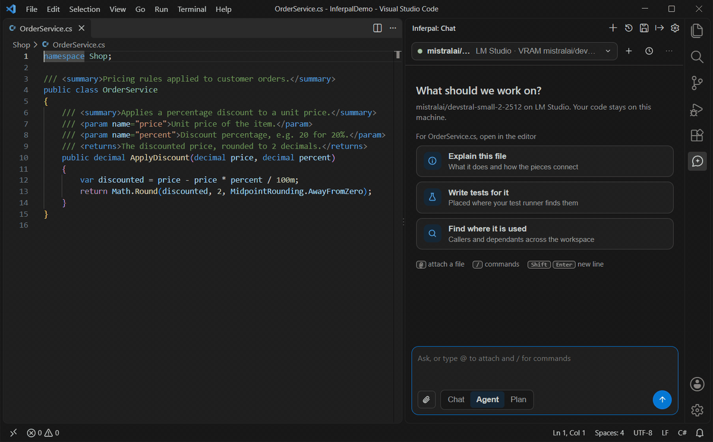
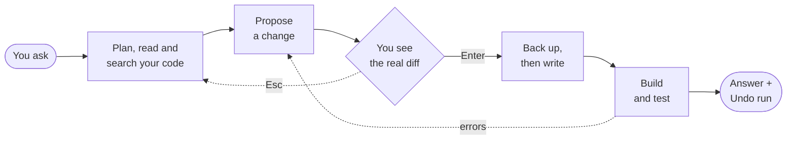
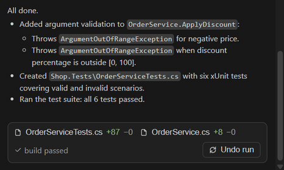
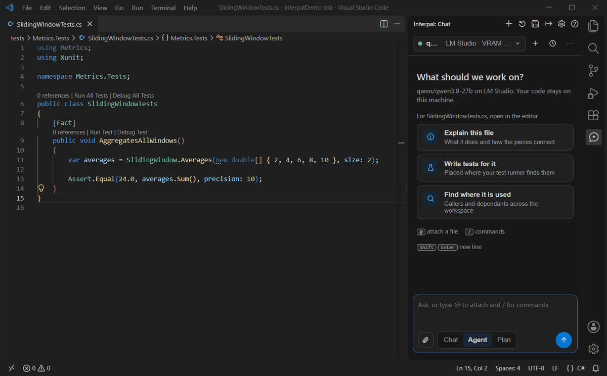
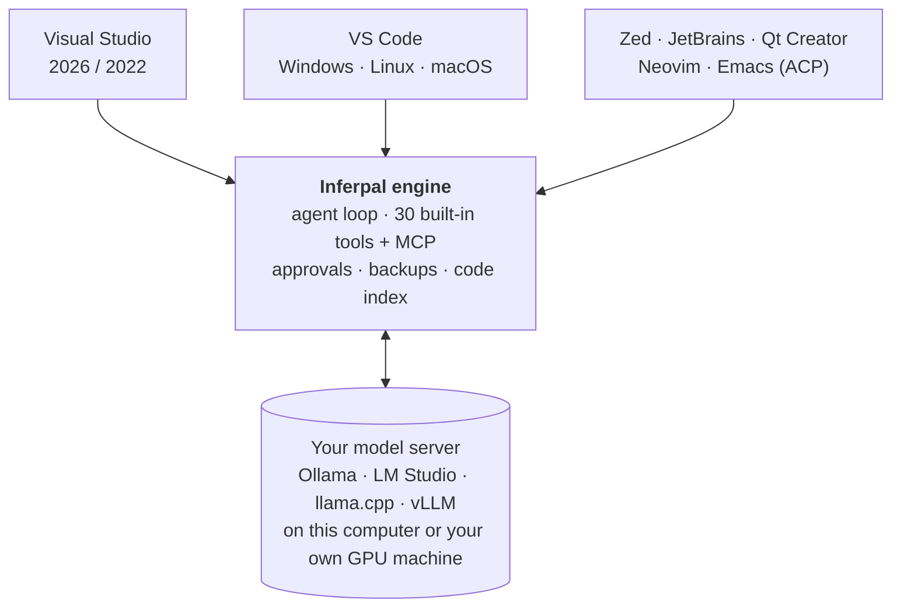
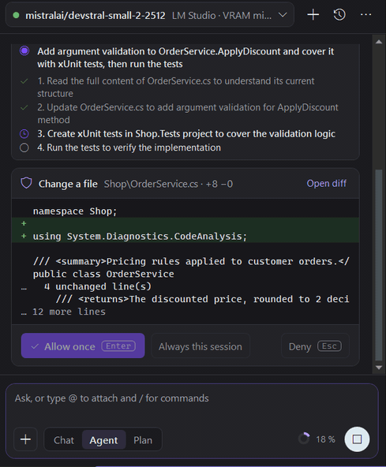
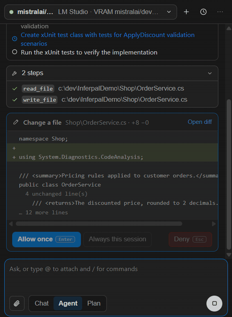

  

<h1 align="center">Inferpal</h1>

  <b>Your local AI coding agent, inside Visual Studio, VS Code and the editors you already use.</b> 
  It reads your code, edits it behind an approval that shows the real diff, then builds and runs your tests. 
  The model runs on your own hardware.

  No account · No telemetry · No API key · Works offline · Free and open source

  
  
  
  
  
  

  <a href="https://marketplace.visualstudio.com/items?itemName=EstaxNet.inferpal-vs"><b>Visual Studio 2026 / 2022</b></a> ·
  <a href="https://marketplace.visualstudio.com/items?itemName=EstaxNet.inferpal-vscode"><b>VS Code</b></a> (Windows, Linux, macOS) ·
  <a href="docs/acp.md"><b>Zed, JetBrains, Qt Creator, Neovim, Emacs</b></a>

  
   
  A real run on a local model (Devstral Small 2 in LM Studio), sped up. Every write and command was approved in the chat.

---

## One turn, from question to green build

Ask in plain words, for example *"add argument validation to this method and cover it with tests"*. The agent plans,
reads, edits, builds and tests, and shows every step live. Nothing touches your disk until you have seen the change.

- **Every write, delete and command waits for you**, with the real diff. Enter allows, Esc denies — or pick a narrow
  rule such as *commands that start with `dotnet test`* (never a chain, a launcher or a program that deletes).
- **Every file is backed up before it changes.** **Undo run** puts the whole run back in one click.
- **Steer it while it works.** Type a correction and press Enter: the agent reads it before its next step.
- **It checks its own work.** A build or typecheck after each edit (.NET, TypeScript, Rust, Go) feeds the errors
  straight back.
- **Invented packages are refused before you are asked.** Local models make up package names; each one is looked up
  on nuget.org, npm or PyPI first.

 

## Right-click, and it's on it

| Where you are | Visual Studio | VS Code |
|---|---|---|
| **Errors** | Error List → *Fix with Inferpal*, or *Fix with AI* on a failed build | Problems or light bulb → *Fix with Inferpal* |
| **A failing test** | `/tdd` | Test view → *Make This Test Pass* · *Explain the Failure* |
| **Debugger, stopped** | *Analyze with Inferpal* (Call Stack, Locals, Watch…) | *Analyze with Inferpal* |
| **A file or a project** | Solution Explorer → *Explain* · *Review Changes* · *Attach to Chat* | Explorer → the same three |
| **A selection** | *Edit with AI…* (Ctrl+Shift+I), accepted part by part in the editor | *Edit with AI*, shown in Refactor Preview first |
| **Committing** | `/commit` drafts the message | Source Control → *Propose a Commit Message* |
| **Typing** | Ghost-text completions: Tab, or Alt+' to ask | the same |

## A failing test? It reads the debugger, not just the log

  

`/tdd` runs your tests (dotnet, pytest, npm, cargo, go), patches the code and runs them again, up to five rounds. On
the first red round a failing .NET test runs again **under the editor's debugger**, and the real exception, call
stack and local values go into the fix.

## Measured, not promised

| On a fixed bench, with local models | Result |
|---|---|
| Real coding tasks in C#, JavaScript and Python, counted only when the project's own tests pass — Qwen3.8 27B on one 24 GB card | **14 / 14** |
| 12 failing C# tests handed to `/tdd`, local 27B model | **12 fixed** with the debugger's view, 10 without |
| A repository rule followed over 10 questions, two local models | **8 and 10** with its instruction file, **0** without |

Every figure, model by model: **[Models](docs/models.md)**. `/bench` measures the ones you have, on your machine.

## Pick a model for your card

| Your card | Agent | Autocomplete beside it |
|---|---|---|
| 24 GB | Qwen3.8 27B (14/14), which also autocompletes, or Gemma 4 12B with Mellum2 | see the agent column |
| 16 GB | Gemma 4 12B (12/14, fast), or Bonsai 27B, a 1-bit Qwen (13/14, about 3× slower) | Mellum2 fits only beside a weaker agent |
| 12 GB | same as 16 GB | none measured fits |
| 8 GB | Granite 4.2 8B (14/14, fast) | none measured fits |
| More than 24 GB | not tested | — |

Measured on one 24 GB card (LM Studio, 32K context), its free memory cut to stand in for the smaller ones. Bigger
cards, multi-GPU machines and 70B-class models were out of our budget, not out of interest: a bigger model makes a
better agent. Any model that calls tools works — [details](docs/models.md#by-graphics-card).

## One engine, every editor

The same chat, approvals and settings in every editor — and Visual Studio and VS Code share conversations, so you can
start in one and finish in the other:

<table>
  <tr>
    <td align="center" valign="top"> Visual Studio</td>
    <td align="center" valign="top"> VS Code</td>
  </tr>
</table>

## Get started

1. **Install** from the Marketplace — [Visual Studio](https://marketplace.visualstudio.com/items?itemName=EstaxNet.inferpal-vs)
   or [VS Code](https://marketplace.visualstudio.com/items?itemName=EstaxNet.inferpal-vscode) — or from the
   [latest release](https://github.com/EstaxNet/Inferpal/releases/latest), which also carries the
   [ACP agent](docs/acp.md) for the other editors.
2. **Run a model server.** [Ollama](https://ollama.com) or [LM Studio](https://lmstudio.ai), on this computer or a
   machine you own ([remote setup](docs/remote-inference.md)). On a 24 GB card: `ollama pull qwen3.8`.
3. **Open Inferpal** — *Tools → Inferpal → Inferpal Chat* in Visual Studio, the activity-bar icon in VS Code. The
   first time, it looks for your model server and sets you up with a model; `/setup` looks again.

Full walkthrough: **[Getting Started](docs/getting-started.md)**. Coming from Continue or Roo Code? `/import continue`
or `/import roo` brings your models, rules, prompts, Roo's modes and MCP servers over — [how](docs/coming-from-continue.md).

## Also in the box

- **30 built-in tools** — files, text and semantic search, build and tests, a shell with background jobs, git, the
  editor, the debugger, compiler-backed analysis and rename, web search — plus any **MCP** server and your own shell
  commands. [Reference](docs/tools.md)
- **Reviews and git text** — `/check` reviews your diff, a branch or a commit, every finding anchored to a line;
  `/commit` and `/pr-description` write the text.
- **Typed context** — `@file` `@folder` `@code` `@diff` `@commit` `@problems` `@debugger` `@clipboard` `@tree` `@url`, `@terminal` (VS Code), and
  **@Docs** to index a documentation site.
- **Your repository's setup, read as it is** — `AGENTS.md`, `CLAUDE.md`, the Copilot, Cursor, Cline, Roo and Continue
  instruction files, and `.aiignore`-style files, honoured by everything that reads for the model.
- **Modes, yours or your repository's** — beside Chat, Agent and Plan, pick a mode found for the workspace: your own,
  GitHub Copilot's custom agents or Roo Code's custom modes, read as they are. It brings its instructions, model, tools
  and effort, and adds no permission. [Modes](docs/configuration.md#modes)
- **Work beside you** — `/task` investigates in the background while you code; `/debug` drives a real debug session
  once you approve it.
- **See what the model sees** — a gauge shows how full its window is, and `/xray` what fills it, layer by layer.
- **Many models, one GPU** — `/bench` scores your installed models per role, `/arena` runs blind duels, and small
  chores (titles, commit messages, summaries) can go to a small utility model.
- **50+ slash commands** and an interface in 10 languages. [All commands](docs/slash-commands.md) ·
  [Full feature tour](docs/features.md)

## What leaves your machine

With a model server on your machine, your code does not. There is no account, no telemetry and no hosted service.
Only these go out: the model server address you choose, the MCP servers you add, a documentation site you index, the
agent's web searches and page fetches (each one asks you first), and the name of a package the agent wants to add,
looked up on its public registry — one setting turns that off.

---

## Documentation

| Use it | Set it up | Under the hood |
|---|---|---|
| [Getting Started](docs/getting-started.md) · [Features](docs/features.md) · [Slash Commands](docs/slash-commands.md) · [Mentions](docs/mentions.md) · [Tools](docs/tools.md) | [Providers](docs/providers.md) · [Models](docs/models.md) · [Configuration](docs/configuration.md) · [Remote Inference](docs/remote-inference.md) · [Other editors (ACP)](docs/acp.md) · [Coming from Continue or Roo](docs/coming-from-continue.md) | [Architecture](docs/architecture.md) · [Search & Indexing](docs/search-and-indexing.md) · [MCP](docs/mcp.md) · [Rules & Checks](docs/rules-and-checks.md) · [Development](docs/development.md) |

## Official sources

Inferpal is an independent open-source project by EstaxNet. It has no hosted version and no account, and is not
affiliated with any cloud or API provider. The only official sources are this repository's
[releases](https://github.com/EstaxNet/Inferpal/releases) and the Marketplace listings for
[Visual Studio](https://marketplace.visualstudio.com/items?itemName=EstaxNet.inferpal-vs) and
[VS Code](https://marketplace.visualstudio.com/items?itemName=EstaxNet.inferpal-vscode). Since October 2026 Google
returns no result for *Inferpal*, while Bing, DuckDuckGo and Brave still do: if a search brought you nothing, these
are the links.

## Contributing

Contributions are welcome — see **[Development](docs/development.md)** for the build, the project layout, and how to
add a tool or a language. Quick version: implement `ITool`, register it in `ToolRegistry.cs`, and add any new strings
to all 10 `.resx` files **and** to `Strings.cs`.

## License

[GNU GPL v3](https://www.gnu.org/licenses/gpl-3.0). Developed with the assistance of **Claude** (Anthropic).
