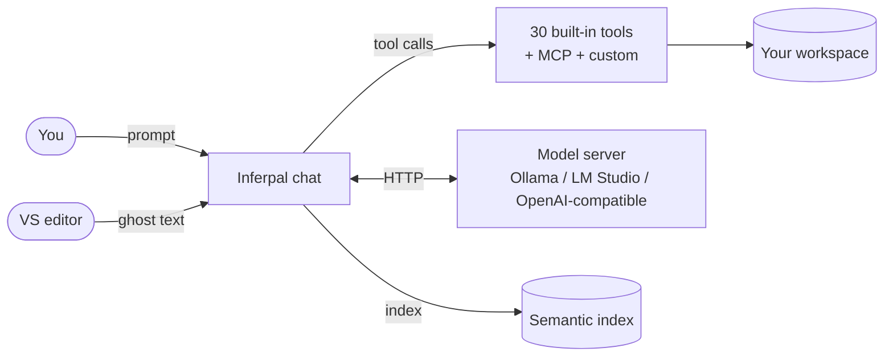



  

# Inferpal Documentation

Inferpal turns a **local LLM** — served by [Ollama](https://ollama.com),
[LM Studio](https://lmstudio.ai), or any OpenAI-compatible server — into an **agentic
developer assistant** with tool calling, inline completions, semantic codebase search, and
zero required cloud dependency. It ships as a **Visual Studio 2026 and 2022 extension** (the
primary target) and a **VS Code extension**, both driven by the same `Inferpal.Core` engine (a few editor features
are Visual Studio-only for now: [the list](features.md#two-editors-one-engine)).

This folder is the full documentation set, split into **functional** guides (how to use it)
and **technical** references (how it works).

> [!TIP]
> New here? Start with **[Getting Started](getting-started.md)**, then skim the
> **[Features](features.md)** overview.

## Overview

## Functional guides

| Guide | What it covers |
|---|---|
| [Getting Started](getting-started.md) | Install a backend, build & install the extension, first run |
| [Providers](providers.md) | Ollama / LM Studio / OpenAI-compatible — capabilities and setup |
| [Models](models.md) | Which model for which job, what Inferpal does for each, and how to set it up |
| [Configuration](configuration.md) | Every setting and config key, with defaults |
| [Features](features.md) | Functional tour of everything Inferpal does |
| [Slash Commands](slash-commands.md) | The full `/command` reference |
| [Tools](tools.md) | The 30 built-in agent tools, custom shell tools, permission rules, and the approval model |
| [Mentions](mentions.md) | The `@` typed-context picker |
| [Search & Indexing](search-and-indexing.md) | Semantic codebase search (RAG) and `@Docs` external documentation |
| [MCP](mcp.md) | Connecting Model Context Protocol servers |
| [Coming from Continue or Roo Code](coming-from-continue.md) | `/import`: what a Continue or Roo Code configuration brings over, and why the rest stays |
| [Rules & AI Checks](rules-and-checks.md) | Repo-versioned governance (`.inferpal/rules`, `.inferpal/checks`) |
| [Remote Inference](remote-inference.md) | Run the model server on another machine; VS Code connected to WSL, SSH or a container |
| [Zed, JetBrains, Qt Creator, Neovim (ACP)](acp.md) | Inferpal as an Agent Client Protocol agent in other editors |
| [ACP across machines](acp-security.md) | Who drives the agent, SSH, and why WebSocket bridges stay off open networks |

## Technical references

| Reference | What it covers |
|---|---|
| [Architecture](architecture.md) | Process model, IPC boundary, services, data flow, GPU scheduling |
| [Development](development.md) | Build, test, project layout, adding tools/languages, contributing |

## Quick facts

| | |
|---|---|
| Visual Studio | **2026**, and **2022 from 17.14** — Community / Professional / Enterprise. One package for both. |
| VS Code | the same engine ([what is Visual Studio-only for now](features.md#two-editors-one-engine)) — VSIX for **Windows x64, Linux x64 and Apple Silicon** since 1.5.0, each with a bundled self-contained backend (`Inferpal.Host`) |
| Runtime | .NET 8 (`net8.0-windows`; core engine is plain `net8.0`) · the VS Code and ACP host: .NET 10 (`net10.0`), carried by its package |
| Extension model | VS: hybrid VSIX — `Microsoft.VisualStudio.Extensibility.Sdk` 17.14.x out-of-process, plus `Inferpal.InProc` (**net472**) for everything `devenv.exe` hosts and its `Inferpal.Fim` sidecar · VS Code: TypeScript + JSON-RPC host |
| Built-in tools | 30 built-in tools (+ MCP servers + user shell tools) |
| Languages (UI) | 10 |
| Tests | the `tests-N passing` badge at the top of the [main README](../README.md), locked against the assembly by `DocCountersTests` |
