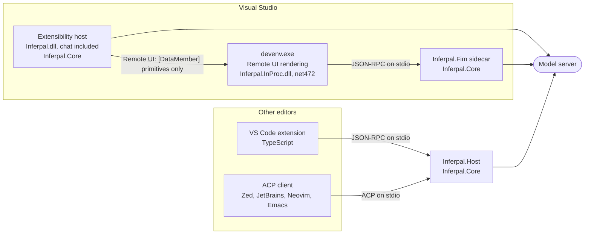
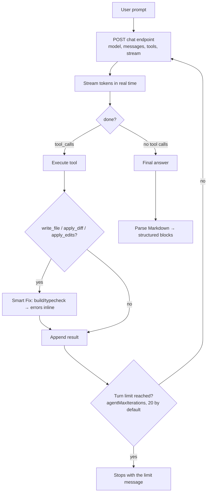

# Architecture

**One engine, several front-ends.** This page describes how Inferpal is put together. It is for a developer who wants
to know where a change belongs: what runs in which process, what may cross between processes, and what happens to a
question. For build/test/contribution mechanics see **[Development](development.md)**.



<sub>Each box that names `Inferpal.Core` runs its own copy of the engine, and that copy is what talks to the model
server.</sub>

| Process | What runs in it | Started by |
|---|---|---|
| Extensibility host | `Inferpal.dll`, chat included, with `Inferpal.Core` | Visual Studio |
| `devenv.exe` | `Inferpal.InProc.dll` (net472): only what cannot work from outside the editor | Visual Studio |
| `Inferpal.Fim` | A sidecar process with `Inferpal.Core`, for Visual Studio's inline completions | `Inferpal.InProc`, on demand |
| `Inferpal.Host` | `Inferpal.Core`, for VS Code and ACP clients | The VS Code extension, or the ACP client |

## Two front-ends, one engine

All the logic — providers, tools, agent orchestrator, RAG, MCP, localization — lives in
**`Inferpal.Core`**, a plain `net8.0` class library with **zero editor-SDK or WPF
dependency** (enforced by `CoreIsolationTests`). Editor access goes through ports:
`IEditorSurface` for the editor surface and `ApprovalServiceBase` for the approval
pipeline.

Two adapters consume it:

- **Visual Studio** (`Inferpal/` + `Inferpal.InProc/` + `Inferpal.Fim/`) — the primary target,
  described in the rest of this page (`VsEditorSurface`, `VsApprovalService`, Remote UI tool
  window, and everything that must live inside `devenv.exe`).
- **VS Code** (`vscode/` + `Inferpal.Host/`) — `Inferpal.Host` is a console
  process hosting the Core behind **header-framed JSON-RPC on stdio** (`initialize`,
  `chat/send` with streamed notifications, `models/list`, `fim/complete`, `textDocument/did*`
  sync…), with reverse ports `RpcEditorSurface` and `RpcApprovalService` (fail-closed).
  - The TypeScript extension spawns and supervises it, renders the sidebar webview chat, and feeds
    dirty buffers through `OpenDocumentOverlay` so `read_file` sees unsaved edits.
  - Visual Studio fills the same overlay on demand (`VsUnsavedDocuments`, asked before every tool call), so the
    writing tools refuse an unsaved file in both editors.

The same `Inferpal.Host` executable serves two more doors:

- **Agent Client Protocol** (`--acp`, for Zed, the JetBrains IDEs, Neovim, Emacs) — `Inferpal.Host/Acp/`: each
  thread drives a `HostServer` of its own, in memory, through the very JSON-RPC methods VS Code calls; the agent adds
  no logic of its own (setup guide: [acp.md](acp.md)).
- **The browser settings window** (`--settings [folder]`, and `/settings` in an ACP thread) —
  `Inferpal.Host/SettingsWindow/`: the settings webview VS Code shows (`vscode/src/webview/settings.ts`), bundled with
  a shell that relays its calls over HTTP (`settingsStandaloneShell.ts`) to a host started for the folder.

<details>
<summary><b>In detail: ACP threads and the settings page</b></summary>

- **ACP threads** — Several threads live in one process, so each host reads the
  settings into **its own copy** (`InferpalConfig.LoadOwnCopy`, never the shared `Load` cache): a model picked in one
  thread is not another's. Before each question a thread follows what the settings file changed since it read it
  (`config/reload`), without writing it back.
- **The form** — The form's logic is shared by both editors' shells (`vscode/src/settingsBridge.ts`).
- **What the page accepts** — The page is served on `127.0.0.1` only,
  under a random token, refuses another site's `Host` or `Origin`, and relays **only** the settings form's calls
  (`SettingsWindowServer.FormMethods`) — never a turn, a command or a tool.
- **Its lifetime** — From an ACP thread it runs inside the agent
  process, never as a child, whose output would land in the protocol's stdout. It stops a few seconds after the page
  says it closes, or after 90 s without a sign of life from it.

</details>

## What runs in which process

Inferpal uses the Visual Studio Extensibility model
(`Microsoft.VisualStudio.Extensibility.Sdk` 17.14.x). `Inferpal.dll`, chat included, runs
out-of-process in the Extensibility host; only `Inferpal.InProc.dll` (net472) loads in `devenv.exe`.
The package declares `RequiresInProcessHosting` + `VssdkCompatibleExtension`, the only documented
way to ship those in-process parts alongside it, and `allowHostingInProcess` is forced back to
`false`.

The Extensibility host holds the view-model side:

- `InferpalToolWindowData`, the ViewModel
- The `IInferenceProvider` clients: Ollama / LM Studio / OpenAI
- `ToolRegistry`: the 30 built-in tools + MCP
- `MarkdownParser` → `MarkdownBlock` + `InlineRun`
- `ProjectIndexService`: hybrid RAG, cosine + BM25/RRF

`devenv.exe` does the Remote UI rendering, in WPF `DataTemplate`s with a `DataTrigger` on `MarkdownBlock.Type`, and
hosts `Inferpal.InProc`: MEF adornments, the package, the `/tdd` driver.

A hard constraint of VS Remote UI:
only types loaded in `devenv.exe` can be referenced in XAML, so all data crossing the
view-model boundary must be `[DataContract]` objects containing **only primitives** (and
collections of such). That rule comes from the SDK.

### How the Visual Studio chat renders an answer

- **Markdown**: `MarkdownParser` (Markdig 1.2.0) parses assistant text into a
  `List<MarkdownBlock>` (stripping `<think>…</think>`), propagated as `[DataMember]` to
  `devenv.exe` and rendered by `DataTrigger` on `MarkdownBlock.Type` (paragraph/lists →
  `WrapPanel`, headings → `TextBlock`, `code_block` → read-only `TextBox`, separator →
  `Border`).
- **Theme**: detected from VS settings and propagated VM → `ChatMessageItem` → `MarkdownBlock`
  → `InlineRun` as plain `[DataMember]` color strings (Remote UI does not propagate via
  `ElementName` across nested `DataTemplate`s). Colors are centralized in `ThemePalette`.

### The in-process half: what must run inside `devenv.exe`

Some features cannot be served from outside the editor: inline completions need
`IWpfTextView`, the inline-diff preview needs an adornment layer, and the `/tdd` debugger
capture needs EnvDTE. Everything in that category lives in **`Inferpal.InProc`** — MEF parts
(`IWpfTextViewCreationListener`, `AdornmentLayerDefinition`), a minimal `AsyncPackage`, the
solution/debugger/build trackers and the chat auto-scroller.

- **It is a separate assembly, and it targets `net472`.** `devenv.exe` is a .NET Framework 4.7.2
  process, and its MEF discovery reflects over the assembly declared as an asset: a .NET 8
  assembly has a reference closure the Framework cannot resolve, so every one of our types is
  rejected — silently. Since 1.6.0 the shipped in-process assembly is therefore
  `Inferpal.InProc.dll`, never `Inferpal.dll`.
- It does **not** reference `Inferpal.Core`. What it shares with the Core it shares **in source**
  (`<Compile Link>`: the signal bus, `Diagnostics`, the debugger DTOs, `RetryGate`), so the two
  ends of a file channel cannot drift apart.
- Inference lives in the Core, so completions are
  served by **`Inferpal.Fim`**, a small net8 console the in-process half starts on demand and
  talks to over the same header-framed JSON-RPC grammar as `Inferpal.Host`. The sidecar *is* the
  Core — no backend logic is duplicated. It is recycled when `config.json` changes, killed when
  the package is disposed, and dies with `devenv` anyway (its stdin closes).

<details>
<summary><b>In detail: why the in-process half can vanish without a word</b></summary>

- Visual Studio only inventories the in-process half through the `MefComponent` / `VsPackage`
  assets of the packaged manifest, and only when that manifest declares the hybrid installation
  type `ExtensionType="VSSDK+VisualStudio.Extensibility"` — with the out-of-process type alone the
  VSIX lands in `Common7\IDE\VSExtensions\` and nobody processes its assets.
- Miss any of these
  and the components load nowhere and nothing says so: the chat is out-of-process and keeps
  working.
- That silence is why the in-process half publishes a heartbeat per load door
  (`InProcAliveSignal`) and why `/diagnostics` reports which one is missing.

</details>

**Try it**

| Type | What happens |
|---|---|
| `/diagnostics export` | Copies a support bundle to the clipboard: its *In-process half* line says what loaded and whether the FIM sidecar answers |

### Cross-process signals

The in-process package publishes state the agent reads via small file-based
IPC channels:

| Signal | Direction | Scope | Purpose |
|---|---|---|---|
| `ChatBusySignal` | host → devenv, host → host | account-wide, one marker file per writer | FIM and the other processes' background indexing yield to an active chat in any process of the account (one GPU) |
| `DebugCommandSignal` | host → devenv | per VS instance (`<name>.<devenv pid>.json`) | carries `/debug` operations (breakpoints, step, continue…) to the in-process EnvDTE driver, and the break state `get_debugger_state` / `@debugger` ask for, captured when asked |
| `BuildSignalFile` | devenv → host | per VS instance (`<name>.<devenv pid>.json`) | `VsBuildMonitor` surfaces VS build failures as the "Build Failed" banner |
| `ActiveSolutionSignal` | devenv → host | per VS instance (`<name>.<devenv pid>.json`) | authoritative open solution for `/solution`, `/map`, RAG — its root is the folder holding the solution and its projects (`SolutionExtent`) |
| `InlineDiffPreviewSignal` | host → devenv | per VS instance (`<name>.<devenv pid>.json`) | carries inline-diff preview requests to the in-editor renderer |

Per-instance channels key their file names on the devenv PID (the in-process package declares
its own PID; the extensibility host declares the PID of its owning `devenv`, found among its
ancestors), so two VS instances never read each other's state. A process that declared no key
keeps the legacy unscoped names; a host with no in-process peer (VS Code) does not read the
per-instance channels at all.

## How a question becomes an answer



<sub>`InferenceProviderBase.RunAgentAsync`. In Agent mode `AgentOrchestrator` adds a plan before this loop and an
observation after each batch of tools. Smart Fix runs inside the writing tool, when `smartFixEnabled` is on (the
default).</sub>

The chat endpoint is provider-specific (`/api/chat` for Ollama, `/v1/chat/completions` for
OpenAI-compatible); the loop logic is identical. `RunAgentAsync` never throws on network
errors — it converts them into a result; only cancellation propagates.

## System prompt layering

`BuildSystemPrompt()` assembles the system message in this order:

```
[Base prompt]                ← hardcoded in the extension, with the environment's facts
[Custom system prompt]       ← Settings (optional)
[Template]                   ← the active /template (optional)
[Pinned files]               ← up to 3 pinned context files (optional)
[## Repository instructions] ← AGENTS.md, CLAUDE.md, … of the repository's root (optional)
[## Skills]                  ← the skills a question can load, with skillsAutoMode on (optional)
[## Project context]         ← .inferpal/context.md (optional)
[## Agent memory]            ← .inferpal/memory.md (optional)
[## Project notes]           ← .inferpal/notes.md (optional)
[## Rules]                   ← .inferpal/rules/*.md that always apply (optional)
[## Mode: …]                 ← the mode picked, last so it wins a conflict (optional)
```

It is rebuilt before every question, so an edited file never reaches the model in its old version — and nothing in
it depends on the active file.

- A server that reuses its cache of the request's prefix (llama.cpp, LM Studio, Ollama,
  vLLM) reads again everything after the first change, so what follows the active file rides with the question instead,
  in an `## Active file` block placed before the request: the persona of its language, the `AGENTS.md` of its folders,
  the instructions and rules whose globs select it.
- The block is sent when the file changes, not with every question.
- The files of the system message share one budget; the block has its own.

**Try it**

| Type | What happens |
|---|---|
| `/xray` | Opens the whole prompt, layer by layer, with what each layer weighs |

## GPU scheduling

Chat, ghost-text FIM, and RAG/@Docs embeddings can all target one backend on one GPU.
Without coordination a steady stream of background embeddings can starve the chat model and
the request times out. A central scheduler enforces priority **chat > FIM > embedding**:

- A chat/agent run acquires a **lease** (`GpuScheduler`) for its whole duration — this covers
  chat, commit/title generation, synthesis, plan, and code actions.
- Background embedding loops (`ProjectIndexService`, `DocsIndexService`) `await
  WaitForChatIdleAsync` — they pause without losing progress and resume immediately; a `/task` run
  waits for every turn to end before it starts (`WaitForTurnsToEndAsync`).
- They yield to a
  chat of **any** Inferpal process of the same account (VS and VS Code share one GPU): besides this
  process's leases, they wait while another process's `ChatBusySignal` marker is live.
- Inline completions run in `devenv.exe`, so they coordinate cross-process via `ChatBusySignal`
  markers (`chat_busy.<pid>.json` in the account's signal folder: `%TEMP%/Inferpal` on Windows,
  `~/.local/share/Inferpal/signals` elsewhere; **one file per writer** — pid + timestamp,
  anti-stale, periodically re-stamped during long runs): FIM is skipped while *any* live marker
  is fresh.

> [!WARNING]
> **Query** embeddings (`search_codebase`, `search_docs`) are never gated — the agent holding
> the lease would otherwise deadlock on its own embedding. Only background **indexing** loops
> wait.

<details>
<summary><b>In detail: a run waiting for a person, and who deletes a marker</b></summary>

- A run that waits for a person (an approval card, a step pause, an MCP form) lets its lease go
  after a 10 s grace, until the answer (`GpuScheduler.PauseThisFlow`): a card left open overnight
  neither silences completion nor holds every process's indexing, and a card answered at once never
  costs the chat model a reload.
- Its turn is still **in flight**: MCP servers are not restarted
  under it, its model is not unloaded, and a `/task` run waits for it to end; its marker says
  `paused`.
- Each writer only ever deletes its own marker, so the first chat to finish cannot
  silence another's.
- A legacy unscoped `chat_busy.json` from an older version is still honoured
  read-only, never written or deleted.

</details>

## Tech stack

| Component | Technology |
|---|---|
| Language / runtime | C# .NET 8 (`net8.0-windows`), declared for .NET 8 and 10: Visual Studio runs it on its .NET 10 extension host when it ships one; the VS Code and ACP host `net10.0` |
| Extension SDK | `Microsoft.VisualStudio.Extensibility.Sdk` 17.14.40608 (out-of-process; `Inferpal.InProc` for what runs in `devenv.exe`) |
| In-process MEF | `Microsoft.VisualStudio.Shell.15.0`, `Microsoft.VisualStudio.Text.UI.Wpf` |
| Markdown | Markdig 1.2.0 |
| Vector store | SQLite WAL (`Microsoft.Data.Sqlite` 8.0.16) |
| C# analysis | `Microsoft.CodeAnalysis.CSharp` 5.9.0 (Roslyn), read at the newest language it knows |
| MCP client | Home-grown JSON-RPC 2.0 — stdio + Streamable HTTP (with OAuth 2.1), zero extra dependencies |

**Next:** [Development](development.md) — build it, run it, and add a tool or a language.
