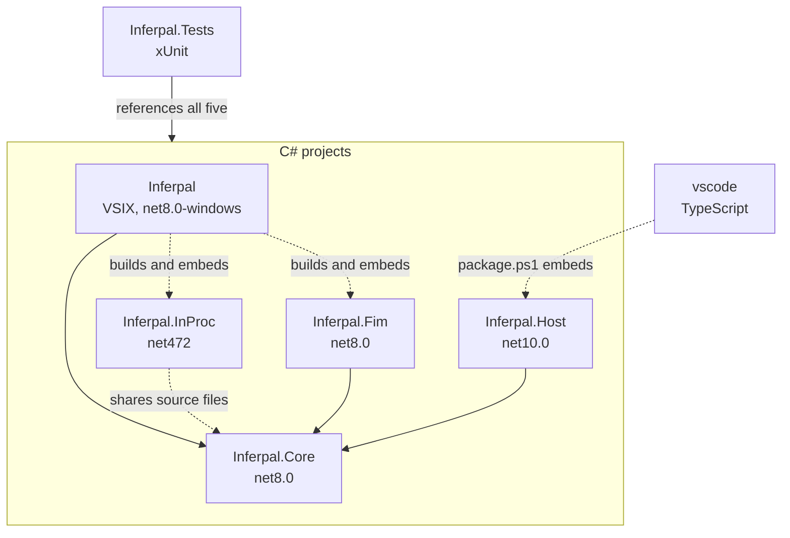

# Development

**Build it, run it, change it.** How to build, test, extend, and contribute to Inferpal. This page is for a developer
who wants to make a change: start with the first run below, then go to the recipe you need. For how the pieces fit
together see **[Architecture](architecture.md)**.

## Prerequisites

- **.NET 10 SDK**, and the **.NET 8 Desktop Runtime**: the test suite runs on Windows twice, on .NET 8 and on .NET 10,
  as Visual Studio's extension host runs the adapter and the Core on either (the manifest declares both, and Visual
  Studio picks the highest it ships)
- **Visual Studio 2026 (18.x)** with the Visual Studio extension development
  workload
- **Node.js 22+** — only for the VS Code extension (`vscode/`); its packager, `@vscode/vsce` 4, requires it
- A running model server for manual testing — see [Getting Started](getting-started.md)

## Build and run it for the first time

To run your own build in Visual Studio:

1. Close Visual Studio: the first install refuses to start while it is open.
2. From the repository's root, build it, install it and open Visual Studio. Expect a UAC prompt.

   ```powershell
   ./deploy-dev.ps1 -Launch
   ```

3. Open the chat: **Tools → Inferpal → Inferpal Chat**.

To build without installing anything:

```powershell
# Debug — includes the PDB in the VSIX (Attach to Process)
dotnet build Inferpal/Inferpal.csproj

# Release — optimized, no symbols, warnings-as-errors
dotnet build Inferpal/Inferpal.csproj -c Release
```

The VSIX is produced under `Inferpal\bin\Debug\net8.0-windows\` (or `Release\`).

### VS Code extension

The `vscode/` folder hosts the TypeScript front-end. It talks to `Inferpal.Host`, a small
console app that exposes the same `Inferpal.Core` logic over JSON-RPC on stdio — both
extensions share one brain.

To run it from source:

1. Build the host:

   ```powershell
   dotnet build Inferpal.Host/Inferpal.Host.csproj
   ```

2. Run `npm ci` in `vscode/`.
3. Open the `vscode/` folder in VS Code and press F5. An Extension Development Host opens with Inferpal loaded from
   sources. It looks for the host in `vscode/host/` first, which `package.ps1` fills, then in `Inferpal.Host/bin/`.

To package it:

```powershell
cd vscode
npm ci
npm run typecheck                  # tsc --noEmit
npm run build                      # esbuild bundle
./package.ps1 -Target win32-x64    # VSIX embedding a self-contained Inferpal.Host
```

## Deploy (dev) and status

```powershell
./deploy-dev.ps1        # build + deploy into the installed VS extension
./status.ps1            # deployed version, artifact freshness, backend reachability
```

`deploy-dev.ps1` builds and deploys straight into the installed VS extension:
- **first run**: silent `VSIXInstaller /q /a` bootstrap (no manual VSIX dance);
- **skip-if-fresh**: nothing changed since the deployed DLL → nothing happens (`-Force` overrides);
- **auto-elevation**: the install dir lives under Program Files, so the script relaunches
  itself elevated (one UAC prompt) instead of failing halfway; a transcript is kept in
  `%TEMP%\inferpal-deploy-vs.log`;
- **hot apply**: locked assemblies are swapped via rename (live processes keep the old
  mapping), the ServiceHub Extensibility host is restarted on the new `Inferpal.dll`, and
  reopening the tool window picks it up. `Inferpal.InProc.dll` (ghost text and the other parts
  inside `devenv.exe`) needs a VS restart: use `-Launch`. With no Extensibility host running, the
  script says the open VS keeps the old build instead of announcing a success.
- F5 on the `Inferpal` project launches the VS Experimental instance
  (`Properties\launchSettings.json` — its machine-specific devenv path is auto-healed).

> [!IMPORTANT]
> `Inferpal.dll`, chat included, runs out-of-process in the Extensibility host
> (`ServiceHub.Host.Extensibility*`): attach there. Only `Inferpal.InProc.dll` runs inside **`devenv.exe`**.

## Tests

```powershell
dotnet test Inferpal.Tests/Inferpal.Tests.csproj
```

**Try it** — one class instead of the whole suite:

```text
dotnet test Inferpal.Tests/Inferpal.Tests.csproj --filter InlineDiffScenarioFixturesTests
```

- The suite is large (the exact figure is the `tests-N passing` badge at the top of the README,
  which `DocCountersTests` locks against the assembly — this sentence deliberately carries no
  number of its own, the last one had rotted by 500 tests).
- The test project uses `InternalsVisibleTo`, so the
  extension's `internal` types are testable directly.
- All the logic lives in `Inferpal.Core`,
  a pure net8.0 library with no editor SDK or WPF dependency (guarded by `CoreIsolationTests`),
  specifically so it can be unit-tested without Visual Studio (e.g. `DiffComputer`,
  `ContextBudgetGauge`, `ThemePalette`, `ConnectionStatusPresenter`, `PromptHistoryNavigator`,
  `ModelCatalog`, `RulesService`, `ChecksService`, `FixPromptBuilder`, `HistoryCompaction`).

### Validating the inline diff preview

The per-hunk preview behind `/fix`, `/refactor` and `/doc` ends in a WPF adornment living
inside `devenv.exe` — the one piece no unit test can see.

- What *can* be checked offline is
  the maths behind it: `Inferpal.Tests/Fixtures/inline-diff-scenarios.json` holds the scenarios
  (hunk shapes, per-hunk accept/reject subsets, expected merge results) and
  `InlineDiffScenarioFixturesTests` locks them against `InlineDiffPlanner`, so a wrong
  expectation fails `dotnet test` instead of masquerading as a broken preview during manual
  validation.
- The rendering itself still has to be eyeballed in a real VS
  (`./deploy-dev.ps1 -Launch` — the renderer is in-proc MEF, a hot apply does not reload it).

## Project layout

Two layers: `Inferpal.Core` is the editor-agnostic logic (net8.0 class library), `Inferpal`
is the Visual Studio adapter (VSIX).



<sub>Solid arrows are project references. Dotted arrows build, package or share files without compiling against the
target.</sub>

- `Inferpal` builds `Inferpal.InProc` and `Inferpal.Fim` without compiling against them, then embeds their output in
  the VSIX.
- `Inferpal.InProc` ships as net472 and cannot reference the Core: the two share files through `<Compile Link>`.
- Two extra legs exist only for the tests: `net8.0-windows` in `Inferpal.InProc`, which does reference the Core, and
  `net8.0` in `Inferpal.Host`.
- `Inferpal.Tests` references `Inferpal` and `Inferpal.InProc` on its Windows legs only.
- `vscode` has no project reference. `package.ps1` publishes `Inferpal.Host` into its VSIX, and `Inferpal.Host` copies
  the settings bundle from `vscode/media/` when it exists.

```
Inferpal.Core/
├── Config/          InferpalConfig — all persisted settings
├── Localization/    Strings.resx (+ 9 locales) and the manual Strings.cs wrapper
├── Models/          Ollama / OpenAI DTOs
└── Services/        One sub-namespace per responsibility:
    ├── Agent/       Plan→Act→Observe orchestrator, policies, compaction
    ├── Inference/   Providers (Ollama, LM Studio, OpenAI-compatible) + ModelCatalog
    ├── Execution/   Tool registries, approval, pattern permissions, file history
    ├── Tools/       The 30 built-in ITool implementations
    ├── Rag/         CodeChunker, RagDatabase, ProjectIndexService (hybrid search)
    ├── Docs/        @Docs crawler/index
    ├── Lsp/         LSP semantic-chunking tier
    ├── Mcp/         MCP stdio + HTTP JSON-RPC client (with OAuth)
    ├── Editor/      IEditorSurface port (implemented by the VS adapter)
    ├── Signals/     File-based IPC signals (chat-busy, build, debugger…)
    └── …            CodeActions, Commands, Governance, Hardware, Persistence,
                     Presentation, Prompting, Shell
Inferpal/
├── Commands/        VS menu commands + editor context-menu code actions
├── Localization/    string-resources.json (%key% tokens for VS commands)
├── Services/
│   └── VsIntegration/  VsContextHolder, VsEditorSurface, VsApprovalService…
└── ToolWindow/      RemoteUI view models, content, settings
Inferpal.InProc/     Everything devenv.exe hosts, in net472 (see architecture.md):
├── GhostText/       MEF inline completions, inline-diff preview, /tdd debugger driver,
│                    solution/debugger/build trackers, chat auto-scroll
├── Fim/             Client of the inference sidecar + the four settings it reads itself
└── Compat.cs        Language support types the net472 BCL does not provide
Inferpal.Fim/        net8 inference sidecar the in-process half starts on demand (JSON-RPC/stdio)
Inferpal.Host/       Console host exposing Inferpal.Core over JSON-RPC/stdio (VS Code backend, ACP agent, browser settings window)
vscode/              VS Code extension (TypeScript): webview chat, FIM, editor bridge
Inferpal.Tests/      xUnit test project
```

## Adding a built-in tool

1. Create `Inferpal.Core/Services/Tools/MyTool.cs` implementing `ITool`.
2. Use **English** for `Name`, `Description`, and `Parameters` (best model compatibility).
3. Use `Strings.X(...)` for any user-facing return text (localization).
4. Register it in `Services/Execution/ToolRegistry.cs`: `Register(new MyTool())`.
5. Declare what a call does in `EffectOf`: the suite holds every built-in tool to it.

```csharp
internal sealed class MyTool : ITool
{
    public string Name        => "my_tool";
    public string Description  => "Does something useful.";
    public object Parameters   => new { type = "object", properties = new { }, required = Array.Empty<string>() };
    public ToolEffect EffectOf(JsonElement args) => ToolEffect.Reads;

    public async Task<string> ExecuteAsync(JsonElement args, CancellationToken ct)
    {
        // implementation
        return "result";
    }
}
```

If the tool touches the filesystem, runs commands, or reaches the network, take an
`IApprovalService` and gate the action (see existing tools).

## Adding a language

1. Create `Inferpal.Core/Localization/Strings.XX-YY.resx` with the **same keys** as `Strings.resx`.
2. Add the culture code and display name to `LanguageOptions` in `InferpalSettingsData.cs`.
3. Build — the satellite `XX-YY/Inferpal.Core.resources.dll` is generated and included in the VSIX.

> [!IMPORTANT]
> `Strings.cs` is written **by hand** (not auto-generated). Every new `.resx` key must be
> added to `Strings.cs` **and** translated in all 9 localized `.resx` files at the same time.

## Coding constraints to know

These are the non-obvious rules that keep the Remote UI model working:

| Topic | Rule |
|---|---|
| Cross-boundary types | Only `[DataContract]` types with primitive members (and `ObservableCollection<T>` of such) cross to `devenv.exe`. |
| `xmlns` | Never write `assembly=Inferpal` in a XAML `xmlns` (→ MC3072). |
| Theme / data binding | Remote UI does not propagate via `ElementName` across nested `DataTemplate`s — push values down the VM hierarchy as `[DataMember]`. |
| Label initialization | Initial VM values aren't read on `DataContext` assignment — call `ApplyLabels()` in `ControlLoadedAsync`. |
| TwoWay collections | Never `.Clear()` a TwoWay-bound `ObservableCollection`; update in place. |
| Tools & VS context | Tools have no `IClientContext` — use `VsContextHolder`. |
| Release builds | `TreatWarningsAsErrors` is on; command strings must come from `string-resources.json` (`%key%`) or you hit `CEE0027`. |

See **[Architecture](architecture.md)** for the reasoning behind each.

## ACP packages and releases

### ACP agent and browser settings window

`Inferpal.Host` also runs as an Agent Client Protocol agent (`--acp`) and serves the settings form in a browser
(`--settings [folder]`, `/settings` in an ACP thread).

- That page is the VS Code settings webview: `npm run build` in
  `vscode/` produces `media/settings-standalone.js`, and `Inferpal.Host.csproj` copies it, with the two stylesheets,
  to `web/` beside the executable **only when it exists** — build the extension bundle before the host, or
  `--settings` says which files are missing.
- The archives an ACP client downloads come from
  `pwsh ./acp/package.ps1 -Target win32-x64|linux-x64|darwin-arm64` (PowerShell 7), which builds the bundle first and
  refuses an archive without `web/`.

### Releases

**The product version lives in one place** — `Directory.Build.props`. Pushing a `v<version>`
tag (matching that version) triggers the CI release workflow
(`.github/workflows/release.yml`): it runs the tests, builds both extensions (the Visual Studio
VSIX and the VS Code VSIXs) and the ACP archives, and attaches them — plus `SHA256SUMS.txt` — to a GitHub Release.

## Contributing

Contributions are welcome. The short version: implement `ITool`, register it in
`ToolRegistry.cs`, and add any new strings to all 10 `.resx` files **and** to `Strings.cs`.
Keep new logic in testable, VS-free helpers where possible and add xUnit coverage.

**Next:** [CONTRIBUTING.md](../CONTRIBUTING.md) — what a pull request needs before you open it.
