# Features

**A local model, turned into an agent that works inside your editor.** This page shows what it does, with real
screens, the diagrams behind it, and something to try in each section. Everything works in **Visual Studio** and
**VS Code** unless a line says otherwise, and the full detail of each area waits in its *In detail* block.

<p align="center">
  
  <br><sub>A real run on a local model, sped up.</sub>
</p>

| [The agent at work](#the-agent-at-work) | [Undo, review, go back](#undo-review-go-back) | [Fix it where you are](#fix-it-where-you-are) | [Tests and the debugger](#tests-and-the-debugger) |
|---|---|---|---|
| Plans, reads, edits, builds and tests — and every change asks first | Every file backed up; a whole run undone in one click | Right-click an error, a selection, a file or a debugger stop | `/tdd` reads the debugger, `/test coverage` writes the missing tests |

| [Work in the background](#work-in-the-background) | [Ghost text](#ghost-text-as-you-type) | [Search & knowledge](#search--knowledge) | [What the model reads](#what-the-model-reads) |
|---|---|---|---|
| `/task` investigates while you keep coding | Fill-in-the-middle as you type, three speeds | Meaning + keywords, `@`-mentions, `@Docs`, MCP | Your repository's `AGENTS.md`, `CLAUDE.md`, rules — and you can see it all |

| [Conversation](#conversation-experience) | [Models & hardware](#models--hardware) | [Safety](#safety) | [Two editors, one engine](#two-editors-one-engine) |
|---|---|---|---|
| Branches, search, export, a welcome screen that knows your file | A model per task, `/bench`, `/arena`, what sits in your VRAM | Approvals, deny rules, ignore files, invented packages refused | The same agent in Visual Studio, VS Code, Zed, JetBrains, Neovim… |

---

## The agent at work

Ask in plain words. In **Agent** mode the model writes a plan, then works through it with its tools — reading,
searching, editing, building, testing — and shows every step as it goes. You can correct it mid-run without
stopping it.

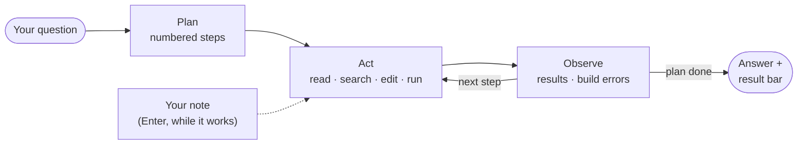

<table>
  <tr>
    <td align="center" valign="top" width="50%">
      <picture>
        <source media="(prefers-color-scheme: dark)" srcset="assets/features/agent-approval-dark.png">
        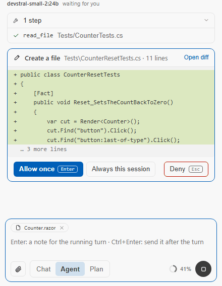
      </picture>
      <br><sub>Every write waits on a card with the real diff. Enter allows, Esc denies.</sub>
    </td>
    <td align="center" valign="top" width="50%">
      <picture>
        <source media="(prefers-color-scheme: dark)" srcset="assets/features/run-result-dark.png">
        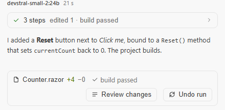
      </picture>
      <br><sub>A finished run folds into one line and ends on its result bar.</sub>
    </td>
  </tr>
</table>

**Try it**

```text
Add a Reset button to the counter page and check that it builds
```

While it works, type *"use the existing CounterService, not a new one"* and press **Enter**: the run reads it before
its next step. **Ctrl+Enter** queues a message for after the turn instead.

- **Three modes** — **Chat** (tools, no plan), **Agent** (plan, act, observe) and **Plan** (`/plan`: read-only, it
  proposes and changes nothing). `/plan save` turns a plan into a committable `.inferpal/plans/` file.
- **30 built-in tools**, plus your own shell commands and any [MCP](mcp.md) server — [the reference](tools.md).
  Independent read-only calls run in parallel; `/tools off <tool>` takes one away from the model.
- **Step by step** — `/agent-step` pauses before each tool call; **▶ Resume** goes on.
- **Long runs you can leave** — the machine stays awake while the model works, a card left unanswered flashes the
  taskbar or raises a notification, and a run stopped at its limit ends with **Continue**.
- **Post-mortem** — `/replay` shows every tool call of a run, with its target and duration.

<details>
<summary><b>In detail: the agent loop, steering, plans, approvals</b></summary>

- **Agentic loop** — the model autonomously chains tool calls (read/write files, run
  commands, search the web, diagnose builds, run tests, search the codebase) for up to
  **20 turns**, showing each step as a collapsible bubble. Independent read-only tools
  (`read_file`, `list_files`, `search_in_files`) in a single turn run **in parallel**.
- **30 built-in tools** plus user-defined shell tools and [MCP](mcp.md) server tools — see
  **[Tools](tools.md)**.
- **Steer a running turn** — while the agent works, type a correction and press **Enter**: it is
  a note the run reads before its next step ("use `ILogger`, not `Console`", "that is the wrong
  file"), shown in the turn as waiting, then as read. Nothing is stopped and nothing is explained
  again. **Ctrl+Enter** sends the message after the turn instead, in the queue above the input box
  (each entry can be removed). A turn with no step to read a note before — a chat without tools,
  a code action, a slash command — queues it. A note the run could not read (typed during the
  final answer) is sent next; after **Stop**, notes and queued messages come back to the input
  box. With an approval card waiting, Enter with text refuses the card and the text goes with the
  refusal. The conversation keeps the notes with their question: the next question, a reload and
  **Regenerate** see them. Stop is the button — Enter never stops a turn.
- **Agent Step Mode** — pause between tool calls to inspect or override each action. Toggle
  with the 🦶 button (or `/agent-step`); continue with **▶ Resume** (or `/resume`). A note typed
  during the pause resumes the run, which reads it at the next step.
- **Agent Orchestrator** — an optional Plan→Act→Observe loop: the **Agent** mode of the Chat/Agent
  switch (`agentModeEnabled`, `inferpal.agentMode` in VS Code). **Chat** mode still uses tools — the
  simple tool loop, without a plan — and `/tools off` gives a chat without tools. Both editors start in
  Chat mode.
- **Turning tools off** — `/tools` lists every tool with what it weighs in each request; `/tools off <tool>` (or the
  Tools page's button) turns one off in every conversation, built-in or MCP: the model is never offered it, and your
  own commands that use it keep working. See [Tools](tools.md#turning-a-tool-off).
- **Plan mode** (`/plan`) — read-only: the agent explores and proposes a plan without editing
  any files.
- **Persistent plans** (`/plan save`) — a plan proposed in the chat used to die at the next
  `/clear`. Saved, it becomes `.inferpal/plans/<name>.md`: numbered steps with checkboxes,
  committed with the code, so it survives a restart, shows up in the review of the change it
  describes, and reaches a colleague. `/plan next` picks it back up, `/plan done <n>` ticks a
  step. Ticking edits **one character** of the file — the prose and notes you wrote by hand are
  preserved byte for byte, because a plan is a document you own and the product only annotates.
  Nothing is ever executed from a plan file: it arrives with any clone, so its text steers the
  model exactly as a rules file does and grants nothing, and every action it leads to goes
  through the usual approval prompt. There is deliberately no "run the whole plan".
- **A run you can read at a glance** *(both editors)* — a run's steps show as they come, then
  fold into one line (`3 steps · read 1 file · edited 1 · build passed`, a ✗ when its last check
  failed). Under the answer, a **result bar** lists the files it changed with their lines added and
  removed, the last build or test check, and **Undo run** (`/undo-run`), offered on the latest run.
- **Approvals in the conversation** *(both editors)* — during a turn, an approval is a card under
  the steps: what will happen, to what, the first lines of the change, then **Allow once**
  (Enter), **Always this session** and **Deny** (Esc); *Open diff* shows the whole change. When a
  narrow rule describes the call, a fourth button offers it — *Always: commands that start with
  `dotnet test`*, *Always: writes under `tests/`* — and writes it to the per-machine permission
  rules, said in the conversation ([Tools → Approval model](tools.md#approval-model)). Enter
  and Esc answer only from an empty message box: the card never takes the keyboard, so a key typed
  for something else cannot approve. Outside a turn (a code action, a slash command), the dialog
  asks as before. A card left unanswered for 15 seconds while the editor does not have the focus
  says so outside the panel: Visual Studio flashes its taskbar button, VS Code shows a notification
  that closes with the answer.
- **Long runs stay awake** *(both editors, and ACP)* — while the model works (an answer, an agent
  run, a `/task`), the machine does not go to sleep: a power request on Windows, `caffeinate` on
  macOS, `systemd-inhibit` on Linux, released ten seconds after the last request and when the
  editor closes, however it closes. A turn waiting for your approval lets the machine sleep:
  nothing is in flight meanwhile. Where the system refuses (no systemd, WSL), `/diagnostics` says
  so once.
- **Continue** *(both editors)* — a turn stopped at its iteration limit, or an answer stopped at
  the length limit, ends with a notice and a **Continue** button: it sends "Continue." as your
  next question. It is not offered after a loop or an answer that repeated itself, where
  continuing would do the same again.
- **Run replay** — `/replay [n]` shows a post-mortem timeline of an agent run: every tool
  call with its target and duration, then the files it touched.

</details>

## Undo, review, go back

Before the agent changes a file, Inferpal keeps a copy of it. So a run can be undone whole, file by file, or together
with the conversation that led to it — and even what a command or a test run changed is put back.

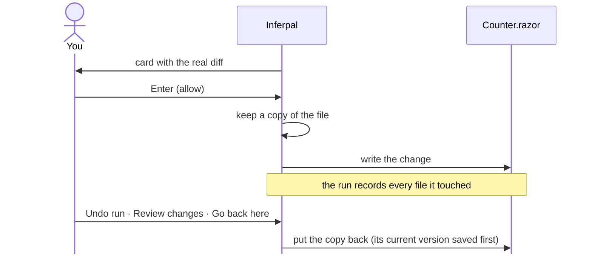

<table>
  <tr>
    <td align="center" valign="top" width="50%">
      <picture>
        <source media="(prefers-color-scheme: dark)" srcset="assets/features/review-run-dark.png">
        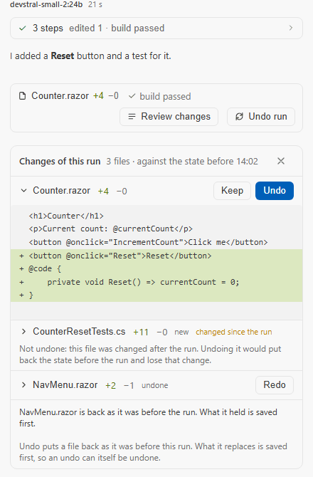
      </picture>
      <br><sub><b>Review changes</b>: keep or undo each file, or each of its changes; redo an undo.</sub>
    </td>
    <td align="center" valign="top" width="50%">
      <picture>
        <source media="(prefers-color-scheme: dark)" srcset="assets/features/go-back-dark.png">
        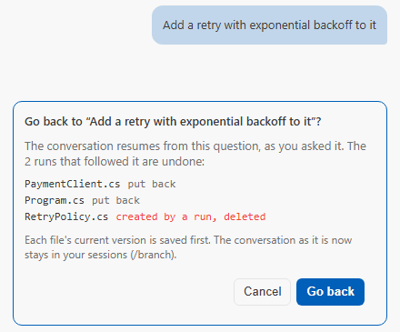
      </picture>
      <br><sub><b>Go back here</b>, under a question: its files and the conversation, together.</sub>
    </td>
  </tr>
</table>

**Try it** — after a run, `/undo-run` (or **Undo run**); `/undo-run list` shows the runs you can still undo.

- **Survives a restart** — runs are kept beside the backups, so **Undo run** still works in a reopened conversation,
  in either editor.
- **A file you changed since is never lost** — it is named and left alone, never silently rolled back.
- **Nothing written into your repository behind your back** — backups live in `.inferpal/history/` (which ignores
  itself in git) or, if you prefer, in your user folder. Inferpal never edits your `.gitignore`.

<details>
<summary><b>In detail: undo, review, go back, backups</b></summary>

- **Review a run file by file** *(both editors)* — the result bar's **Review changes** opens a
  card under it: each file the run changed, its diff against the state before the run, and
  **Keep** or **Undo** (**Delete** for a file the run created) on its own. An undone file offers
  **Redo**: what an undo replaces is saved first. A file changed after the run says so and is
  not undone — undoing it would put back the state before the run and lose that change. Where
  there is no card (an agent thread), `/undo-run review` lists the files and where each stands,
  and `/undo-run #<run> <file>` undoes one.
- **Keep or undo one change of a file** *(both editors)* — in **Review changes**, a file the run
  changed in several places opens on its changes, each with **Keep** and **Undo** (**Redo** once
  undone); the others stay exactly as the run made them, and **Undo run** leaves a change you
  kept. Each write saves what the file held first, and a file edited since is never rewritten. A
  file the run created or deleted, that is not text, or whose changes span more than 1,000 lines
  goes back whole only, and the card says why. Without a card (an agent thread),
  `/undo-run review` numbers the changes, `/undo-run #<run>:<n> <file>` undoes one and
  `/undo-run redo #<run>:<n> <file>` redoes it.
- **Go back to a question, with its files** *(both editors)* — **Go back here**, under a question
  you asked, opens a card: the runs that followed it are undone (each file put back, or deleted if
  a run created it — its current version saved first), the conversation resumes from that
  question — the whole one stays in your sessions (`/branch`) — and the question comes back in the
  message box. A file changed after those runs, by hand or by another conversation's run, refuses
  the whole going back and says which and when: nothing is undone, and the card offers to go back
  in the conversation only, or to review those runs file by file.
- **Undo a whole run** — `/undo-run` reverts every file changed during the last agent run
  (restores edited files, deletes files created that run) — save the files changed after the run
  and those you kept, left as they are and named; `/undo-run list` shows the
  workspace's tracked runs. **Runs outlive a restart**: each run that changed files is kept beside
  the backups (`runs/` in the history folder), so `/undo-run` and the **Undo run** of a reopened
  conversation still work after Visual Studio, VS Code or an agent thread restarts — and a later
  run made in the other editor holds an earlier one back, as a later run of your own does; one the
  other editor's agent is still writing is not undone under it, and one cut short by an editor
  that closed mid-run is undone and said to be. Each run file is signed with a key kept in your
  own local application data: a run a repository brought, or one edited in place, is never read,
  nor one naming a file outside the workspace.
  **What commands changed is undone too**: in a git repository, the
  files a `run_command`, a test run, one of your shell tools or an MCP tool changed are recorded
  like the agent's own edits — byte for byte, nothing written to your repository — and counted on
  the result bar. A file you save while an approval card waits is yours, not the command's, and so
  is a file your editor held unsaved changes for when the command started. What could not be
  recorded is said under the undo: a command run outside a git repository, a background job after
  it started, a file larger than 20 MB or stored with Git LFS. Files git ignores (build output,
  `node_modules`, an ignored `.env`), nested repositories and submodules are never recorded, and an
  undo gives back files, never a commit, a branch or the index.
- **Where the backups live** — `/undo-run`, `/restore` and `restore_file` read the copy Inferpal
  keeps of a file before each change: in `.inferpal/history/` at the repository root (ignored by
  git from inside the folder — Inferpal never edits your `.gitignore`), or, with *Backups of
  changed files* set to **In my user folder** (`historyStorage: user`), in Inferpal's local
  application data, one folder per repository, with nothing new written into the project. Switching
  keeps the backups already made restorable.

</details>

## Fix it where you are

You don't have to copy an error into the chat. Inferpal sits in the menus you already use, and sends the code around
the problem with it.

<p align="center">
  <picture>
    <source media="(prefers-color-scheme: dark)" srcset="assets/features/build-banner-dark.png">
    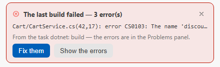
  </picture>
  <br><sub>A failed build puts its errors one click away.</sub>
</p>

| Where you are | Visual Studio | VS Code |
|---|---|---|
| **Build errors** | Error List → *Fix with Inferpal*; *Fix with AI* on the failed-build banner; `/fix-build` | Problems or light bulb → *Fix with Inferpal*; the banner of a failed build task |
| **A selection** | *Edit with AI…* (**Ctrl+Shift+I**): red and green in the editor, accepted part by part | *Edit with AI*, shown in Refactor Preview first |
| **The editor's menu** | Explain · Fix · Refactor · Add Tests · Add Docstring | Explain · Fix · Refactor · Add Tests · Document |
| **A file or a project** | Solution Explorer → *Explain* · *Review Changes* · *Attach to Chat* | Explorer → the same three |
| **The debugger, stopped** | *Analyze with Inferpal* (Debug menu, Call Stack, Locals, Autos, Watch) | *Analyze with Inferpal* (call stack, variables) |
| **Committing** | `/commit` drafts the message | Source Control → *Propose a Commit Message* |
| **A pull request** | `/pr-description` | `/pr-description` |

**Try it** — select a method, press **Ctrl+Shift+I** in Visual Studio and type:

```text
use a switch expression and keep the same behavior
```

The change appears in the editor in red and green; keep or drop each part.

- **It checks its own edits** — after each write, a quick build or typecheck (.NET, TypeScript, Rust, Go, or your own
  validator in `.inferpal/validators.json`) feeds the errors straight back to the agent.
- **Edits land whole or not at all** — `apply_edits` changes several files at once only if every edit applies.
- **Nothing is run from a debugger stop** — *Analyze with Inferpal* reads the stack and the locals, and explains.

<details>
<summary><b>In detail: code actions, Edit with AI, Smart Fix, the menus</b></summary>

- **Code actions** (editor context menu → **Inferpal**) — **Explain**, **Fix**, **Refactor**,
  **Add Tests**, **Add Docstring** (VS Code's editor context menu has the same five: *Inferpal: Explain This Code*,
  *Fix This Code*, *Refactor This Code*, *Add Tests* and *Document This Code*). All use a dedicated model and run
  without tool calling.
  **Fix**, **Refactor** and **Add Docstring** apply their result **directly in the editor**
  (undoable with Ctrl+Z); **Add Tests** writes into a **separate test file** (created/opened,
  or extended if it already exists); only **Explain** answers in the chat window.
- **The editor's gestures, in both** — **Edit with AI** (an instruction on the selection or the caret's line, the
  change shown before it applies), **Explain**, **Add Tests**, **Fix**, **Refactor** and **Document** in the editor's
  menu, `/test` on the **selection** with its tests written by an edit you can undo, and `/map` on **Alt+M**.
- **Inline Edit (Edit with AI)** — select code (or place the caret on a line), press
  **Ctrl+Shift+I** (or pick **Edit with AI…** from the context menu), type an instruction, and
  the model rewrites the selection **directly in the editor** (re-indented to match the
  original), shown first when *Show the change before applying it* is on — in VS Code, in its Refactor Preview. Uses
  the Inline Edit model (falls back to Code Actions → chat model); the same prompt in both editors.
- **Atomic multi-file edits** — `apply_diff` matches `old_content` exactly, then falls back to
  a **whitespace-tolerant** match (indentation / trailing spaces / line endings) and supports
  `occurrence` = `unique` / `first` / `all`. `apply_edits` applies many edits across several
  files **all-or-nothing**: nothing is written unless every edit resolves.
- **Smart Fix Protocol (polyglot)** — after every `write_file` / `apply_diff` / `apply_edits`
  on a build-relevant file, a quick build/typecheck runs automatically and any compilation
  errors are fed back inline so the agent fixes them in the same loop. The ecosystem is picked
  from the file extension — **.NET / TypeScript / Rust / Go** built in, extendable via
  `.inferpal/validators.json`. When the toolchain is not installed, Smart Fix stays silent — told
  apart from a failed build by the shell's own signal, whatever the system's language.
- **Fix with AI** — when a build fails (agent, `/build`, or a VS solution build), a button
  pre-fills the prompt with the MSBuild errors **and the content of each affected file** (up
  to 5 files × 4 000 chars).
- **Build Failed banner** — when Visual Studio finishes a solution build with errors, a banner
  appears above the input with the first error and a one-click **Fix with AI** / `/fix-build`
  entry point. In VS Code, a task of the *build* group that fails draws the banner over the chat: the errors of the
  Problems panel as it stands (each once), the first one, the task — **Fix them** sends them to the model, **Show the
  errors** opens the panel; a build that passes takes it down.
- **Fix with Inferpal, from the problem list** — select lines in Visual Studio's **Error List** (errors, warnings — the
  NuGet vulnerability warnings NU1901 to NU1904 among them — or messages) and choose **Fix with Inferpal** in its
  context menu; in VS Code, **Fix with Inferpal** is among the quick fixes of every diagnostic in the workspace (the
  editor's light bulb and the Problems panel), and *Inferpal: Fix the Problems at the Cursor* in the palette. The agent
  gets those problems, as a build prints them, with the code around each — read from the editor when the file has
  unsaved changes (the same windows as **Fix with AI**, up to 100 problems, errors first; a file excluded from AI tools
  is named, never read) — and fixes them with its tools, under the usual approvals. Nothing selected, a list Visual
  Studio did not give, or problems only in files the agent cannot edit (outside the workspace, or excluded) are said,
  and nothing is sent. During a turn, Visual Studio sends it when the turn ends; VS Code asks you to wait.
- **Inline diff preview for code actions** — `/fix`, `/refactor` and `/doc` no longer rewrite
  the buffer blind: the change is shown in the editor with per-hunk accept/reject (Visual
  Studio: a red/green adornment with ✓/✗ per hunk, and ✓✓/✗✗ on the first open hunk to decide
  all the hunks not yet answered; VS Code: the native Refactor Preview).
  Accepted hunks apply as a single undo step. Toggle with `inlineDiffPreviewEnabled`
  (default on).
- **Inline diff viewer** — an LCS-based diff is shown after every write/apply (added green, removed red, unchanged
  collapsed): in the tool bubble in Visual Studio, in the step in VS Code with its `+/−` count and **Open diff**.
- **Inferpal in the Explorer** — right-click a project, a folder or a file in Visual Studio's Solution Explorer (*Ask
  Inferpal*) or VS Code's file explorer (*Inferpal*): **Explain** asks about it without tools — a file as the editor has
  it, a folder as `@folder` attaches it, sized for the code-actions model's window; **Review Changes** runs `/check` on
  it (the uncommitted changes under it); **Attach to Chat** puts the `@file` / `@folder` chip in the message box,
  nothing sent. In Visual Studio a project or a solution stands for its folder; in VS Code a `.csproj` is the file
  itself. A file the ignore files exclude, a binary file, or a node with no file behind it, is said.
- **A commit message in Source Control (VS Code)** — **Propose a Commit Message** (the ✨ in the Source Control view's
  title when one repository is shown, a repository's menu, or the palette) writes `/commit`'s proposal for that
  repository into its commit message box: what is staged, or the tracked files' changes when nothing is. Nothing is
  committed — the Commit button stays yours — and a message you already typed is replaced only if you say so, the
  proposal shown; a box emptied while the message was written (committed meanwhile?) is left alone. From the palette,
  the repository is the active file's, else the only one open; several and no active file: said. Untracked files left
  undescribed, a diff or a reply cut, nothing to commit: said. The repository is one of the window's folders, or holds
  one — the ignore files read are theirs. Visual Studio's Git window lets no extension write its message: there,
  `/commit` proposes it in the chat.
- **A pull request description (`/pr-description`)** — `/pr-description [base]` writes a pull request's title and description for the
  current branch: what it brings since it left `base` (by default the remote's default branch, else `main` or
  `master`), from its commits' subjects and its diff, by the utility model. The range described is named above it, the
  proposal sits in a block to copy as it is; nothing is pushed or created. A diff past the cap, files the ignore files
  exclude, a reply cut at its limit: said above the proposal. A branch with nothing beyond its base, an unknown base,
  two histories with no common commit: said. Both editors, and ACP.
- **Review a Commit…, in both** — a commit picked from the recent ones of the current branch (searchable by its
  message), or a branch, tag or range typed, reviewed by `/check`: VS Code's command palette, Visual Studio's
  *Tools › Inferpal › Review a Commit…*.
- **Analyze with Inferpal, at a debugger stop** — stopped at a breakpoint or an exception, choose **Analyze with
  Inferpal** in Visual Studio's Debug menu or in the context menu of the Call Stack, Locals, Autos or Watch window; in
  VS Code, in the context menu of the call stack or the variables, or *Inferpal: Analyze the Debugger Stop* in the
  palette. The model gets the stop as `@debugger` shows it — the reason, the exception, your frames, the locals — and
  the code around each of your frames in the workspace (a file outside it is counted, never read), sized for the window
  the code-actions model loaded, and explains the cause. It answers **without tools**: nothing is continued, stepped or
  evaluated. The whole stop is sent, not the row you right-clicked. Nothing paused, or a debugger that does not answer,
  is said, and nothing is sent. During a turn, Visual Studio sends it when the turn ends — the stop as it was when you
  clicked; VS Code asks you to wait.

</details>

## Tests and the debugger

A failing test is the best spec there is. `/tdd` runs your suite, patches the code, and runs it again until it is
green — and on the first red round it **looks at the failure under the debugger** instead of guessing from the log.

<p align="center">
  
</p>

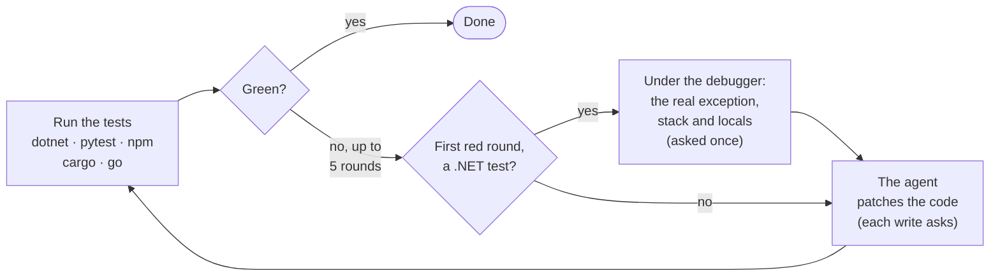

**Try it**

| Type | What happens |
|---|---|
| `/tdd` | Fix until the whole suite is green |
| `/tdd SlidingWindowTests` | Only the tests whose name matches |
| `/test coverage src/Billing` | Tests for the code no test reaches, under that folder |
| `/debug why does Total ignore the discount?` | The agent settles it in a real debug session |

- **Measured** — 12 failing C# tests handed to `/tdd` with a local 27B model: **12 fixed** with the debugger's view,
  10 without.
- **No shortcut through the tests** — rewriting a *test* file during `/tdd` always asks, whatever your rules say.
- **`/test coverage`** measures with the tool your project already has, writes one new test file per uncovered
  method, and keeps it only if it passes three times and covers something new.
- **`/debug`** lets the agent set breakpoints, step and read locals in a real debug session — after you approve the
  launch.

<details>
<summary><b>In detail: /tdd, /test coverage, /debug, /fix-build, the Test view</b></summary>

- **`/fix-build`** — compile → AI fixes errors → recompile, repeated until clean (max 5 rounds).
- **`/tdd [filter]`** — "fix until green", the test-side twin of `/fix-build`: runs the test
  suite (`run_tests` auto-detects dotnet / pytest / npm / cargo / go), hands the failure
  report to the agent, re-runs, up to 5 rounds. Writes go through the usual approval
  pipeline and `/undo-run` applies.
  On the first red round the failing test is also **re-run under the debugger**, and what the
  runner's text cannot carry — the real exception, the call stack, the values of the locals at
  the point of failure — is added to the fix prompt. Visual Studio attaches its own debugger,
  VS Code drives the Debug Adapter Protocol; running a test under a debugger is execution, so
  it asks **once per `/tdd` run**. No debugger, a failed capture or a refused approval falls
  back to the text-only loop, and a failed capture says so in the run. Rewriting a *test* file
  during the loop always asks, whatever your permission rules say — "make it green" has an
  obvious shortcut, and this is the one place it must not be taken silently.
- **`/test coverage [folder]`** — tests for the code no test reaches. The coverage is measured
  with the tool the project already has (.NET: `coverlet.collector` or `dotnet-coverage`; Python:
  `coverage.py`; Node: vitest, jest, or `node --test` with `c8`) — a missing tool is named with
  the command that adds it, never installed. The methods with the most uncovered lines are chosen
  by the measure, not by the model, ten per run; for each, the model writes one **new** test file
  (never an existing file, never the code under test), through the usual approval. A file is kept
  only if it passes three times, asserts something, skips nothing and covers lines nothing
  covered — the others are removed, their copy kept. The report gives the coverage before →
  after, per file, and why each file was set aside; `/undo-run` gives the whole command back.
- **`/debug [hypothesis]`** — settle a question about runtime behaviour by observing it: the
  agent starts a **real debug session** (after asking you first), sets breakpoints, steps, and
  reads locals and the call stack through two read-only tools (`debug_control`,
  `debug_inspect`). Before launching, the target is built through the automation, so a solution
  that does not compile is refused instead of freezing the IDE on a modal. Visual Studio drives
  its own debugger in-process; VS Code goes through a DAP bridge — same command, either editor.
  `/debug` alone reports the current break state; `/debug stop` ends the session.
- **Inferpal in the Test view (VS Code)** — right-click a test: **Make This Test Pass** runs `/tdd` with the test's name
  (a theory's parameters left out); **Explain the Failure** runs the test — from its file for a C# or Python test, else
  from the workspace — and asks why it fails, with the code around it, without tools; on the failure message under the
  test, it asks about that message and the failing line without running anything. The name is a filter, matched by each
  runner its own way: tests whose name contains it run too, and a report that never names the clicked test is said to
  be about others. A test that passes, a run where nothing ran or that was stopped at its budget, is said; a running
  test can be cancelled. Visual Studio's Test Explorer gives no extension the test you clicked: there, type
  `/tdd <name>`.

</details>

## Work in the background

`/task` hands an investigation to a background run and gives you the chat back at once. It only reads, so it never
interrupts you with a question; with `propose`, it writes down the changes it *would* make, for you to apply later.

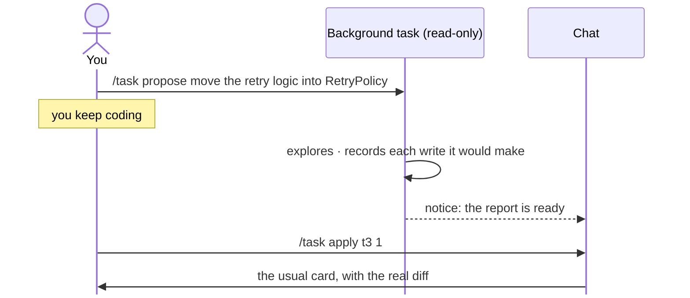

**Try it**

```text
/task find every place that reads the cart total without the discount
```

- **One at a time, behind you** — tasks wait for the chat to be idle before taking the graphics card.
- **Consent at apply time** — `/task apply <id> <n>` replays one proposal through the normal card; a file changed
  since is refused, never overwritten.

<details>
<summary><b>In detail: /task and /task propose</b></summary>

- **`/task <objective>`** — a background agent run, detached from the conversation: submitting
  returns at once and you keep working while it investigates. Tasks run one at a time and wait
  for the chat to be idle before taking the GPU, so interactive work is never blocked. A notice
  appears when the report is ready (`/task <id>` reads it, `/task` lists, `/task stop <id>`
  cancels). Background runs are **read-only** — they explore and report, never write, execute or
  reach the network, so nothing can interrupt you with an approval prompt.
- **`/task propose <objective>`** — a background run that can *describe* writes without making
  them: each write is recorded at the exact point it would have asked for approval, and never
  granted. `/task apply <id> <n>` replays one proposal through the ordinary approval prompt,
  real diff included, once the task has ended; a proposal whose file changed since is refused instead of applied.
  A task stopped with `/task stop` keeps what it had proposed.
  There is one proposal per file: edits to different parts of a file are combined into it, and
  when two edits touch the same lines the later one replaces the earlier — the task is told so.
  Consent still happens at apply time, one write at a time — never in advance.

</details>

## Ghost text as you type

Fill-in-the-middle completions in the editor: the model sees the code before **and after** the caret. **Tab**
accepts, **Esc** dismisses.

<p align="center">
  <picture>
    <source media="(prefers-color-scheme: dark)" srcset="assets/features/settings-autocomplete-dark.png">
    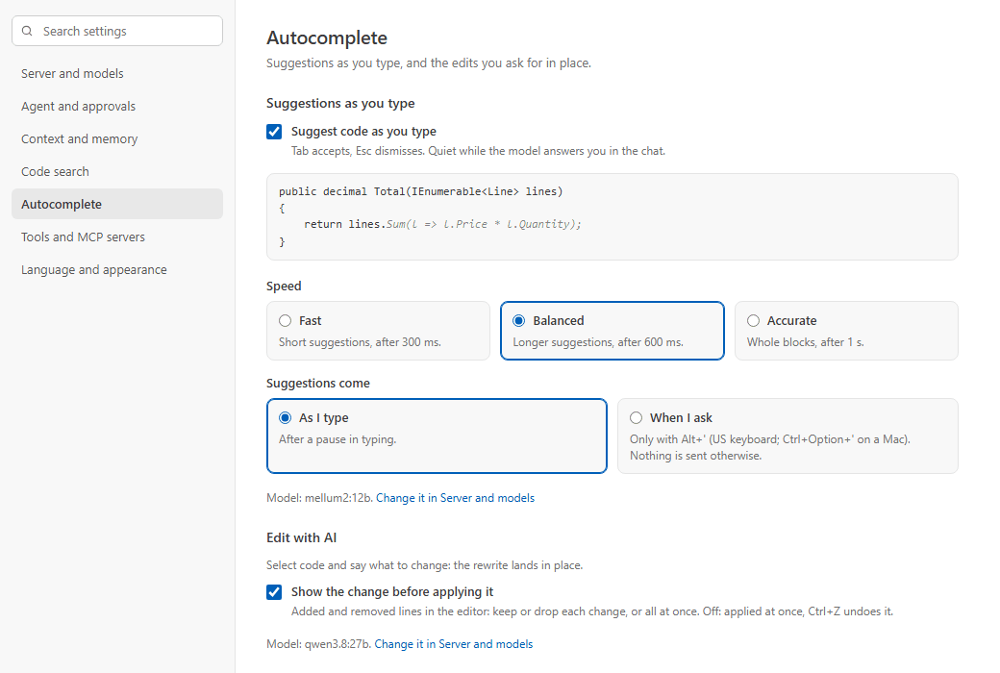 l.Price * l.Quantity); three speed cards, Fast, Balanced and Accurate; Suggestions come As I type or When I ask; and Edit with AI's Show the change before applying it" width="760">
  </picture>
</p>

| Speed | Suggests | After a pause of |
|---|---|---|
| **Fast** | short suggestions (128 tokens) | 300 ms |
| **Balanced** | longer suggestions (256 tokens) | 600 ms |
| **Accurate** | whole blocks (512 tokens) | 1 s |

**Try it** — type a method signature and its opening brace, pause, then **Tab**. Or press **Alt+'** to ask for a
suggestion right now: with *When I ask*, nothing is ever sent until you do.

<details>
<summary><b>In detail: keys, servers, when it stays quiet</b></summary>

- **Ghost-text Fill-in-the-Middle** as you type — **Tab** to accept, **Esc** to dismiss.
- Three speeds, picked as cards in the settings: **Fast** (128 tok / 0.4 / 300 ms) · **Balanced** (256 / 0.2 /
  600 ms) · **Accurate** (512 / 0.1 / 1 000 ms).
- **Alt+'** (the key left of Enter on a US keyboard; **Ctrl+Option+'** in VS Code on macOS) asks for a suggestion at
  the caret, without waiting for a pause, or takes the one shown — a second accept key where an open list
  (IntelliSense, ReSharper's) holds Tab. A key that brings nothing says why in the status bar: completion turned off,
  the file excluded from AI tools, no model chosen for an OpenAI-compatible server, a chat or a task answering on the
  same machine (it keeps the graphics card), the completion server not answering or refusing, or no suggestion from
  the model. The key is free in Visual Studio, ReSharper's Visual Studio scheme and VS Code. It is a key position,
  not a character: on another layout it is the key in that place (*²* on a French keyboard), and the menus show it.
  Change it in *Tools › Options › Keyboard* (*Suggest or Accept a Completion*) or in VS Code's Keyboard Shortcuts
  (*Trigger Inline Suggestion*).
- **When I ask** (*Autocomplete* page, or `inlineCompletionTrigger: "onDemand"`): only the key asks — nothing is sent
  after a pause in typing, so on a small card the chat never shares it with the completion.
- Suppressed while IntelliSense triggers are active. Supported on Ollama, LM Studio, and OpenAI-compatible servers that
  complete around the cursor (llama-server, Ollama's `/v1`) — see [Providers](providers.md).
- **On a server of their own** — the chat on a team server, ghost text on this machine: *Runs on › Another server* on
  the *Server and models* page (its kind and key under *Connection*, with the advanced settings), or
  `inlineCompletionRunsOn` in `config.json`. That server gets its own key, never the chat's, and its own model — the
  chat's is not there to fall back on. Ghost text on another machine than the chat's no longer waits for a chat answer
  to finish; on the chat's machine — under any of its names or addresses — it still does, the card being one.

</details>

## Search & knowledge

Inferpal indexes your workspace in the background and finds code **by meaning and by name** — so "where is the
discount applied?" and `ApplyDiscount` both land. The best matches join your question on their own, as chips you can
remove before sending.

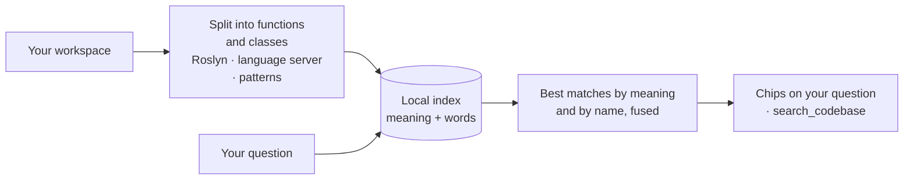

<table>
  <tr>
    <td align="center" valign="top" width="50%">
      <picture>
        <source media="(prefers-color-scheme: dark)" srcset="assets/features/auto-chips-dark.png">
        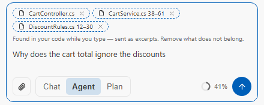
      </picture>
      <br><sub>Found while you type, sent as excerpts. Remove what does not belong.</sub>
    </td>
    <td align="center" valign="top" width="50%">
      <picture>
        <source media="(prefers-color-scheme: dark)" srcset="assets/features/mcp-form-dark.png">
        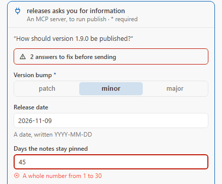
      </picture>
      <br><sub>An MCP server that needs a value asks on a card — checked before it is sent.</sub>
    </td>
  </tr>
</table>

<p align="center">
  <picture>
    <source media="(prefers-color-scheme: dark)" srcset="assets/features/settings-search-dark.png">
    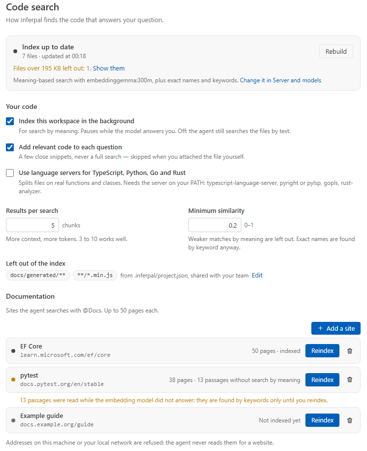
  </picture>
  <br><sub>The index, what it leaves out, and the documentation sites the agent can search.</sub>
</p>

**Try it**

| Type | What happens |
|---|---|
| `@diff what could break in what I changed?` | The current `git diff` goes with the question |
| `@problems fix these` | The current build errors go with it |
| `/docs add https://learn.microsoft.com/ef/core` | The site is indexed; from then on the agent searches it when you ask about EF Core |

Mentions: `@file` `@folder` `@code` `@diff` `@commit` `@problems` `@debugger` `@clipboard` `@tree` `@url`, and `@terminal` in VS Code — [what each attaches](mentions.md).

<details>
<summary><b>In detail: indexing, @Docs, MCP, mentions</b></summary>

- **Semantic codebase search** — background indexing with 3-tier chunking (Roslyn → LSP →
  regex) and **hybrid retrieval** (cosine + BM25 lexical fused with RRF, so exact identifiers
  rank well). Shadow pre-warm and Smart Auto-attach chips (both editors), and **per-turn auto-context** that
  silently injects the most relevant chunks into each code question. See
  **[Search & Indexing](search-and-indexing.md)**.
- **@Docs** — crawl and index external documentation sites, queried via `search_docs`.
- **MCP client** — expose tools from any stdio or Streamable HTTP MCP server. See **[MCP](mcp.md)**.
- **`@`-mentions** — a typed context picker (`@file`, `@diff`, `@debugger`, …). See
  **[Mentions](mentions.md)**.

</details>

## What the model reads

What reaches the model is never a mystery. Inferpal reads the instructions your repository already wrote for coding
agents — `AGENTS.md`, `CLAUDE.md`, Copilot's, Cursor's, Cline's, Roo's, Continue's — plus its own project files, and
splits them in two: what never changes goes into the system prompt, so the model server can reuse its cache; what
depends on the file you are in goes with the question.

| System prompt — the same for every question | With your question — follows the file you are in |
|---|---|
| ① Inferpal's base prompt, then your custom prompt | ① Instructions and rules for the active file's folders and globs |
| ② Pinned files, up to 3 | ② Code found by search, your mentions and chips |
| ③ Repository instructions at the root: `AGENTS.md`, `CLAUDE.md`, Copilot, Cursor, Cline, Roo, Continue | ③ Your question |
| ④ `.inferpal/`: context, memory, notes, the rules that always apply — they win a conflict | |

<p align="center">
  <picture>
    <source media="(prefers-color-scheme: dark)" srcset="assets/features/settings-instructions-dark.png">
    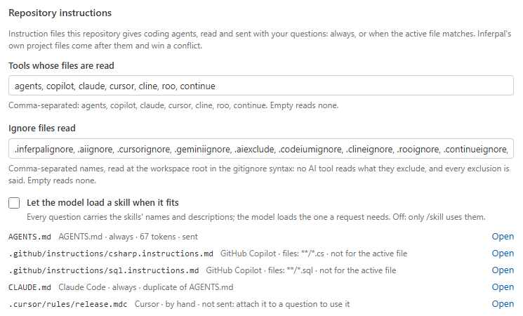
  </picture>
  <br><sub>Every instruction file found, its tool, when it applies, and whether the next question sends it.</sub>
</p>

**Try it**

| Type | What happens |
|---|---|
| `/instructions` | What each instruction file sends, and why not when it does not |
| `/xray` | The whole prompt, layer by layer, with what each layer weighs — and switches to leave one out |
| `/onboard context` | A first `.inferpal/context.md`, drafted from the repository itself, opened for you to correct |
| `/note the payment API sandbox resets every night` | Kept in `.inferpal/notes.md`, read with every later question |

<details>
<summary><b>In detail: prompt layers, memory, rules, skills, the project profile</b></summary>

- **System prompt layering** — base prompt + custom prompt + pinned files + project context
  + agent memory + project notes + matching rules. See
  **[Architecture](architecture.md#system-prompt-layering)**.
- **Persistent project context** — `.inferpal/context.md`, injected into every prompt.
- **Agent memory** — `.inferpal/memory.md`, updated by the `update_memory` tool / `/memory`.
- **Project notes** — `/note` appends timestamped notes to `.inferpal/notes.md`.
- **Pinned context files** — up to 3 files always injected (the composer's attach menu, or a
  promoted chip).
- **Context compaction** — old messages are summarized by the LLM instead of being
  hard-truncated, triggered at ~80 % of the context budget; **KV-cache anchor** preserves
  the first N messages verbatim. The summary request is sized to the window of the model
  that writes it: when the oldest messages don't fit, the summary covers the most recent
  ones and says how many it misses.
- **Workspace auto-context** — the first message of every session silently attaches solution
  info + open editors.
- **Context X-Ray** — `/xray` (or a click on the context gauge) opens an interactive panel
  breaking down everything composing the system prompt: token bars per layer (base, custom,
  pinned, project files, scoped rules), the exact content of each section, per-section on/off
  toggles for the next turn, copy of the raw prompt, and an overhead warning when the fixed
  layers dominate the budget.
- **Project rules & AI checks** — repo-versioned governance. See
  **[Rules & Checks](rules-and-checks.md)**.
- **Instructions your repository already gives coding agents** — `AGENTS.md` (from the git root
  down to the active file's folder), `.github/copilot-instructions.md` and
  `.github/instructions/*.instructions.md` (`applyTo`), `CLAUDE.md` with the files it imports,
  `.claude/rules/`, `.cursor/rules/*.mdc`, `.cursorrules`, `.clinerules`, `.roo/rules/` and
  `.continue/rules/` are read as each tool reads them and sent — those of the repository's root in
  the system prompt, after pinned files and before `.inferpal/`, which wins a conflict; those of the
  active file's folders and globs with the question, in a block sent when the active file changes,
  so the start of the request never moves with it. A file identical to another is sent once; the
  root's share the prompt's file budget, the active file's have their own, and a cut says so. Rules meant to load on demand or by hand are not sent yet.
  `/instructions` and the Context settings page list every file found — its tool, when it
  applies, what the next question sends of it (cut or whole), and why not when it does not —
  and `repoInstructionFamilies` chooses which tools' files are read (all by default).
- **Commands your repository already wrote** — `.github/prompts/*.prompt.md` (Copilot),
  `.claude/commands/**/*.md` (Claude Code, subfolders as `/folder:name`) and `.continue/prompts/` (Continue) are
  slash commands too, named as their tool names them, with their origin in the autocomplete and `/help`.
  `${input:…}`, `$ARGUMENTS` and `{{{ input }}}` receive the words typed after the command, and a command
  that asks for none gets them at the end. A command named like a built-in, or like an earlier one, is
  dropped and `/prompts` says by what; a Claude Code `` !`command` `` line is never run before sending — the
  model is asked to run it, under approval.
- **Skills** — the `SKILL.md` folders a repository wrote for Copilot (`.github/skills`), Claude Code
  (`.claude/skills`), any agent of the Agent Skills standard (`.agents/skills`), Cline or Roo, and your own
  (`~/.copilot/skills`, `~/.claude/skills`, `~/.agents/skills`). `/skill` lists them; `/skill <name> <request>`
  joins the skill's instructions and the list of its files to your question, named under it like an attached file.
  The model reads the skill's other files with `read_skill_file`, confined to that skill's folder, and runs a script
  only through `run_command` — with your approval: `allowed-tools` grants nothing. A repository's skill wins over
  yours of the same name, and `/skill` names the one left out. Writing into a skill folder always asks.
  With `skillsAutoMode` on (off by default), every question lists the skills and the model loads the one a request
  needs by itself.
- **Project profile & `/onboard`** — `.inferpal/project.json` travels with the repository and
  says how it likes to be worked on. Index exclusions apply on their own (additively — a clone
  can exclude more, never index more); model roles and context size are recommended, shown next
  to the values in effect, and written to your settings only by `/onboard apply`; everything else
  is ignored, unknown keys included. `/onboard context` drafts `.inferpal/context.md` from the
  repository (layout, README, recent commits) and opens it for you to correct. See
  **[Configuration → The project profile](configuration.md#the-project-profile-inferpalprojectjson)**.

</details>

## Conversation experience

<p align="center">
  <picture>
    <source media="(prefers-color-scheme: dark)" srcset="assets/features/welcome-dark.png">
    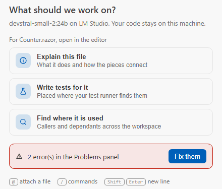
  </picture>
  <br><sub>An empty chat offers what makes sense for the file you are in.</sub>
</p>

A conversation is a file you can branch, search, export and come back to — in either editor.

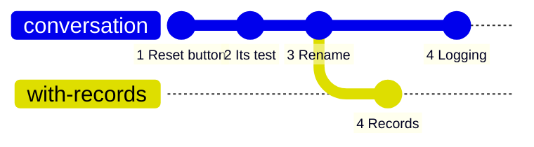

<sub>`/branch 3` forks at turn 3: the branch keeps turns 1 to 3 and the conversation goes on there, while the original is
saved first. `/branch` shows the family tree.</sub>

- **Real-time streaming** with Markdown, code blocks to copy, a **context ring** that fills as the model writes.
- **Sessions** auto-saved with a generated title, searchable, exportable to `.md` with their statistics.
- **Snippets, templates, prompt history** — ⭐ keeps a code block, `/template` loads a ready context, `/phistory`
  finds what you asked before.

<details>
<summary><b>In detail: streaming, sessions, branching, the welcome screen</b></summary>

- **Real-time streaming** — tokens appear as generated; Markdown renders once complete.
- **Real-time context ring** — the composer's ring (share of the window; token counts in its
  tooltip) updates live during generation (provisional `~` values), then snaps to the exact
  `prompt_eval_count + eval_count`. Its colour ramps amber → orange → red at 50 / 80 / 95 %; a
  click opens the Context X-Ray.
- **Markdown rendering** — headings (H1–H3), selectable code blocks with a copy button,
  lists, **bold**, *italic*, `inline code`; `<think>` tags are stripped automatically.
- **Regenerate** the last assistant reply in one click.
- **Conversation search** — *More › Search in the conversation*; non-matching messages dim to
  20 % opacity.
- **Session persistence & export** — sessions auto-save with a 4–5 word AI-generated title;
  export to `.md` / `.txt` with a stats header (model, turns, tool calls, tokens, duration).
- **Conversation branching** — `/branch <n>` forks the conversation at turn *n*: the branch keeps
  turns 1..*n* and the conversation continues in it, while the original is written back to disk
  first — exactly as it stands, under a generated name if it never had a file — so branching can
  never lose the half left behind.
  `/branch` lists the branch points and the family tree, `/branch <name>` switches branch.
  A branch is a plain session file with a `parent` + `fork_turn` link — nothing else in the
  store, the history rebuild or the picker had to learn about branching.
- **The end of a long run, announced** — when an answer took more than 30 seconds, Visual Studio plays an audible ping and VS Code shows a notification while you are not looking at its chat — done, or stopped on an error (**Show the answer** brings it back); turned off in Settings › Language and appearance › Agent runs, for both.
- **Code snippet library** — ⭐ saves any code block; `/snippets` manages it across sessions.
- **Session & prompt templates** — `/template` loads a preconfigured context; user prompt
  templates support `{args}`.
- **Prompt history** — persistent; search with `/phistory`.
- **Welcome screen** — an empty session shows one-click cards for what can be done now: with a
  file open, explain it, write its tests, find its usages; without one, explain the project, review
  your uncommitted changes, see all commands. When the last build failed (Visual Studio) or the
  Problems panel has errors (VS Code), **Fix them** sends those errors to the agent.
- **Documentation** — the chat's **?** button (Visual Studio's chat header; beside the gear in VS Code's chat title
  bar, or *Inferpal: Documentation* in the command palette) and the last line of `/help` open these pages, as they
  were for the version installed.
- **Attach file / selection** — 📎 toolbar buttons attach a file or the current editor
  selection as a context chip (the same context you can add with `/read` or `@file`).
  The message bubble names what went with it, so the transcript — on screen, exported, or
  reloaded later — still says what the question was asked about.

</details>

## Models & hardware

One graphics card, several jobs. Inferpal gives each job the model you choose for it — or the chat model when you
choose nothing — and shows what sits in graphics memory right now.

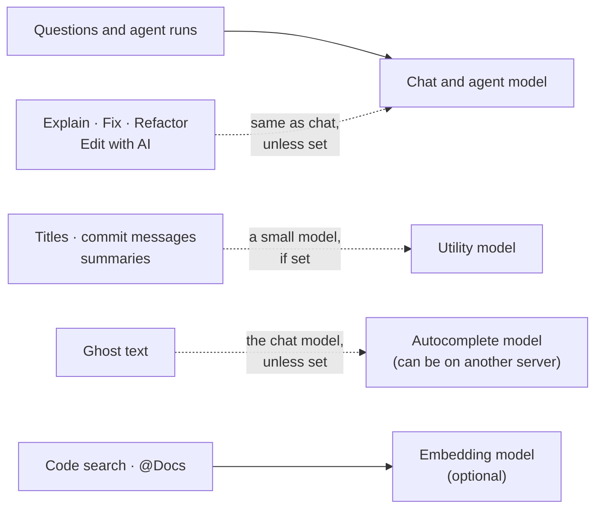

<p align="center">
  <picture>
    <source media="(prefers-color-scheme: dark)" srcset="assets/features/first-run-dark.png">
    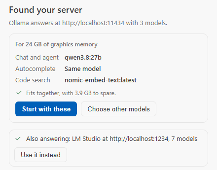
  </picture>
  <br><sub>First run: it finds your server and proposes models that fit your card.</sub>
</p>

<p align="center">
  <picture>
    <source media="(prefers-color-scheme: dark)" srcset="assets/features/settings-models-dark.png">
    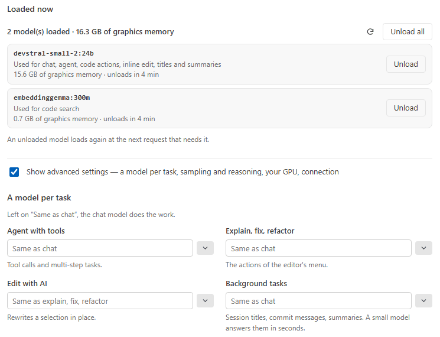
  </picture>
  <br><sub>What is loaded, what each model is used for, and a model per task.</sub>
</p>

**Try it**

| Type | What happens |
|---|---|
| `/bench` | Your installed models timed and scored, with a recommendation per role |
| `/arena explain this regex: ^(?=.*\d).{8,}$` | Two models answer blind; `/arena a`, `b` or `tie` reveals them |
| `/hardware` | Your memory budget, what is loaded, and the context size that fits |
| `/models pull qwen3.8` | Downloads a model, with its progress (Ollama) |

Which model for which card: **[Models](models.md#by-graphics-card)**, measured on real coding tasks.

<details>
<summary><b>In detail: model manager, VRAM, /bench, /arena, the Model Router</b></summary>

- **Model manager** — `/models list/pull/delete/running` (streaming pull on Ollama).
- **VRAM monitoring** — a header badge shows the models resident in VRAM;
  `ModelLifetimeService` auto-unloads idle ones.
- **Hardware profile** — `/hardware` reports budget, loaded models, headroom, and a
  recommended `num_ctx`.
- **Model bench** — `/bench [model…]` runs a local test bench of installed models: warm
  time-to-first-token, tokens/s, VRAM pressure and a 5-task quality micro-eval scored by
  programmatic assertions (no LLM judge), with per-role recommendations (agent / utility /
  FIM) feeding the Model Router. `/bench last` redisplays the persisted run. The tokens/s figure
  only aggregates the tasks whose generation could actually be timed — a reply that never streams
  (a tool call) is left out rather than counted as free tokens — and the column shows `—` when
  nothing in the run could be timed.
- **Model arena** — `/arena <prompt>` sends the same prompt to two models (sequentially — one
  GPU) and shows both answers blind-labelled A/B; `/arena a|b|tie` records the vote and
  reveals the models, `/arena stats` shows the cumulative local standings.
- **Model Router** — a dedicated **utility model** role (`utilityModel`) handles session
  titles, `/commit` message proposals, `/pr-description` proposals and compaction summaries instead of the chat model.
  With none set, they go to the chat model — or, when it is not loaded and the agent or
  code-actions model is, to that one: a session title never loads a model of its own.
  Opt-in **auto mode** (`modelRouterAuto`): with no utility model set, background tasks use
  the model `/bench` recommended for the utility role — but only when it is already warm in
  VRAM; a cold model is never loaded for a title or commit message.
- **First run, in both editors** — Inferpal looks for a model server where one usually listens (Ollama, LM Studio,
  llama-server, vLLM) and says what each place answered. VS Code shows it on a card in the chat: the models proposed
  for your card, a server on another machine by its address, a key when a server asks for one, and — on Ollama
  without a chat model — a download of a recommended model. Visual Studio takes the server that answers when nothing
  was set up yet, and says so; `/setup` looks again in both.
- **Dynamic timeout engine** — Quick / Normal / Deep thresholds per task complexity.
- **Heartbeat & connection guard** — a silent pre-flight before every send; the Send button
  greys out when the server is unreachable, and recovers automatically.

</details>

## Safety

The model proposes; you decide. Every call that writes, runs a command or goes online passes the same checks before it
can happen, and the last word is a card showing exactly what will run.

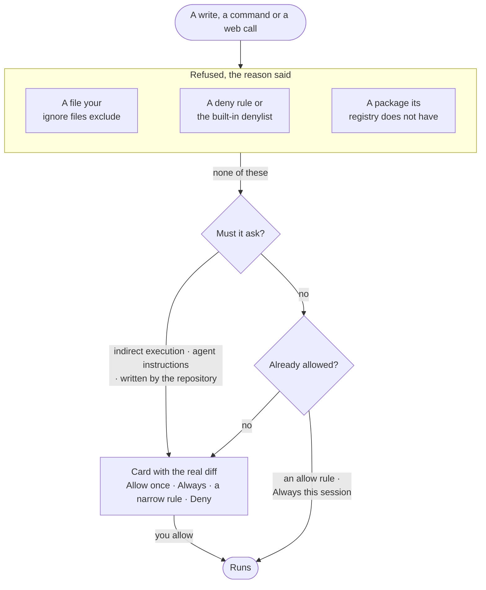

**Try it**

| Type | What happens |
|---|---|
| `/permissions` | Every rule, in the order it is evaluated, the built-in denylist included |
| `/permissions suggest` | The narrow rules you granted three times and never refused; `/permissions add <n>` saves one |

A committable `.inferpal/permissions.json` can only **deny**: a cloned repository can never approve anything on your
behalf. And `.aiignore`, `.cursorignore` and the other tools' ignore files keep files away from everything that reads
for the model — each exclusion said, never silent.

<details>
<summary><b>In detail: the sandbox, approvals, rules, ignore files, diagnostics</b></summary>

- **Workspace-confined file operations** — a single `AssertUnderRoot` sandbox on every
  path-taking tool. In Visual Studio the workspace is the folder that holds the whole solution:
  when a solution lists projects beside its own folder (`UI\UI.sln` naming `..\DAL\DAL.csproj`),
  the root widens to hold them — within the git repository that holds the solution, never to your
  home folder or a drive root, and not while the solution's folder keeps its own `.inferpal/`
  files (move them up to the wider folder to let it widen). Projects still out of reach are
  marked by `get_solution_info` and named in `/diagnostics`. A folder opened without a solution
  (*File › Open › Folder*) is the workspace too, unless it is a whole drive or your user folder.
  With no workspace — a file alone, or the few seconds before Visual Studio reports its solution —
  no tool reads or writes a file, builds, runs tests or runs a command in a folder nobody named:
  the refusal says to open a folder or a solution. `run_command` is not path-confined: when it
  runs anywhere but the workspace root, its approval card names the folder.
- **Markup and generated code** — a rename follows the markup that binds the symbol (`.razor`,
  `.cshtml`, `.xaml`: bindings under a matching `x:DataType`, `Model.X` and `asp-for`, a component's
  own code, route parameter and attributes on its tag) and lists every other occurrence of the
  name instead of rewriting it; `analyze_code impact` lists the markup that uses a type. A file a
  generator writes is refused for hand edits, with the source to change instead; an edit of the
  Windows Forms designer's code goes to a card that warns ([Tools](tools.md)).
- **Approval prompts** — `write_file`, `apply_diff`, `apply_edits`, `delete_file`,
  `run_command`, `rename_symbol`, `fetch_url`, `web_search`, custom shell tools, and MCP calls
  each prompt **Allow once / Always this session / Deny** ("Always" allows the tool for this session in this
  workspace, never written to disk). Edit prompts show the **actual diff** before you confirm. A command or a write that
  one narrow rule describes also offers that rule (*commands that start with `dotnet test`*,
  *writes under `tests/`*), written to the per-machine rules when picked; `/permissions suggest`
  names the ones you keep granting.
- **Permission rules** — `allow` / `deny` patterns classify a call before the prompt. The
  per-machine setting can do both; the committable `.inferpal/permissions.json` overlay can only
  *deny* (a cloned repository must not be able to grant itself auto-approval); a built-in denylist of
  catastrophic shell commands always applies (an **accident guard**, not a security boundary —
  it matches text, so obfuscation defeats it), and indirect execution — PowerShell (`iex`,
  `-EncodedCommand`, `FromBase64String`, `[scriptblock]::Create`, `& $var`) and POSIX
  (`eval`, piping into a shell, `base64 -d`, `sh -c "$var"`, `source`/`exec` on a variable)
  alike — is **force-prompted**: never auto-approved by any rule, session grant or setting,
  never blocked — the approval prompt, where the raw command is visible, is the actual boundary.
  See **[Tools → Permission rules](tools.md)**.
- **Files kept out of reach** — the ignore files a repository writes for AI tools are honoured:
  `.inferpalignore`, and JetBrains' `.aiignore`, Cursor's `.cursorignore`, Gemini's `.geminiignore`
  and `.aiexclude`, Codeium's, Cline's, Roo's, Continue's and Aider's, read at the workspace root in
  the gitignore syntax (negations, anchors, `**`, folders). What they exclude is never read nor
  changed by a tool, never attached (`@file`, `@folder`, chips, ACP attachments), indexed, pinned,
  completed by ghost text, sent by a code action (`/explain`, `/review`, `/fix`, `/refactor`, `/doc`,
  `/test`, Edit with AI) or shown in a git diff (`get_git_status`, `@diff`, `/check`, `/commit`, `/pr-description`) —
  and **every exclusion is said**: a refused call names the file, the line and the pattern, a walk
  says how many files it skipped, and `/check`, `/commit` and `/pr-description` say which files the model did not read.
  `ignoreFiles` chooses which files are read (empty = none). Not covered, by nature: what a command
  reads by itself (`run_command` can `cat` a file — the approval card shows the command), what an MCP
  server reads on its own, an ignore file in a subfolder, and the files written for the agent itself
  (`.inferpal/`, `AGENTS.md` and the other instruction files, skills), which are never excluded.
- **Instruction files always ask first** — a write to a file agents read back as instructions is
  force-prompted the same way: Inferpal's own `.inferpal/` memory, notes, context and rules, and the
  files a repository writes for coding agents (`AGENTS.md`, `CLAUDE.md`,
  `.github/copilot-instructions.md`, `.github/instructions/`, `.claude/rules/`, `.cursor/rules/`,
  `.cursorrules`, `.clinerules`, `.roo/rules/`, `.continue/rules/`). A silent edit there would
  change what every later session — and every other agent in the repository — is told to do.
- **Hardened SSRF guard** on outbound fetches (DNS rebinding, IPv4-mapped IPv6, `0.0.0.0/8`,
  loopback/private ranges, ReDoS-safe timeout).
- **Circuit breaker** on backend failures and **loop detection** to stop infinite agent loops.
- **Local diagnostics, transparent export** — `/diagnostics` lists background errors swallowed
  best-effort (in-memory ring buffer, zero telemetry), and `/diagnostics export` copies a
  **sanitized support bundle** for GitHub issues: remote endpoints redacted, API key never
  included, profile and workspace paths masked. The chat shows exactly the text that was
  copied — you read what you are about to send, and nothing leaves the machine on its own.
- **`/diagnostics` also answers "why is my ghost text gone?"** — the Visual Studio half that lives
  inside `devenv.exe` (inline completions, inline-diff preview, the `/tdd` debugger driver) fails
  silently by nature: the chat is out-of-process and keeps working. Each of its load paths
  publishes a heartbeat, and `/diagnostics` names the one that is missing — in the chat and in the
  support bundle. It says so only on **proof of absence**, never on absence of proof: in VS Code,
  where there is no in-process half at all, it stays quiet.

</details>

## Two editors, one engine

The same engine runs behind every editor, so a conversation, a setting or an approval rule follows you from Visual
Studio to VS Code and back — and to any editor that speaks the [Agent Client Protocol](acp.md).

<table>
  <tr>
    <td align="center" valign="top" width="50%">
      <picture>
        <source media="(prefers-color-scheme: dark)" srcset="assets/features/editor-vs-dark.png">
        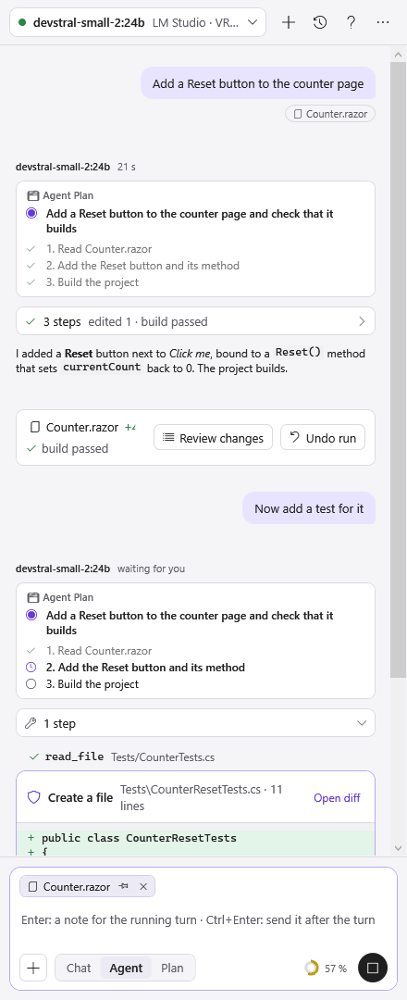
      </picture>
      <br><sub>Visual Studio</sub>
    </td>
    <td align="center" valign="top" width="50%">
      <picture>
        <source media="(prefers-color-scheme: dark)" srcset="assets/features/editor-vscode-dark.png">
        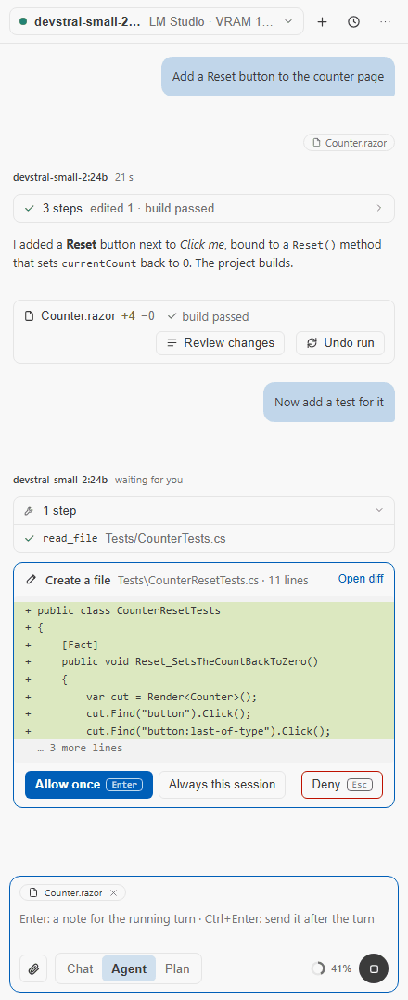
      </picture>
      <br><sub>VS Code</sub>
    </td>
  </tr>
</table>

| | Visual Studio 2026 / 2022 | VS Code | Zed, JetBrains, Qt Creator, Neovim, Emacs |
|---|---|---|---|
| Chat, agent, approvals, undo | ✓ | ✓ | ✓ (the editor's own diff and approvals) |
| Ghost text, Edit with AI | ✓ | ✓ | — |
| `/tdd` with the debugger, `/debug` | ✓ | ✓ | — |
| `/fix-build` | ✓ | — | — |
| Settings | the same seven pages | the same seven pages | the same seven pages, in your browser |

<details>
<summary><b>In detail: what each front-end has</b></summary>

- The **Visual Studio extension** (primary) and the **VS Code extension** run the same
  `Inferpal.Core` engine and share the same configuration: the agent, its tools and approvals, search, MCP, ghost
  text, `/tdd` and `/debug` are the same in both. The VS Code chat has full markdown rendering, welcome screen,
  connection + VRAM badge, collapsible tool bubbles (input/output, the colored change a write made, "Fix with AI" on
  errors), live agent-plan block,
  slash-command autocomplete, Shift+↑/↓ prompt history, token counter with a clickable context gauge (opens the X-Ray
  panel), conversation search, `.md`/`.txt` export, and a localized webview (10 languages).
- **Not in VS Code yet** — `/fix-build` is Visual Studio's alone (it answers that it is not available).
- **Headless slash commands** — nearly all the slash commands are served by the host over JSON-RPC with the
  same approval/permission pipeline; long commands are cancellable.
- **Settings panel in VS Code** — an "Inferpal Settings" webview with the same seven pages as the
  Visual Studio window, read from the same description in the Core, backed by the shared config.
  `/settings` opens it from the chat (and the settings window in Visual Studio).
- **Zed, JetBrains IDEs, Neovim, Emacs** — the same host, run with `--acp`, is an
  [Agent Client Protocol](acp.md) agent: modes and model as thread options, the real diff before every change,
  sessions saved and reloaded. Its settings are the same seven pages, in the browser: `/settings` in a thread, a button
  at first setup, or `Inferpal.Host --settings`; saved, they apply to the open threads from their next question.
- **Typed @-mentions, `/plan` and `/agent-step` modes, and per-turn RAG auto-context** all
  work in VS Code too.

</details>

## Localization & theming

- **10 UI languages**, following Visual Studio or overridden independently.
- **Theme awareness** — colors follow the editor's Light / Dark / Blue themes and Windows high
  contrast; **Density** (*Language and appearance*) draws the conversation comfortable or compact.

## Keyboard shortcuts

Opening Inferpal takes no key of its own: the keys it had open Visual Studio's Build menu in English and its Tools menu
in French, and VS Code's own chat. **Tools → Inferpal → Inferpal Chat** and the activity-bar icon open it; in VS Code,
Keyboard Shortcuts binds a key to `inferpal.chat.focus`. Alt+M works in both (**Ctrl+Alt+M** on macOS, where Option+M
types µ). **Ctrl+Shift+I** is Visual Studio's: in VS Code that key already belongs to the
developer tools and to other assistants' chats, so Edit with AI has no key of its own there — it is in the editor's
context menu and the command palette, and VS Code's Keyboard Shortcuts binds it to the key you want.

| Shortcut | Action |
|---|---|
| **Alt+M** | Run `/map`: the project's architecture map |
| **Ctrl+Shift+I** | Inline Edit (Edit with AI) on the selection |
| **Enter** | Send the message |
| **Shift+Enter** | Insert a newline in the prompt |
| **Tab** / **Esc** | Accept / dismiss a ghost-text completion |
| **Alt+'** | Ask for a ghost-text completion at the caret, or take the one shown (**Ctrl+Option+'** in VS Code on macOS) |
