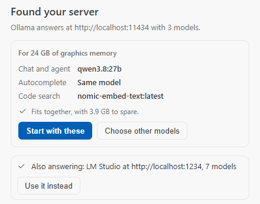
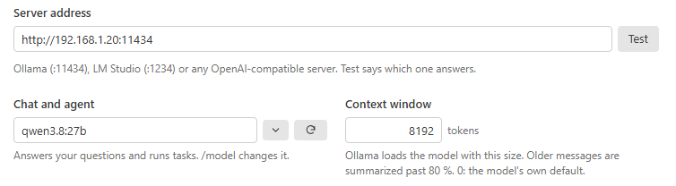
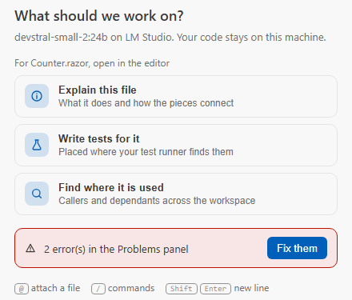

# Getting Started

**From nothing to a first answer, in Visual Studio or VS Code.** Six short steps, and a seventh when you want Inferpal
to know your project. In short: start a model server, install the extension, open the chat. Inferpal looks for the
server and helps you pick a model; with no server at all, it says what each place answered and how to get one.

## 1. Check what you need

| Requirement | Details |
|---|---|
| Editor | **Visual Studio 2026**, or **Visual Studio 2022 from 17.14** — Community, Professional or Enterprise — or **VS Code** (Windows x64, Linux x64, or Apple Silicon on macOS 12 or later). |
| .NET SDK | .NET 10 (building from source only) |
| Model server | [Ollama](https://ollama.com) (default — full hardware-aware features), [LM Studio](https://lmstudio.ai), or any **OpenAI-compatible** server (llama.cpp, vLLM, …) |

> [!IMPORTANT]
> Tool calling is required for the agent, and the model to pick depends on your graphics card: **Granite 4.2 8B** on
> 8 GB, **Gemma 4 12B** on 12 to 16 GB, **Qwen3.8 27B** on 24 GB — see **[By graphics card](models.md#by-graphics-card)**
> and **[Models](models.md)** for every model's results. A model not trained for tool calling (`qwen2.5-coder`,
> `llama3` v1) chats but makes a poor agent.
>
> - **Inline completions** work with any model; one trained for it completes far better (Mellum2 and Qwen3.8 measured best — see [By graphics card](models.md#by-graphics-card)).
> - **Semantic search** can add a dedicated embedding model — optional: without one, the search runs on keywords. EmbeddingGemma (`embeddinggemma`) measured best — see [Models](models.md).

## 2. Start a model server

Pick whichever backend you already use — see **[Providers](providers.md)** for the
differences. No server yet? On Windows with winget, step 5 can install Ollama for you: go straight to step 3.

- **Ollama** (default `:11434`)
  ```powershell
  ollama serve
  ollama pull qwen3.8:27b        # chat and agent on a 24 GB card — 12-16 GB: gemma4:12b · 8 GB: granite4.2:8b
  # Optional, dedicated models:
  # inline completions: the model that fits beside the agent depends on your card (docs/models.md#by-graphics-card)
  ollama pull embeddinggemma     # semantic search (optional)
  ```
- **LM Studio** (default `:1234`)
  1. Open the **Developer** tab (the server view) and **Start** the server.
  2. **Load** a tool-calling chat model — the one for your card ([By graphics card](models.md#by-graphics-card)) — and,
     optionally, an autocomplete model ([Mellum2](models.md#mellum) measured best) and an embedding model for semantic
     search.
  3. Inferpal uses LM Studio's native `/api/v1/*` API for the model list and load/unload, so
     `/models` works here too. Point the **Server address** at `http://localhost:1234`.
- **OpenAI-compatible** — expose the server's `/v1` endpoint (and an API key if it needs one).

The backend does not have to run on the machine hosting Visual Studio — see
**[Remote Inference](remote-inference.md)**.

## 3. Install the extension

### Visual Studio

The quickest path is the **[Visual Studio Marketplace](https://marketplace.visualstudio.com/items?itemName=EstaxNet.inferpal-vs)**
listing, *Inferpal — Local AI Agent for Visual Studio* — or the prebuilt VSIX from
**[the latest release](https://github.com/EstaxNet/Inferpal/releases/latest)**, by double-clicking
`Inferpal-vs2026-<version>.vsix`.

> [!IMPORTANT]
> Close Visual Studio before installing a VSIX. The merge that registers an extension rewrites the
> whole configuration at once and gives up if any part of it is in use, so installing with the IDE
> open can leave nothing registered — silently.

### VS Code

The VS Code extension shares the same engine and the same Inferpal configuration as the
Visual Studio extension — configure once, use in both editors. A few editor features are
Visual Studio-only for now: [the list](features.md#two-editors-one-engine).

Install from the
**[VS Code Marketplace](https://marketplace.visualstudio.com/items?itemName=EstaxNet.inferpal-vscode)** —
search *Inferpal* in the Extensions view, or run
`code --install-extension EstaxNet.inferpal-vscode`. The backend (`Inferpal.Host`) is
bundled and self-contained — no .NET installation required.

<details>
<summary><b>In detail: install VS Code's VSIX by hand</b></summary>

To install by hand instead, take the VSIX for your platform from
**[the latest release](https://github.com/EstaxNet/Inferpal/releases/latest)** —
`inferpal-vscode-win32-x64-<version>.vsix` (Windows x64),
`inferpal-vscode-linux-x64-<version>.vsix` (Linux x64) or
`inferpal-vscode-darwin-arm64-<version>.vsix` (Apple Silicon) —
`code --install-extension inferpal-vscode-<platform>-<version>.vsix`
(or Extensions view → `…` → *Install from VSIX…*).

</details>

<details>
<summary><b>In detail: build from source</b></summary>

To build from source:

```powershell
# Debug (includes PDB in the VSIX, for Attach-to-Process debugging)
dotnet build Inferpal/Inferpal.csproj

# Release (optimized, no symbols, warnings-as-errors)
dotnet build Inferpal/Inferpal.csproj -c Release
```

Open the generated `.vsix` from `Inferpal\bin\Debug\net8.0-windows\` (or `Release\`) and
double-click it to install into Visual Studio.

> [!TIP]
> Contributors can build and deploy straight into the installed extension with
> `./deploy-dev.ps1` (silent first-install bootstrap, skip-if-fresh, hot apply of the chat
> without restarting VS) — see **[Development → Deploy (dev)](development.md#deploy-dev-and-status)**.

To build it from source, see **[Development → VS Code extension](development.md#vs-code-extension)**.

</details>

## 4. Open the chat

In Visual Studio: **Tools → Inferpal → Inferpal Chat**.

In VS Code: open the **Inferpal** view in the Activity Bar.

## 5. Connect to your server

The first time the window opens, Inferpal looks for a model server: the address set, else where one usually listens
on this computer (Ollama, LM Studio, llama-server, vLLM). What comes next depends on what answers.

### When a server answers

<p align="center">
  <picture>
    <source media="(prefers-color-scheme: dark)" srcset="assets/features/first-run-dark.png">
    
  </picture>
  <br><sub>VS Code's first-run card: it finds your server and proposes models that fit your graphics card.</sub>
</p>

- **In VS Code**, the first time, a card looks for a model server on this computer and proposes the models that fit
  your card (**Start with these**); a server on another machine is typed on the same card, and Ollama without a chat
  model gets a recommended one downloaded.
- **In Visual Studio**, when nothing was set up yet (no address, key or model chosen), it takes the server that answers
  and picks a model, and says so in the chat.
- **In both**, on Ollama, with the graphics card's memory known, it also sets the context window for the card
  ([Models](models.md#measured-results)) — an install set up before that gets it at its next start.

**Try it** — `/setup` looks again, and says what each place answered when none does. In VS Code, `/setup` brings the
card back.

### When nothing answers

<p align="center">
  <picture>
    <source media="(prefers-color-scheme: dark)" srcset="assets/features/first-run-nothing-dark.png">
    
  </picture>
  <br><sub>VS Code, nothing found: what each place answered, and what you can do about it.</sub>
</p>

- When none does, on Windows with winget, Inferpal offers to install Ollama for your account (about 1.6 GB, no
  administrator rights): the card shows the exact `winget` command before you click **Install**, then the steps; an
  Ollama already installed but not running is started instead.
- On macOS and Linux it shows the command to run in a
  terminal, and never runs it.
- The ACP setup (`Inferpal.Host --setup`) prints the command.

### Choose the server and the model by hand

<p align="center">
  <picture>
    <source media="(prefers-color-scheme: dark)" srcset="assets/features/settings-server-dark.png">
    
  </picture>
  <br><sub>The first page of the settings: the server, then the model that answers.</sub>
</p>

1. Open **Inferpal Settings** — the first page is **Server and models**.
2. Set the server address (Ollama default: `http://localhost:11434`) and click **Test** beside it: it names the server that
   answered and how many models it lists (`✓ Ollama answered — 7 models installed`), and fills the model list.
3. Pick the **Chat and agent** model. The kind of server (Ollama / LM Studio /
   OpenAI-compatible) and an **API key**, if it needs one, are under **Connection**, which **Show advanced settings**
   unfolds.
4. Optionally give autocomplete and code search a model — and a server — of their own on the same page, and a model per
   task under **Show advanced settings**.
5. Code search needs nothing: the workspace is indexed in the background by default (*Code search → Index this
   workspace in the background*).

See **[Configuration](configuration.md)** for every available setting.

<details>
<summary><b>In detail: settings in VS Code</b></summary>

- Configure through the **Inferpal Settings** panel (the same seven pages as Visual Studio's —
  [Configuration](configuration.md) — backed by the configuration shared with Visual Studio).
- VS Code-side extension settings (`inferpal.*`) cover `hostPath` (leave empty for the bundled host), this
  window's models (`model`, `utilityModel`, `modelRouterAuto`), `agentMode`, and `fim.enabled`.
- A model or a mode picked in the chat is kept by VS Code for that folder — nothing is written into the repository's
  `.vscode/settings.json` — until `model` or `agentMode` is changed there, which then applies.

</details>

## 6. Ask your first question

Switch to the **Inferpal** chat window, type a prompt, and press **Enter** (or click **↑**).

<p align="center">
  <picture>
    <source media="(prefers-color-scheme: dark)" srcset="assets/features/welcome-dark.png">
    
  </picture>
  <br><sub>An empty chat offers what makes sense for the file you are in: click a card, or type your own question.</sub>
</p>

**Try it**

```text
Explain this project: what it does and where it starts
```

In VS Code too, start chatting: streaming replies with full markdown, the agentic loop with approvals and a
live plan block, collapsible tool bubbles, typed `@`-mentions, slash-command
autocomplete, inline FIM completions, unsaved-buffer awareness and live diagnostics from
the Problems panel are all wired. Nearly all slash commands work headless through the
host — see **[Slash Commands](slash-commands.md)** for the few still VS-only.

## 7. Add project context (optional)

Create `.inferpal/context.md` at the root of your solution. Anything you write there —
conventions, architecture decisions, team rules — is injected into every system prompt.

- `/context` shows what is currently loaded.
- An edit applies from your next question: the file is read again before every one.

See **[Architecture → System prompt layering](architecture.md#system-prompt-layering)** for
the full injection order.

## Next steps

- **[Features](features.md)** — a tour of everything Inferpal can do.
- **[Slash Commands](slash-commands.md)** — the `/command` reference.
- **[Tools](tools.md)** — what the agent can do on its own.
