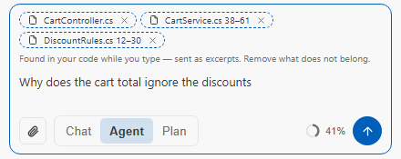

# @-mentions

Point the model at exactly what your question is about: a file, your changes, the current errors, a web page. Type `@`,
pick what to attach, and ask. This page shows each mention by what you want to attach, and what it says when there is
nothing to attach.

Type `@` in the prompt to open a typed context picker. The mention is resolved into real
context **the moment you pick it** — the token leaves the prompt and a chip holds what was read
then. A path typed after `@` in VS Code is read when you send.

  <picture>
    <source media="(prefers-color-scheme: dark)" srcset="assets/features/auto-chips-dark.png">
    
  </picture>
   A chip is what goes with your question. These dashed ones were found while typing; a mention adds one you chose.

**Try it**

| Type | What happens |
|---|---|
| `@diff what could break in what I changed?` | The current `git diff` goes with the question |
| `@problems fix these` | The current errors go with it |
| `@file`, then pick a file | A chip holds the file, and it goes with your question |

> [!TIP]
> The `@`-mention popup and the `/`-command popup are mutually exclusive — typing `@` opens
> the mention picker, `/` opens the command list.

## Attach your code

| Mention | Attaches |
|---|---|
| `@file` | A file you pick |
| `@folder` | A folder: the list of its files, plus the text of the first of them |
| `@code` | A semantic search of the indexed codebase — type the query after the token |
| `@tree` | The solution's C# tree |

**`@folder` is bounded, and it says where.** It lists up to 200 files, up to 4 levels deep, and
includes the text of the first 30 of them within a 60 000-character budget. Whenever one of those
limits bites — or a file cannot be read — the attachment ends with a line saying which one, so a
file named in the list but absent from the text is never mistaken for a file that is simply empty.
Attach a subfolder to get the rest.

**Visual Studio: drag a file or a folder onto the chat** — from Solution Explorer or Windows Explorer — and it becomes
the chip `@file` or `@folder` makes, with the same refusals; nothing is sent until you send your message. A project
node is not attached (it carries no file to attach): a notice says so — drop its files, or attach its folder with
`@folder`.

**VS Code does not offer it:** it hands a drop from its own Explorer to no extension view, and one from
outside VS Code only with Shift held and without the file's path.

## Attach your changes

| Mention | Attaches |
|---|---|
| `@diff` | The current `git diff` |
| `@commit` | One commit's message and diff — pick one of the latest, or type a hash, a branch or a tag (alone, the last commit) |

A long diff is cut to the size of one attachment, and its chip says how many characters it kept. `@commit` leaves
out the files your ignore files exclude, and says how many.

## Attach what went wrong

| Mention | Attaches |
|---|---|
| `@problems` | The current errors: a build's diagnostics in Visual Studio, the Problems panel in VS Code |
| `@debugger` | The live debugger break state (via `get_debugger_state`) |
| `@terminal` | *VS Code:* the last command a terminal finished — the command, its folder, its output (its end, when it is long) and its exit code |
| `@output` | *Visual Studio:* the Output window's pane — the one shown, else Build — its end when it is long |

**`@terminal` reads what VS Code's shell integration reports** (on by default for bash, zsh, fish and PowerShell):
the active terminal's last finished command — another terminal's is never taken in its place.

- Inferpal follows a terminal's commands from the first time `@terminal` is used in it, so that first time it asks
  you to run the command again: while a command runs, VS Code keeps its whole output in memory for whoever reads it,
  and following every terminal would cost that to people who never use `@terminal`.
- A command still running is not attached: use `@terminal` again once it ends.
- Visual Studio offers `@output` instead: the text of the Output window's pane you are looking at (else the
  Build pane), its end when it is long; a pane Visual Studio does not give the text of (one not yet shown) is
  said, never attached empty.

## Attach something from outside your code

| Mention | Attaches |
|---|---|
| `@clipboard` | The clipboard contents |
| `@url` | A web page's text — type or paste the address after the token |

**`@url` fetches the address you typed, without asking.** It goes the way `fetch_url` goes — a private or local address
is refused, and so is a redirect to one; `fetch_url` turned off or a deny rule that matches the address refuses it too —
but there is no approval card: you typed the address yourself.

## When nothing is attached

**A mention with nothing to attach says why instead of leaving a chip.** These
answer with a short notice — a chip always means something joined your question:

- `@folder` on a path that does not exist, or on a file (use `@file`)
- `@code` while there is no index to search or when its search finds nothing
- `@tree` with no solution or project folder to map
- `@diff` outside a git repository or with no uncommitted change
- `@commit` on a name no commit has or on a range (`a..b`: `/check` reviews a range)
- `@url` on a page that cannot be fetched, is binary or has no text

**A file your repository keeps away from AI tools is never attached.** `@file`, a chip, a path typed after `@` or an ACP
attachment of a file that `.aiignore`, `.cursorignore` or another ignore file excludes answers with a notice naming the
ignore file, the line and the pattern; `@folder` leaves such files out of its list and says how many
(see [Features → Safety](features.md#safety)).

## Mentions in VS Code

**VS Code:** typed mentions work there too (since 1.2.0) — the eleven categories from
`@file` to `@terminal` are offered in a two-level popup, and resolved mentions appear as
context chips in the composer, alongside a "+" attach menu (active file, selection, file
from disk, and **pin the active file** — pinned files show above the input box, ✕ unpins one).

A path typed after `@` (`@src/app.ts`) attaches the file directly: up to 5 files per question, each up to 40,000
characters (a chip, 60,000). A file sent in part, or left out, is named under your question with the counts, and
the model is told the same, with `read_file` to read the rest.

## Related

- [Tools → `get_debugger_state`](tools.md#built-in-tools) backs `@debugger`.
- [Slash Commands](slash-commands.md) for the `/` command list.

**Next:** [Search & Indexing](search-and-indexing.md) — how `@code` and the chips find the right code.
