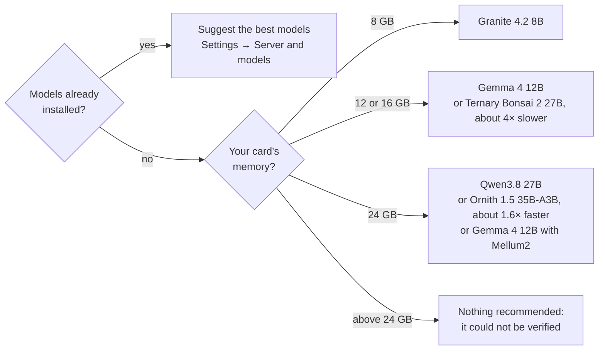
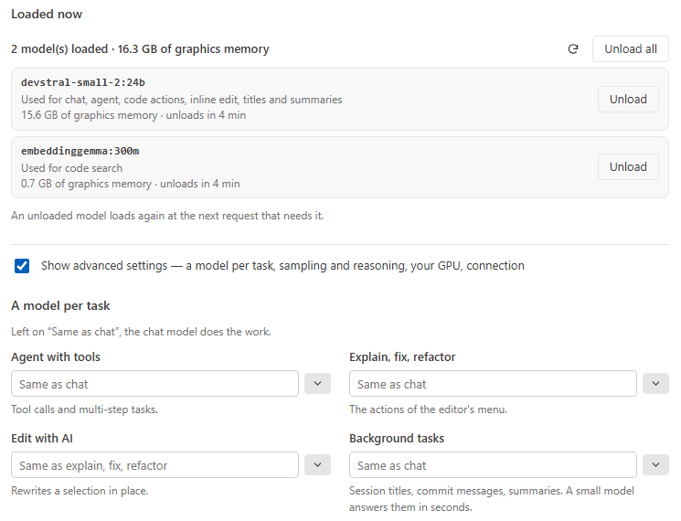

# Models

**Which model for your graphics card, and what to expect from it.** In short: **Granite 4.2 8B** on 8 GB, **Gemma 4
12B** on 12 or 16 GB, **Qwen3.8 27B** on 24 GB. This page is for anyone choosing or setting up a model: the first
section gives the reasons, the rest waits until you want a model's figures or its fine print.

> [!TIP]
> In a hurry? **Qwen3.8 27B** and **Devstral Small 2** are the two models to start with for agent work; see
> [At a glance](#at-a-glance). Already have models installed? *Settings → Server and models → Suggest the best models*
> picks among them from the figures on this page, and says why. Every figure on this page comes from Inferpal's own test battery — real tasks on real
> projects, judged on their outcome (the project's tests green), never on the model's wording.

- **[By graphics card](#by-graphics-card)** — what fits your card, together
- **[At a glance](#at-a-glance)** — what to use each model for, what Inferpal does for it
- **[Code search](#code-search-do-you-need-an-embedding-model)** — do you need an embedding model?
- **[Background tasks](#background-tasks-do-you-need-a-utility-model)** — do you need a utility model?
- **[How long a model reasons](#how-long-a-model-reasons)** — the levels, and what they change
- **[How Inferpal reads a model](#how-inferpal-reads-a-model)** — tool calls, reasoning, templates, sampling
- **[Model by model](#model-by-model)** — each family's figures and fine print
  - [Qwen3.8 27B](#qwen35) · [Ornith 1.5 35B-A3B](#ornith) · [Devstral Small 2](#devstral) · [Ternary Bonsai 2 27B](#bonsai) · [Muse Glimmer](#muse-glimmer) · [Granite 4.2 8B](#granite)
  - [Gemma 4](#gemma4) · [GLM 4.7 Flash](#glm47) · [Qwen3 4B Thinking 2507](#qwen3) · [Qwen2.5 Coder 7B](#qwen-coder) · [Qwen3 Coder](#qwen3-coder)
- **[Autocomplete (FIM) models](#fim-models)** — which model completes best, and the tokens each family gets
- **[Measured results](#measured-results)** — every score, and what the context window changes

## By graphics card

The agent for your card. The table below says what fits beside it.

What fits in your card's memory **together** — the agent at a 32K context, the autocomplete model, the embedding
model for the semantic index — measured on Inferpal's test server (24 GB, LM Studio) with the free memory reduced
to about 7, 11 and 15 GB for the smaller cards (1 GB is left for your display). The scores are the models' own; the
speed on your card will differ. Nothing is recommended above 24 GB: it could not be verified.

| Card | Agent | Autocomplete | Measured beside it |
|---|---|---|---|
| **8 GB** | [Granite 4.2 8B](#granite) (14/14, fast), at an 8K or 32K context — Bonsai 27B and Qwen3.5 4B, despite their small files, do not fit | none measured fits beside the agent | EmbeddingGemma 300M |
| **12 GB** | [Gemma 4 12B](#gemma4) (12/14, fast) or [Ternary Bonsai 2 27B](#bonsai) (14/14, about 4× slower) | none measured fits beside the agent | Qwen3 Embedding 0.6B |
| **16 GB** | the same | [Mellum2](#mellum) fits only beside a weak agent (Ling 3.0, 7/14): choose between the two | Qwen3 Embedding 0.6B |
| **24 GB** | [Qwen3.8 27B](#qwen35) (14/14), which also autocompletes (27/36, 0.5 s) — or [Ornith 1.5 35B-A3B](#ornith) (14/14 at a 16K context, about 1.6× faster, autocomplete not measured) — or [Gemma 4 12B](#gemma4) (12/14) with [Mellum2](#mellum) (29/36, 0.1 s) | see the agent column | Qwen3 Embedding 0.6B |

A setup that did not keep its speed with the memory reduced does not fit. The last column is the embedding model
whose **memory** was measured beside the others (the lightest ones, EmbeddingGemma 300M and Nomic, take less); for
search quality, see [Code search](#code-search-do-you-need-an-embedding-model).

**Try it**

| Type | What happens |
|---|---|
| `/hardware` | Your memory budget, what is loaded, and the context size that fits |
| `/setup` | Looks for a model server again and sets it up with models that fit |
| `/models pull granite4.2:8b` | Downloads a model, with its progress (Ollama) |
| `/bench` | Your installed models timed and scored, with a recommendation per role |

> [!NOTE]
> **These recommendations are bounded by the means we have**: one test server with a **24 GB** graphics card, running
> LM Studio. Larger models, larger cards and faster hardware could not be tested — not for lack of interest, for lack
> of budget and infrastructure. A model missing from this page is not a model measured and rejected; a speed quoted
> here is that server's, and yours will differ.
>
> **More capable hardware makes Inferpal better.** On the battery, the best results came from the largest models the
> server could run (Qwen3.8 27B: 14 tasks in 14; most small models trail at 6 to 8) — although size alone does not
> decide (Gemma 4 26B scored below Gemma 4 12B, and Granite 4.2 8B scored 14 in 14 on an 8 GB card). And more memory is
> more than a larger model: a longer context before compaction, and a separate autocomplete or utility model beside the
> agent, which the 8, 12 and 16 GB cards could not hold.

## At a glance

What to use each model for, what Inferpal does for it, and what to know about its server. A name links to its
section.

| Model | Use it for | What Inferpal does for it | Server notes |
|---|---|---|---|
| [Qwen3.8 27B](#qwen35) | ✅ **Agent** — recommended (14/14); also autocompletes (27/36, 0.5 s) | Reads its XML tool calls when the server leaves them as text | Reasoning separated by LM Studio |
| [Ornith 1.5 35B-A3B](#ornith) | ✅ **Agent** on a 24 GB card (14/14, about 1.6× faster than Qwen3.8) | Reads its XML tool calls when the server leaves them as text | 22.6 GB with its vision part, at the limit of the card; 3B active parameters |
| [Devstral Small 2](#devstral) | ✅ **Agent** — recommended, fastest (13/14) | Reads its `[TOOL_CALLS]` calls when left as text | Temperature **0.15** |
| [Muse Glimmer](#muse-glimmer) | ✅ **Agent** — recommended (14/14) | Splits its addressed messages (reasoning / answer) and reads its ATEM tool calls | Needs a recent llama.cpp runtime |
| [Ternary Bonsai 2 27B](#bonsai) (ternary Qwen3.8) | ✅ **Agent** on 12 and 16 GB cards (14/14, slow) | Same as Qwen3.8 | 8.6 GB with its vision part; needs a recent engine |
| [Bonsai 27B](#bonsai) (1-bit Qwen) | ✅ **Agent** on small GPUs (13/14, slower than Ternary Bonsai 2) | Same as Qwen3.8 | 4.7 GB for 27B |
| [Granite 4.2 8B](#granite) (IBM) | ✅ **Agent** on 8 GB cards (14/14, fast) | Reads its XML tool calls when the server leaves them as text | Ollama: `granite4.2:8b` |
| [GLM 4.7 Flash](#glm47) | Agent — usable with the **Unsloth GGUF** (12/14) | Reads its `<arg_key>` tool calls when left as text | Older GGUFs (lmstudio-community) loop |
| [Gemma 4](#gemma4) (12B, 26B A4B, 31B) | Agent — usable on small GPUs (12B: 12/14, 7 GB) | Describes the tools in the system prompt when the template cannot render them | LM Studio's template fails on tools |
| [Qwen3 Coder 30B](#qwen3-coder) | Agent usable (9/14) | Uses its fill-in-the-middle tokens; reads its XML tool calls | Fast: 3B active parameters |
| [Qwen3 4B Thinking 2507](#qwen3) | Small machines | Reads its JSON tool calls when left as text | Long reasoning |
| [Mellum2 12B-A2.5B Base](#mellum) (JetBrains) | ✅ **Autocomplete (FIM)** — recommended (29/36, 0.1 s) | Uses its fill-in-the-middle tokens | A completion model: never the chat or the agent |
| [Qwen2.5 Coder 7B](#qwen-coder) | Superseded for autocomplete by Mellum2; not the agent (3/14) | Uses its fill-in-the-middle tokens | A 2024 model, no longer benched |

## Code search: do you need an embedding model?

**In short:** no, and if you want one, install EmbeddingGemma and leave the field empty.

Embedding models (semantic search) are **optional**: with none installed, the search runs on keywords. With the
field left empty in *Settings → Server and models → Code search*, Inferpal uses the best embedding model installed
— EmbeddingGemma first — but never, for code search, one that makes it worse than keywords alone: **bge-m3** (86
against 106 for keywords alone, in a run where Ollama served them all), **mxbai-embed-large** (89),
**nomic-embed-text** (96) and Qwen3 Embedding 0.6B (below).

- With only those installed, code search stays on keywords and the index's status says so; the code added
  automatically to each question, which needs an embedding model, is then off, and @Docs keeps using them.
- A model named in the field is used as named, and the index's status says when it is one of these.

<b>In detail: what was measured</b>

- Measured on 192 change descriptions taken from the history of five open-source projects (C#, Python, TypeScript),
  in an earlier run served by LM Studio — how often the right file is among the 5 results: **EmbeddingGemma 300M**,
  **109** (29 of 50 in French); keyword search alone, 103 (25); **Nomic Embed Text v1.5**, 96 (21); **Qwen3
  Embedding 0.6B**, 92 (20).
- Inferpal sends EmbeddingGemma and Qwen3 the query format their authors document (Qwen3 scores 77 without it).
- EmbeddingGemma is the only one clearly ahead of Nomic; on descriptions like these (identifiers, type names) no
  embedding model adds much to keyword search, and a question in plain language was not measured.
- **EmbeddingGemma 2** (`embeddinggemma-2` on Ollama, which Inferpal treats as EmbeddingGemma) does no better, in a
  later run on the same descriptions: 112 (27 in French), against 111 (31) for EmbeddingGemma 300M and 106 (27) for
  keyword search alone.
- Granite Embedding R2, pplx-embed and Nemotron-3-Embed are to be measured: LM Studio does not serve them as
  embedding models.

## Background tasks: do you need a utility model?

**Utility model** (session titles, commit messages, and the summary that replaces older turns when a conversation
outgrows the context): optional, and best left empty — the agent then writes the summaries.

  <picture>
    <source media="(prefers-color-scheme: dark)" srcset="assets/features/settings-models-dark.png">
    
  </picture>
   What is loaded, what each model is used for, and a model per task.

Measured on six working sessions with 90 facts to keep (a ticket number, a value the user settled on, a file
changed…): Qwen3.8 27B keeps 85, Gemma 4 12B 77, Qwen3.5 4B 75, Ministral 3 3B 64, Qwen3.5 2B and Gemma 4 E4B 59,
Granite 4.2 3B 58, Gemma 4 E2B 51, LFM2.5 1.2B 16. Qwen3.5 4B comes close to Gemma 4 12B in a third of the time,
but does not fit beside the setups above on a 12 or 16 GB card.

## How long a model reasons

**A question reasons low, an agent run as your server says.** Settings → Server and models → Sampling and reasoning
(advanced) sets how long a model that reasons thinks: `Server's`, `Low`, `Medium` or `High`, one setting for a
question (with tools or without, a `/check` review included) and one for an agent run, which keeps its level for
the whole run. A level is sent only to a model its server publishes it for, on LM Studio or llama-server.

<b>In detail: what the levels were measured to change</b>

- Measured on Qwen3.8 27B, on a 24 GB server: `/check` at `Low` found the same ten defects as at the server's
  setting in 38 seconds instead of 136, and three tool tasks passed at `Low`, in the chat as in an agent run — but
  an agent run gained only a tenth of its time, which goes to its tools, so it keeps the server's setting by
  default.
- Code actions, `/onboard context`, `/test`, `/arena` and `/bench` keep the server's.

**Background tasks ask for no reasoning.** A session title, a commit message, a summary and the session recap are
sent with `reasoning_effort: "none"` when LM Studio says the model can turn its reasoning off — when `off` is among
the reasoning settings its model list publishes for that model (Qwen3.8 27B, Gemma 4 31B and Bonsai 27B do: they
then write 63 to 87 % fewer tokens).

<b>In detail: the models and servers that get nothing</b>

- Nothing is sent to any other model: to one that publishes no such setting, the field is not a lower effort — GLM
  4.7 Flash, sent `none`, reasons six times longer.
- llama-server gets the same treatment from what its `/props` publishes for the model; an older one lists nothing
  and is sent nothing.
- Ollama and other OpenAI-compatible servers are sent nothing yet: not measured.

## How Inferpal reads a model

Inferpal works with any chat model served by Ollama, LM Studio or an OpenAI-compatible server. What differs from
one model to the next is not whether it can be used, but **how it writes its turn**: where its reasoning goes, what
a tool call looks like when the server leaves it as text, and what the chat template bundled with it accepts. What
Inferpal does about each, one fold per subject:

<b>In detail: tool calls the server leaves as text</b>

- **Tool calls.** When the server parses the model's calls, they arrive as structured `tool_calls` and nothing more
  is needed.
- When it does not — a server without a parser for that model, or one that only parses when a call is forced — the
  call arrives as text, and Inferpal reads it: JSON in `<tool_call>…</tool_call>` (Qwen3, Hermes style), Qwen's XML
  (`<function=name><parameter=key>…`), GLM's `<arg_key>`/`<arg_value>` pairs, Mistral's
  `[TOOL_CALLS]name[ARGS]{…}`, Gemma's `<|tool_call>call:name{…}<tool_call|>`, Muse Glimmer's ATEM block, gpt-oss's
  Harmony call (`<|channel|>commentary to=name<|message|>{…}`), and Cohere's
  `<|START_ACTION|>[{"tool_name":…}]<|END_ACTION|>` (North Mini Code).
- A call Inferpal reads this way runs exactly like a structured one.

<b>In detail: reasoning the server leaves in the answer</b>

- **Reasoning.** Most servers put the model's reasoning in a separate field (`reasoning_content`), and Inferpal
  shows it as reasoning.
- When a server leaves it in the answer, Inferpal separates it: `<think>…</think>` tags (including the lone
  `</think>` Qwen3 and GLM produce when their template opened the tag), Muse Glimmer's `to=self` messages, Gemma's
  thought channel, gpt-oss's `analysis` and `final` channels, and Cohere's `<|END_THINKING|>` and
  `<|START_TEXT|>…<|END_TEXT|>` markers.
- The answer you read, the history the model reads back, and every artifact made from a reply (edits, tests, commit
  messages) carry the answer only.

<b>In detail: chat templates that cannot write tools</b>

- **Chat templates that cannot write tools.** A model's chat template sometimes fails as soon as a request carries
  tool definitions — the server then refuses every such request with *"Error rendering prompt with jinja template"*
  (LM Studio) — or declares no tools at all, and Ollama refuses the request with *"… does not support tools"*
  (Gemma 3, for instance).
- Inferpal recognises both refusals, asks again with the tools described in the system prompt and the tool calls
  and results written as text, and keeps doing so for that model for the rest of the session.
- The model works as an agent; only the transport changes.

<b>In detail: system messages, the prompt cache, responses that loop</b>

- **Constraints Inferpal respects.** The templates of Qwen3.8, Bonsai and Devstral refuse a system message anywhere
  but first; Inferpal never sends one elsewhere.
- The start of the request does not change with the active file: what follows it rides with the question, so a
  server that keeps its prompt cache reads only what is new — on the test server, a question asked after opening
  another file starts in under a second on a long conversation, instead of 33 s spent reading it all again.
- A response that loops (the same passage, or the same tool call, again and again) is stopped and said to be
  incomplete, instead of running until the context window is full.

<b>In detail: why a first word can take minutes</b>

- **A long prompt takes time to read.** Before its first word, the server reads the whole prompt — the
  conversation, the attached files, the tool definitions — and sends nothing meanwhile.
- On the test server, Qwen3.8 27B reads about 600 tokens a second (a 26 000-token conversation: 44 s before the
  first word); a smaller or slower card can take minutes.
- Inferpal learns how fast each server reads, per model, and waits for a first word twice as long as the read is
  measured to take ([time limits](configuration.md)); in the chat, a card under the status line says what it is
  reading, and when it stops.
- A reverse proxy between Inferpal and the server cuts a connection that stays silent past its own limit (nginx's
  `proxy_read_timeout` is 60 s by default): raise it for a slow machine.

<b>In detail: the sampling settings Inferpal sends</b>

- **Sampling.** For the families on this page, Inferpal sends the sampling settings their vendor recommends — only
  the values the vendor publishes; the **Settings** line of each section says exactly which. Two exceptions, sent as
  they were measured: Ternary Bonsai 2 gets Bonsai 27B's values, and Ornith 1.5 gets none.
- A server applies its generic defaults to a model it has no preset for, and those can hurt a model badly (GLM's
  vendor says to disable the repeat penalty that llama.cpp applies by default).
- On LM Studio and Ollama every value is sent; on another OpenAI-compatible server only temperature and top_p, the
  fields the OpenAI API defines.
- To use your server's per-model settings instead, set `"useRecommendedSampling": false` in the configuration.

<b>In detail: what a model's name decides</b>

- **The model is recognised by its name, and the name only chooses.** Inferpal recognises a family from the model
  id (`qwen3.8`, `devstral`…) for two decisions:
  - the model it picks on first run — a family measured as a good agent first, in the order of the table above
    (within a family, its newest release first: Qwen3.8 before an older Qwen3.5, whatever the size), then a model
    Inferpal does not know, and a family measured to fail as the agent last; a base model (`…-base`, not trained to
    chat) comes after all of them
  - and the autocomplete prompt, which uses fill-in-the-middle tokens only for the families measured to complete
    better with them ([below](#fim-models)).
- How a reply is *read* never depends on the name: every call form and every reasoning form above is read for every
  model, so a renamed or fine-tuned model keeps working.

## Model by model

This page says, for each model Inferpal is measured with, what the model does, what Inferpal does with it, and how
to set it up. A section opens on the model and how it did; its fold holds the fine print.

### Qwen3.8 27B

- **Model.** Alibaba Qwen, 27B, reasoning model (architecture `qwen35` in LM Studio), 262,144-token context.
- **Inferpal.** Structured calls on LM Studio; the XML form is read when a call arrives as text. Autocomplete uses
  its fill-in-the-middle tokens: 27 right completions in 36 with them, 12 from the code before the cursor alone. On the
  default path — Ollama, the 24K window a 24 GB card gets — 18 tasks in 18 in each mode, twice, and the same 27 in 36
  autocompleting.

<b>In detail: tool calls, reasoning, settings, known issues, sources</b>

- **Tool calls.** XML: `<tool_call><function=name><parameter=key>value</parameter></function></tool_call>`; tool
  results go back as `<tool_response>` blocks in a user turn.
- **Reasoning.** On by default; the template opens `<think>` itself, so a server that does not separate reasoning
  leaves a lone `</think>` in the answer. LM Studio (0.4.7 and later) separates it.
- **Settings.** Inferpal sends the thinking-mode values: temperature 1.0, top_p 0.95, top_k 20, min_p 0.0. Without
  thinking, Qwen recommends temperature 0.7, top_p 0.8, presence penalty 1.5.
- **Known issues.** Its template refuses a system message that is not the first one (HTTP 500 "System message must
  be at the beginning"). On LM Studio, the model can occasionally announce an action without emitting the call
  ([#2440](https://github.com/lmstudio-ai/lmstudio-bug-tracker/issues/2440)).
- **Sources.** [Model card](https://huggingface.co/Qwen/Qwen3.8-27B) ·
  [LM Studio](https://lmstudio.ai/models/qwen/qwen3.8-27b)

### Ornith 1.5 35B-A3B

- **Model.** A 35B mixture of experts with about 3B active parameters, reasoning model (architecture `qwen35moe`),
  262,144-token context, MIT license.
- **Inferpal.** Structured calls on LM Studio; the XML form is read when a call arrives as text. Its template opens
  `<think>` itself, like Qwen3.8's. Its card gives temperature 0.6, top_p 0.95, top_k 20; Inferpal sets none of these,
  and the run below used the server's own values.
- **Measured.** 14 tasks in 14 and the 4 harder scenarios at a 16K context with the embedding model beside it, in 46 s
  a task against 75 s for Qwen3.8 27B on the same run. About 40 tokens per second at 16K and at 32K, with the free
  memory reduced to about 23 GB. One run on LM Studio: neither Ollama nor autocomplete was measured.
- **Memory.** It sits at the limit of a 24 GB card. Inferpal's estimate, 1.2 times the file, is above 24 GB: expect
  its memory warning, and on Ollama a window left at 8K (set 16K yourself). A model with 3B active parameters usually
  runs much faster than 40 tokens per second, so part of it probably stayed outside the card on the test server.
- **Getting it.** The `Q4_K_M` file of [its GGUF repository](https://huggingface.co/ornith-ai/Ornith-1.5-35B-A3B-GGUF)
  is the file measured (21.7 GB, and 0.9 GB for its vision part). It is on Hugging Face only, so Inferpal does not
  offer it as a download.
- **Its smaller sibling.** Ornith 1.5 9B is not recommended: see [Measured results](#measured-results).
- **Sources.** [Model card](https://huggingface.co/ornith-ai/Ornith-1.5-35B-A3B)

### Devstral Small 2 (2512)

- **Model.** Mistral AI, 24B, agentic coding model, not a reasoning model. Context 256K (the GGUF declares 393,216;
  Mistral recommends passing 262,144).
- **Inferpal.** Structured calls on LM Studio; the `[TOOL_CALLS]` form is read when a call arrives as text.
- **Measured.** On the default path — Ollama (`devstral-small-2`), the 32K window a 24 GB card gets, two runs per
  mode — 14 tasks in 14 in the Agent mode, and 12 to 13 in the Chat mode, where it more often ends with a change
  shown but not written; 10 right completions in 36 autocompleting.

<b>In detail: tool calls, settings, known issues, sources</b>

- **Tool calls.** `[TOOL_CALLS]name[ARGS]{json}`, several in a row for parallel calls; results go back in
  `[TOOL_RESULTS]` blocks, matched by position.
- **Settings.** Inferpal sends temperature 0.15 (the model card's value).
- **Known issues.** The template bundled with the lmstudio-community GGUF refuses a system message that is not the
  first one and enforces strict user/assistant alternation. Inside tool-call JSON the model sometimes drops a
  character — measured: the `$` of a C# interpolated string (`$"Total: {…}"`), in one call in five in isolation and
  in every attempt of one rename task, which then compiles but prints the braces.
- **Sources.** [Model card](https://huggingface.co/mistralai/Devstral-Small-2-24B-Instruct-2512) ·
  [LM Studio](https://lmstudio.ai/models/mistralai/devstral-small-2-2512)

### Ternary Bonsai 2 27B and Bonsai 27B

- **Model.** PrismML's low-bit conversions of 27B Qwen models, same architecture and chat format as Qwen3.8. **Ternary
  Bonsai 2 27B** keeps three values per weight, from Qwen3.8 27B: 7.6 GB, and 0.9 GB for its vision part. **Bonsai 27B** keeps one
  sign bit per weight plus a scale per 128 weights, about 1.125 bits per weight: 4.7 GB.
- **Measured.** Ternary Bonsai 2 27B: 14 tasks in 14 and the 4 harder scenarios at a 32K context, in 119 s a task,
  against 169 s and 15 in 18 for Bonsai 27B, and 30 s and 17 in 18 for Gemma 4 12B, on the same run (one task was replayed: the
  connection to the test server was cut during it). 20.7 tokens per second at a 16K and a 32K context, with the free
  memory reduced to about 11 GB. Bonsai 27B alone, earlier: 13 tasks in 14, in 28 minutes over the battery, against 19
  for Qwen3.8 and 5 for Devstral. It reasons at length before each call.
- **Getting it.** The `Q2_0` file of [Ternary Bonsai 2's GGUF repository](https://huggingface.co/prism-ml/Ternary-Bonsai-2-27B-gguf)
  is the file measured, on LM Studio. PrismML warns that llama.cpp builds older than b11556 load it without a word and
  answer garbage. It is on Hugging Face only, so Inferpal does not offer it as a download; Ollama was not measured.

<b>In detail: tool calls and reasoning, settings, known issues, sources</b>

- **Tool calls and reasoning.** Same as [Qwen3.8](#qwen35): XML calls, `<think>` reasoning. Autocomplete, unlike
  Qwen3.8's, completes from the code before the cursor: with the fill-in-the-middle tokens its 1-bit weights got no
  completion right in 36, against 8 without. Ternary Bonsai 2's autocomplete was not measured.
- **Settings.** Inferpal sends temperature 0.7, top_p 0.95, top_k 20, to both. PrismML advises capping Bonsai 27B's
  reasoning (for example 8,192 thinking tokens) rather than switching it off, and gives Ternary Bonsai 2 temperature 1.0
  in thinking mode: the runs above used 0.7.
- **Known issues.** Of Bonsai 27B, PrismML states that long-horizon agentic coding "is not yet a strong target of this
  release"; the one task it failed was an edit it repaired by removing a line the page needed.
- **Sources.** [Ternary Bonsai 2 27B](https://huggingface.co/prism-ml/Ternary-Bonsai-2-27B-gguf) ·
  [Bonsai 27B](https://huggingface.co/prism-ml/Bonsai-27B-gguf) ·
  [PrismML docs](https://docs.prismml.com/models/bonsai-27b)

### Muse Glimmer

- **Model.** Meta, 28–30B, agentic model; reasoning is always on (strength `low` to `xhigh`, default `high`).
  Context 131,072.
- **Inferpal.** LM Studio streams the addressed messages as plain text: Inferpal splits them (reasoning shown as
  reasoning, the answer as the answer) and reads the ATEM calls, which LM Studio only parses itself when a call is
  forced.
- **Measured.** 14 tasks in 14.
- **Known issues.** Needs a recent llama.cpp runtime (LM Studio runtime 2.28.2 or later), or it fails to load with
  "unknown model architecture". Its template lists tool names without a dot oddly, which can lead the model to invent
  names such as `read.filePath` ([#60](https://huggingface.co/meta-models/Muse-Glimmer-30B/discussions/60)); an
  invented name is answered with the list of real tools.

<b>In detail: turn format, tool calls, settings, sources</b>

- **Turn format.** A turn is a sequence of addressed messages: `<|start|>assistant to=self<|message|>…<|eom|>` for
  its reasoning, `<|start|>assistant to=user<|message|>…` for the answer, `<|start|>assistant to=tool_name<|message|>`
  for a tool call.
- **Tool calls.** ATEM: `<atem:function_calls><atem:invoke name="…"><atem:parameter name="…">value</atem:parameter>
  </atem:invoke></atem:function_calls>`; one call per turn.
- **Settings.** Inferpal sends temperature 1.0, top_p 0.95, top_k 64 (not greedy).
- **Sources.** [Meta docs](https://dev.meta.ai/docs/muse-glimmer/prompting) ·
  [Model card](https://huggingface.co/meta-models/Muse-Glimmer-30B)

### Granite 4.2 8B

- **Inferpal.** The agent for an 8 GB card. Its template asks for Qwen's XML tool calls (`<tool_call><function=…>`),
  read when the server leaves them as text, and opens a `<think>` block, separated from the answer; on LM Studio and
  Ollama the calls arrived structured.
- **Measured.** 14 tasks in 14, and the 4 harder scenarios added to the battery since; it fits an 8 GB card beside
  the embedding model, at an 8K and a 32K context (86 % of its speed with the free memory reduced to 7 GB — it may
  spill a little). One run on LM Studio. On the default path — Ollama, the 8K window an 8 GB card keeps, two runs in
  the Chat mode and two in the Agent mode — the 14 again every time, but 2 or 3 of the 4 harder scenarios: the longer
  ones stop at the length limit or end without writing. On LM Studio at 8K, on 2026-11-05: 13 of the 14 and 1 of the 4.
- **Getting it.** Ollama: `granite4.2:8b` is the file measured (Q4_K_M, 5.3 GB); Inferpal's first-run card offers it
  from an 8 GB card up.
- **Sources.** [GGUF files](https://huggingface.co/ibm-granite/granite-4.2-8b-GGUF)

### Gemma 4 (QAT)

- **Model.** Google, three sizes — 12B, 26B A4B (mixture of experts, 4B active) and 31B — quantization-aware Q4_0,
  reasoning switchable (thought channel), up to 262,144-token context.
- **Inferpal.** On LM Studio, the bundled chat template fails whenever a request carries tools (see below): Inferpal
  describes the tools in the system prompt instead, reads the calls from the text, and stops the model where it opens
  the tool's response — Gemma's own format ends a call with `<tool_call|><|tool_response>`, and a model nobody stops
  there writes the result itself, then more calls and more invented results. Reasoning leaked as
  `<|channel>thought…<channel|>` is separated.
- **Measured.** 12B (7.2 GB): 12 tasks in 14 — on the default path (Ollama, the 8K window a 12 GB card keeps, two runs
  per mode) 10 to 14, and in 6 tasks of 72 it left a build or a test failing, which Inferpal's end notice said (among
  them a Razor directive written twice); 26B A4B: 10 in 14. The 31B is not measured yet.

<b>In detail: tool calls, settings, known issues, sources</b>

- **Tool calls.** `<|tool_call>call:name{key:<|"|>value<|"|>}<tool_call|>` — strings wrapped in `<|"|>`, numbers and
  booleans bare. The models also write some strings and keys in plain JSON quotes (`path:"src/a.cs"`, Gemma 4 12B in
  about one call in eleven on our bench): Inferpal reads those as the string inside the quotes. When the tools are
  described in the system prompt, they sometimes write the JSON call asked there inside their own tags
  (`<|tool_call>call:{"name":…,"arguments":{…}}<tool_call|>`): read as that call.
- **Settings.** Inferpal sends temperature 1.0, top_p 0.95, top_k 64.
- **Known issues (LM Studio).** Older lmstudio-community templates call a macro they never define,
  `format_type_argument` ([#2012](https://github.com/lmstudio-ai/lmstudio-bug-tracker/issues/2012)); newer ones use a
  Jinja test LM Studio does not support, `Unknown test: sequence`
  ([#2233](https://github.com/lmstudio-ai/lmstudio-bug-tracker/issues/2233)). Both refuse every request with tools.
  To get Gemma's native tool calling back, fix the template in *My Models → Gemma 4 → Prompt Template* (the fixes are
  in those issues); Inferpal's fallback works either way.
- **Sources.** [Prompt format](https://ai.google.dev/gemma/docs/core/prompt-formatting-gemma4) ·
  [Function calling](https://ai.google.dev/gemma/docs/capabilities/text/function-calling-gemma4)

### GLM 4.7 Flash

- **Model.** Zhipu AI / Z.ai, 30B mixture of experts (3B active), reasoning on by default.
- **Inferpal.** Reads that form when a call arrives as text; a lone `</think>` is separated as reasoning.
- **Known issues.** GGUFs made before the llama.cpp fix of January 21 set the model's expert scoring function to
  softmax instead of sigmoid: the model loops and its output degrades — measured here with the lmstudio-community GGUF:
  loops of several minutes, invented tool names, 0 tasks in 7. **Use the Unsloth GGUF** (`UD-Q4_K_XL`), re-uploaded
  with the fix — measured: 12 tasks in 14, fast (3B active parameters).

<b>In detail: tool calls, settings, sources</b>

- **Tool calls.** `<tool_call>name<arg_key>key</arg_key><arg_value>value</arg_value></tool_call>`.
- **Settings.** Inferpal sends Z.ai's values for tool calling and agentic coding — temperature 0.7, top_p 1.0 — with
  min_p 0.01 and repeat penalty 1.0 (no penalty), as Unsloth advises: llama.cpp's defaults (min_p 0.05, repeat
  penalty 1.1) degrade it. Z.ai's general-purpose values are temperature 1.0, top_p 0.95.
- **Sources.** [Model card](https://huggingface.co/zai-org/GLM-4.7-Flash) ·
  [Unsloth GGUF](https://huggingface.co/unsloth/GLM-4.7-Flash-GGUF)

### Qwen3 4B Thinking 2507

- **Model.** Alibaba Qwen, 4B, reasoning only (no switch), 262,144-token context.
- **Inferpal.** A small reasoning model can loop on a tool call inside its reasoning: Inferpal stops at the repeat
  and runs the first call. Autocomplete completes from the code before the cursor: 15 right completions in 36,
  against 3 with the fill-in-the-middle tokens.

<b>In detail: tool calls, settings, sources</b>

- **Tool calls.** JSON in `<tool_call>{"name": …, "arguments": …}</tool_call>`.
- **Settings.** Inferpal sends temperature 0.6, top_p 0.95, top_k 20, min_p 0.0.
- **Sources.** [Model card](https://huggingface.co/Qwen/Qwen3-4B-Thinking-2507)

### Qwen2.5 Coder 7B

- **Model.** Alibaba Qwen, 7B code model, no reasoning, fill-in-the-middle tokens (`<|fim_prefix|>`…).
- **Use it for** inline completion (ghost text) and chat. It was not trained for tool calling: as the agent it
  often answers with a call written as text, or none — measured here: 3 tasks in 14.

<b>In detail: settings, sources</b>

- **Settings.** Inferpal sends temperature 0.7, top_p 0.8, top_k 20, repeat penalty 1.05 (the model's generation
  configuration).
- **Sources.** [Model card](https://huggingface.co/Qwen/Qwen2.5-Coder-7B-Instruct)

### Qwen3 Coder

- **Model.** Alibaba Qwen, code models (30B mixture of experts and larger), no reasoning, fill-in-the-middle tokens
  like Qwen2.5 Coder, trained for tool calling.
- **Inferpal.** Autocomplete with its fill-in-the-middle tokens. As the agent, 9 tasks in 14 (30B): fast, but it
  often stops before the task is done — three renames left callers behind, one bug fix ended with the tests still
  failing.

<b>In detail: tool calls, settings, sources</b>

- **Tool calls.** The same XML as [Qwen3.8](#qwen35) — Qwen3 Coder introduced it.
- **Settings.** Inferpal sends temperature 0.7, top_p 0.8, top_k 20, repeat penalty 1.05 (the model card's values).
- **Sources.** [Qwen3-Coder](https://github.com/QwenLM/Qwen3-Coder)

## Autocomplete (FIM) models

Inline completion (ghost text) asks the model to fill the gap between the code before and after the cursor. **In
short:** [Mellum2](#mellum) if it fits beside your agent, [Qwen3.8 27B](#qwen35) when it is already your agent.
Which one fits beside your agent depends on your card: see [By graphics card](#by-graphics-card).

With no autocomplete model set — the default — the chat model completes on Ollama and LM Studio; an
OpenAI-compatible server needs one chosen for it.

### What was measured

Fill-in-the-middle tokens show a model the code after the cursor. Having the tokens in its vocabulary does not make
a model good at the task: every Qwen model has them, and measured on what reaches the editor (12 gaps to fill, 3
attempts each), Qwen3.8 fills 27 in 36 with them and 12 without — but Qwen3 4B Thinking 3 against 15, and Bonsai,
its 1-bit sibling, 0 against 8. Each family gets the form measured best.

Recent models trained for it, measured the same way through Inferpal (right answers in 36, and the time until the
completion ends, on the test server — a smaller card is slower):

| Model | Right | Time | |
|---|---|---|---|
| [Mellum2 12B-A2.5B Base](#mellum) (JetBrains) | 29 | 0.1 s | ✅ recommended |
| [Qwen3.8 27B](#qwen35) | 27 | 0.5 s | ✅ when it is already your agent |
| Granite 4.2 3B / 8B | 16–20 / 16 | 1.4 s / 2.5 s | writes the right code, then keeps going |
| Qwen3.5 2B / 0.8B Base | 15 / 12 | 0.1 s | |
| Ministral 3 8B / 14B Base | 11–12 | 3–4 s | writes the right code, then keeps going |

Measured the same way on Ollama: Qwen3.8 27B 27 in 36, as on LM Studio; Granite 4.2 8B 15 and Gemma 4 12B 12. On an
8 or 12 GB card, the default autocomplete gets one suggestion in three to two in five right, and no model measured
fits beside the agent there.

### The tokens each family gets

For the families below, Inferpal builds the prompt with their fill-in-the-middle tokens when the server does not
(LM Studio; Ollama applies the model's template itself). Any other model completes from the code before the cursor
only — it still works, without seeing what follows.

- On Ollama, a model whose template has no fill-in-the-middle slot — most chat models — is refused with *"… does
  not support insert"*: Inferpal then builds the prompt itself, as for LM Studio, and the refusal is noted once in
  `/diagnostics`.
- A completion that fails never blocks the chat.

| Family | Tokens |
|---|---|
| [Qwen2.5 Coder](#qwen-coder), [Qwen3 Coder](#qwen3-coder), [Qwen3.8](#qwen35) | `<\|fim_prefix\|>…<\|fim_suffix\|>…<\|fim_middle\|>` |
| CodeGemma | the same `<\|fim_…\|>` tokens |
| DeepSeek Coder | `<｜fim▁begin｜>…<｜fim▁hole｜>…<｜fim▁end｜>` |
| StarCoder, StarCoder2 | `<fim_prefix>…<fim_suffix>…<fim_middle>` |
| Mellum (JetBrains) | StarCoder's `<fim_prefix>…<fim_suffix>…<fim_middle>` |
| Code Llama | `<PRE> … <SUF>… <MID>` |

## Measured results

Inferpal's battery runs real tasks on real projects with each model — fix a bug so the tests pass, add a class,
rename a method everywhere, answer a question about the code, run a command — in C#/.NET, JavaScript (jest) and
Python (pytest), and judges the outcome only. LM Studio, 32K context, the Linux host built from source.

| Model | Result | Measured |
|---|---|---|
| Qwen3.8 27B | 14/14 | 2026-09-28 |
| Muse Glimmer | 14/14 | 2026-09-28 |
| Devstral Small 2 | 13/14 | 2026-09-28 |
| Ornith 1.5 35B-A3B | 14/14 and the 4 harder scenarios, at a 16K context | 2026-11-06 |
| Ternary Bonsai 2 27B | 14/14 and the 4 harder scenarios | 2026-11-06 |
| Bonsai 27B | 13/14 | 2026-09-28 |
| GLM 4.7 Flash (Unsloth GGUF) | 12/14 | 2026-09-28 |
| Granite 4.2 8B | 14/14 — and 4 of the 4 harder scenarios added since | 2026-10-22 |
| Gemma 4 12B | 12/14 | 2026-09-29 |
| Laguna XS 2.1 | 12/14 | 2026-09-29 |
| Gemma 4 26B A4B | 10/14 | 2026-09-29 |
| Nemotron 3.5 Lightning 30B-A3B | 10/14 | 2026-09-29 |
| North Mini Code 1.0 | 10/14 — with Inferpal reading Cohere's format (2/14 before) | 2026-09-29 |
| Qwen3 Coder 30B | 9/14 | 2026-09-28 |
| gpt-oss 20B | 8/14 | 2026-09-28 |
| Gemma 4 E4B (QAT) | 8/14 | 2026-10-22 |
| Ornith 1.5 9B | 12/14 and 1 of the 4 harder scenarios, at 8K — not recommended: one task ended announcing an edit it had not written | 2026-11-05 |
| Ling 3.0 tiny | 7/14 | 2026-09-29 |
| LFM2.5 8B-A1B | 6/14 | 2026-09-29 |
| Qwen3 4B Thinking 2507 | 5/8 (C# only) | 2026-09-27 |
| GLM 4.7 Flash (lmstudio-community GGUF) | 1/8 (C# only) | 2026-09-27 |
| Gemma 4 31B | to be measured — the test server lacked the memory to run it next to the embedding model | — |
| Granite 4.2 30B | to be measured — the test server lacked the memory to run it at 32K context next to the embedding model | — |

A model is scored only when the test server runs it properly: a task that ends because the model was too slow to
answer in time — it did not fit in the server's graphics memory — is a limit of the test server, not of the model, so
such a model is listed as *to be measured* rather than given a low score.

Run again on the night of 2026-11-05, on the 14 tasks and the 4 harder scenarios: Qwen3.8 27B 18 in 18 at 16K, Gemma 4 12B 17 and
Bonsai 27B 15 at 32K, Granite 4.2 8B 14 at 8K.

Each figure is **one run**, and the same model varies from one run to the next — Gemma 4 12B scored 13/14, then 6/14,
on two identical runs — so a gap of one or two tasks between two models means nothing. Only recent models are measured:
the 2024 models once on this list (Llama 3.1 8B, Codestral 22B, Qwen2.5 Coder 7B as an agent) are no longer benched.

### What the context window changes

- Inferpal's default context window is 8K (*Settings → Server and models*): on the same tasks, Devstral Small 2 and
  Gemma 4 12B passed as often at 8K (27 of 28 against 28 of 28), but took 1.5 to 2.3 times as long.
- For Devstral, the time lost came from the summary that replaces older turns: since it was fixed, it takes the
  same time at 8K as at 32K (24.8 s, in one pass, against 24.7 s).
- For Gemma 4 12B the runs were too noisy to conclude (30 to 55 s at 8K against 24 s at 32K).
- If your card has the memory, a 32K window keeps the agent faster; at 8K, the tools' descriptions take more than
  half the window.

On real projects the difference is larger. Questions about tablib, js-yaml and scriban in the default setup
(Ollama, Chat mode): at 8K, 15 of 24 answers by Granite 4.2 8B and Gemma 4 12B ended on "the request is larger than
the context the model is loaded with" or were cut; at 32K (Granite) and 20K (Gemma), none was.

So on Ollama, when your graphics card's memory is known, the first run, `/setup` and **Suggest the best models**
set the context window for the card: the largest that fits beside the search and autocomplete models, up to 32K.

<b>In detail: which cards keep 8K, and when a window follows the model</b>

- They set it only from 16K: at 11K (Granite on an 8 GB card) answers still overflowed or looped, so an 8 GB card
  keeps 8K.
- Gemma 4 12B also keeps 8K on a 12 GB card: Inferpal sizes the memory a window takes as if every layer attended to
  the whole window, which Gemma 4's sliding window does not, and its real footprint could not be read on the test
  server.
- An install that still has the factory 8K window — one set up before Inferpal sized it — gets the window for its
  card when the editor starts, said once in the chat.
- A window Inferpal set follows the chat model when you change it with `/model` or the model picker.
- A window you set yourself is never changed, 8K included once Inferpal has sized it: to keep 8K, set it back in
  the settings.

**Next:** [Configuration](configuration.md) — where these models are set, and every other setting.
