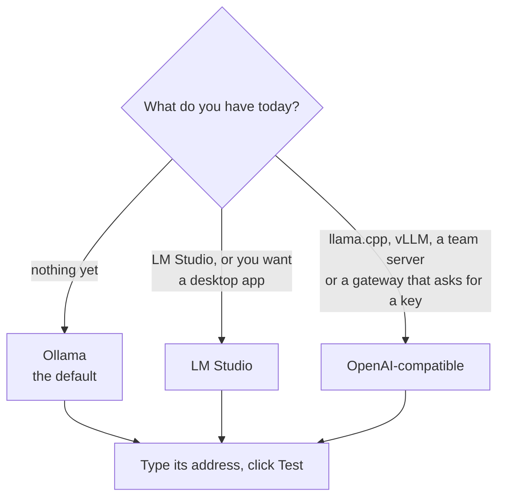
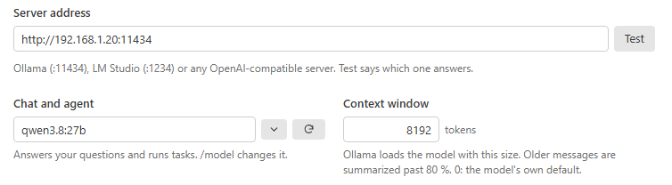

# Providers

Inferpal needs a **model server**: the program that runs the model and answers over HTTP. This page helps you choose
one and connect to it. In short: with nothing installed, take **Ollama**; with a server already running, keep it.

## Choose a server

All three chat, call tools, search your code and complete as you type. What changes is what Inferpal can do around the
model:

- **Ollama** has the full hardware-aware features: `/models` lists, downloads and deletes models, `/hardware` shows the
  memory each loaded model takes, and an idle model can unload by itself.
- **LM Studio** is a desktop app with its own server. `/models` lists and downloads too; a model is deleted in LM Studio,
  and the memory of each model is not reported.
- **OpenAI-compatible** covers generic servers, with an optional **API key**. `/models` has no list or download there:
  you manage the models on the server.

The full comparison is in [What each server can do](#what-each-server-can-do).

## Supported providers

Inferpal talks to a model server over HTTP through a provider abstraction
(`IInferenceProvider`, resolved at startup by `InferenceProviderFactory`). You pick the
provider in **Settings → Server and models**: **Test** names the server that answers and selects its type.

| Provider | `provider` value | Endpoint style | Notes |
|---|---|---|---|
| **Ollama** | `ollama` | `POST /api/chat` (NDJSON) | Default. Full hardware-aware features. |
| **LM Studio** | `lmstudio` | OpenAI `/v1` | Local server; per-model resident VRAM is not reported, so the header shows no VRAM figure, and `/hardware`, `/models` and `/bench` say so instead of printing a figure. |
| **OpenAI-compatible** | `openai-compatible` | `POST /v1/chat/completions` (SSE) | Generic servers (llama.cpp, vLLM, …). Supports an optional **API key** (sent as `Authorization: Bearer …`). |

## Connect Inferpal to your server

  <picture>
    <source media="(prefers-color-scheme: dark)" srcset="assets/features/settings-server-dark.png">
    
  </picture>
   The address, its Test button, and the model the server lists.

1. **Settings → Server and models → Server address** — each server's default: `http://localhost:11434` (Ollama),
   `http://localhost:1234` (LM Studio — a trailing `/v1` is accepted), `http://localhost:9931` (llama-server;
   `8080` in older builds and in its Docker image), `http://localhost:8000` (vLLM), or any other `/v1` base URL (OpenAI-compatible).
2. **Test** — names the server that answers, selects its type and lists its models.
3. **Server type** and **API key** — under *Show advanced settings → Connection*. The key is only
   needed for OpenAI-compatible endpoints that require auth. Once saved, it is masked: **Show** displays it until the
   window closes, **Change** takes a new one (in Visual Studio; VS Code's box is a password field).

## What each server can do

Each provider advertises a `ProviderCapabilities` record; features degrade safely when a
capability is missing.

| Capability | Ollama | LM Studio | OpenAI-compatible |
|---|:---:|:---:|:---:|
| Chat + tool calling | ✅ | ✅ | ✅ |
| Embeddings (semantic search) | ✅ | ✅ | ✅ |
| Inline completions (FIM) | ✅ | ✅ | ✅ (see below) |
| Model management (`/models` list/pull) | ✅ | ✅ | ❌ |
| `/models delete` | ✅ | ❌ (delete it in LM Studio) | ❌ |
| Loaded models (`/models running`, `/hardware`) | ✅ | ✅ | ❌ |
| Per-model VRAM figure (`/api/ps`) | ✅ | ❌ | ❌ |
| `keep_alive` (auto-unload) | ✅ | ❌ | ❌ |

**Inline completions on an OpenAI-compatible server** run with the completion model you choose (Settings ›
Server and models › Autocomplete), never the chat model: on such a server it is often a large one a team shares, and every pause in typing
would ask it.

<b>In detail: how each server is asked for a completion</b>

- The server wraps the code before and after the cursor in the
  model's own fill-in-the-middle tokens; on this server type Inferpal never writes them itself.
- llama-server (recognized by its `/props`) is asked
  through `/infill` — not yet measured on a real llama-server.
- Any other server is asked through `/v1/completions` with
  `suffix`, which Ollama's `/v1` accepts for a model that has a fill-in-the-middle template (measured on Ollama 0.40.4:
  28 of 36 completions right with `qwen2.5-coder:7b`, against 27 through Ollama's own API).
- A server that refuses it —
  vLLM for most models, and Ollama for a model without fill-in-the-middle — is named once in `/diagnostics`, and that
  model gets no inline completion for the next ten minutes: pick a code model the server can complete with, or serve it
  with llama-server.
- A server that ignores `suffix` without a word completes from the code before the cursor only;
  nothing in its answer tells it apart.
- For LM Studio, choose the LM Studio server type: Inferpal writes the
  fill-in-the-middle tokens of the model families it has measured, and sends the code before the cursor alone for the
  others.

> [!NOTE]
> Streaming-pull progress in `/models` is an Ollama feature. Live per-model VRAM and the
> hardware-aware fit-checks rely on Ollama's `/api/ps` + `/api/show`, and so do the `num_ctx`
> advice and the headroom of `/hardware`; other backends have the manual **VRAM budget** (see below).

## Set the VRAM budget

The hardware-aware features (first-run fit-check, `/hardware`, recommended `num_ctx`) need
to know the GPU's **total** VRAM. For a server on this machine with an NVIDIA card, this is
auto-detected via `nvidia-smi`; otherwise set it manually:

- **Settings → Server and models → *Show advanced settings* → Graphics memory** (in GB), or
- `/hardware <gb>` in the chat (e.g. `/hardware 24`).

Run `/hardware` with no argument for the full profile. When live monitoring isn't available
for the backend, Inferpal tells you and falls back to the manual budget for fit-checks.

**Try it**

| Type | What happens |
|---|---|
| `/hardware 24` | Sets the budget to 24 GB |
| `/hardware` | Shows the full profile |

## Connect to a server on another machine

Any provider URL can point at another machine. For a full walkthrough (exposing the host,
firewall, VRAM budget, GPU scheduling) see **[Remote Inference](remote-inference.md)**.

**Next:** [Models](models.md) — which model for which job, what Inferpal does for each, and how to set it up.
