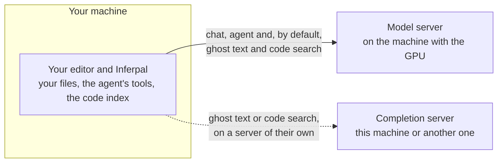
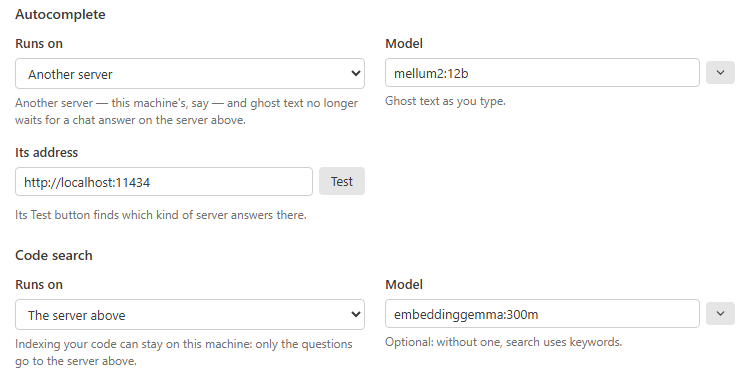

# Remote Inference Guide

Inferpal talks to its model server over plain HTTP, so the server does **not** have to be
the machine running Visual Studio. Pointing the extension at a remote box — a workstation
with a big GPU, a home server, another machine on your LAN — lets you keep Visual Studio
light while a beefier machine does the inference.



<sub>The dashed line is optional: see [Run ghost text or code search on another server](#run-ghost-text-or-code-search-on-another-server).</sub>

This works with **any** provider: **Ollama**, **LM Studio**, or any **OpenAI-compatible**
server. The only thing that changes per provider is *how you expose the server on the
network* and the *default port*. This guide covers both Ollama and LM Studio, points
Inferpal at the host, and explains the one setting you must configure by hand because the
backend can't report it: the **VRAM budget**.

| Provider | Default port | Inferpal Server URL | How to expose on the network |
|---|---|---|---|
| **Ollama** | `11434` | `http://<host>:11434` | `OLLAMA_HOST=0.0.0.0:11434` env var |
| **LM Studio** | `1234` | `http://<host>:1234` (a `/v1` suffix is also accepted) | **Serve on Local Network** toggle in the Developer/Server tab |
| **OpenAI-compatible** | varies | your `/v1` base URL | per-server (llama.cpp `--host 0.0.0.0`, vLLM, …) |

Three steps: [expose the server](#1-expose-the-server-on-the-remote-host),
[point Inferpal at it](#2-point-inferpal-at-the-remote-host),
[set the VRAM budget](#3-set-the-vram-budget-required-for-remote-hosts). In VS Code connected to WSL, SSH or a container,
go to [section 5](#5-vs-code-connected-to-wsl-ssh-or-a-container): `localhost` means something else there.

---

## 1. Expose the server on the remote host

Read the [security note](#security-note) first: this step opens an API with no authentication to everyone who can reach
the port.

### Option A — Ollama

By default Ollama only listens on `127.0.0.1:11434`, which is unreachable from other
machines. Bind it to all interfaces with the `OLLAMA_HOST` environment variable.

**Windows (remote host)**

```powershell
# Set it permanently for the current user, then restart Ollama
setx OLLAMA_HOST "0.0.0.0:11434"
# Quit Ollama from the tray icon and relaunch it, or:
# Stop-Process -Name ollama -Force ; ollama serve
```

**Linux / macOS (remote host)**

```bash
# One-off
OLLAMA_HOST=0.0.0.0:11434 ollama serve

# Persistent (systemd): add to the service unit
#   Environment="OLLAMA_HOST=0.0.0.0:11434"
# then: sudo systemctl daemon-reload && sudo systemctl restart ollama
```

### Option B — LM Studio

LM Studio ships a built-in server that speaks the OpenAI `/v1` wire (plus a native
`/api/v1/*` surface that Inferpal uses for model management and loaded-state). By default
it listens only on `localhost:1234`; you expose it to the LAN with a single toggle.

1. Open LM Studio and switch to the **Developer** tab (the server view).
2. **Load** the model(s) you want to serve (a tool-calling chat model, and optionally an
   embedding model for semantic search).
3. **Start** the server.
4. In the server settings, enable **Serve on Local Network** — this rebinds it from
   `localhost` to `0.0.0.0` so other machines can reach it. Note the **port** (default
   `1234`).

Prefer the CLI? `lms server start` boots the server; enable the *Serve on Local Network*
option in the app (or the app settings) so it binds to all interfaces.

> LM Studio has no `keep_alive` idle-unload, so a loaded model stays resident until you
> unload it or stop the server. That's usually what you want on a dedicated host.

### Open the firewall

Allow inbound TCP on the server's port — `11434` for Ollama, `1234` for LM Studio:

```powershell
# Windows (run as admin on the remote host) — adjust the port per provider
New-NetFirewallRule -DisplayName "Inferpal backend" -Direction Inbound -Protocol TCP -LocalPort 11434 -Action Allow
```

```bash
# Linux (ufw)
sudo ufw allow 11434/tcp   # Ollama
sudo ufw allow 1234/tcp    # LM Studio
```

### Verify from the client machine

From the machine running Visual Studio, confirm the host is reachable (replace the IP):

```powershell
# Ollama
curl http://192.168.1.2:11434/api/tags
# LM Studio (OpenAI-compatible)
curl http://192.168.1.2:1234/v1/models
```

A JSON list of models means you're good.

---

## 2. Point Inferpal at the remote host

1. Open **Inferpal Settings**.
2. On **Server and models**, set **Server address** to the remote address (**Test** selects the
   server type):
   - Ollama → `http://192.168.1.2:11434`
   - LM Studio → `http://192.168.1.2:1234` (a trailing `/v1` is accepted and normalized)
3. Click **Test** — it should name the server and how many models it lists, and the model dropdown should populate
   with the remote host's models.
4. Pick a chat model (and, optionally, a separate code-actions / FIM / embedding model).

Everything else — agent tools, inline completions, semantic indexing — works exactly as it
does locally; the requests just travel over the network.

> **Latency note.** Inline ghost-text completions are latency-sensitive. Over a fast LAN
> this is usually fine; over Wi-Fi or a VPN you may want to raise the completion preset to
> *Accurate* (longer debounce) so fewer in-flight requests are cancelled.

### Run ghost text or code search on another server

Ghost text and code search can each have a server of their own: the chat on a team server, ghost text on this machine,
for example.

<p align="center">
  <picture>
    <source media="(prefers-color-scheme: dark)" srcset="assets/features/settings-runs-on-dark.png">
    
  </picture>
  <br><sub>Ghost text on this machine, code search on the chat's server.</sub>
</p>

1. On **Server and models**, under **Autocomplete** or **Code search**, set **Runs on** to **Another server**.
2. Type **Its address** and click **Test**: it finds which kind of server answers there.
3. Pick the **Model**: one that server has, since the chat's is not there to fall back on.

- Its kind and its key are under **Connection**, with the advanced settings. That server gets its own key, never the
  chat's.
- Ghost text on another machine than the chat's no longer waits for a chat answer to finish; on the chat's machine,
  under any of its names or addresses, it still does, the graphics card being one.
- Code search can also run on **The autocomplete server**. With a server on this machine, indexing your code stays here
  while the chat answers on a team server.

---

## 3. Set the VRAM budget (required for remote hosts)

Neither backend reports the GPU's **total** VRAM over the network. Ollama exposes how much
VRAM each *loaded* model currently uses (`/api/ps`) but has no total-VRAM endpoint; LM
Studio reports loaded-state but not a per-model GB figure either. On a **local** host
Inferpal auto-detects the total via `nvidia-smi`; on a **remote** host that probe can't
run, so the total is unknown unless you tell it — regardless of provider.

The VRAM budget powers three things:

- the **fit-check** that warns on first run when the auto-picked chat + embedding models
  won't fit together,
- the **recommended max `num_ctx`** shown in `/hardware` (computed from the model's exact
  KV-cache cost), and
- the overflow warning when your configured `num_ctx` exceeds what the budget allows.

Set it either way:

- **Settings → Server and models → *Show advanced settings* → Graphics memory** — enter the remote
  GPU's total VRAM in GB (e.g. `24`).
  Leave it empty to keep auto-detection (local hosts only).
- **`/hardware <gb>`** in the chat — e.g. `/hardware 24`. Persists to config immediately.

Then run **`/hardware`** with no argument to see the full profile: budget, currently loaded
models, headroom, per-model VRAM estimates, and the context-window recommendation (headroom and
the recommendation need Ollama).

**Try it**

| Type | What happens |
|---|---|
| `/hardware 24` | Sets the budget to 24 GB |
| `/hardware` | Shows the full profile |

> The budget is a hint used for advice only. It never caps or overrides your settings —
> Inferpal will not stop you from running a large `num_ctx`, it just warns when the
> KV-cache is likely to spill into system RAM and slow generation.

---

## 4. Why the chat comes first on a shared server

A remote host is typically a **single backend** (one Ollama or one LM Studio server) shared
by everything Inferpal does: chat/agent requests, background RAG indexing, `@Docs`
embedding, and inline completions. To stop background work from starving the interactive
model, Inferpal routes all of it through a central GPU scheduler:

- a chat/agent run takes a lease for its whole duration;
- RAG and `@Docs` embedding loops and `/task` wait while a chat/agent run holds the lease — in
  any Inferpal process on the machine — and resume right after; a run waiting on an approval
  card lets the lease go until it is answered;
- inline completions yield via an IPC busy-signal so they
  don't compete with an active chat.

The practical effect: the interactive model always loads first and you never wait 30
minutes for a prompt because indexing monopolised the remote GPU. This is provider-agnostic
— it applies whether the remote backend is Ollama or LM Studio.

---

## 5. VS Code connected to WSL, SSH or a container

With **Remote - WSL**, **Remote - SSH**, **Dev Containers** or a tunnel, VS Code runs Inferpal **on the other side**,
next to your files, with the extension's package for that machine.

- Packages exist for **Linux x64**, Windows x64 and
  macOS on Apple silicon: an ARM Linux machine or container (a Dev Container on an Apple-silicon Mac, an ARM server) and
  Alpine-based images (musl) have none, and Inferpal does not start there.
- Measured from WSL (Ubuntu, x64): the engine
  starts, reaches the model servers and completes code in about the time it takes from Windows (1.3 s against 1.1 s, same
  server and model).

What changes is **`localhost`**: on the other side it means WSL, the SSH server or the container — not the computer you
sit at. A server you started on your computer is therefore not at `http://localhost:11434` for Inferpal. When a local
address does not answer, Inferpal says where it runs and what to do; the first launch says it too, and from a container
it also looks at `http://host.docker.internal`.

| Connected to | A server on your computer answers at | What to set |
|---|---|---|
| **WSL**, mirrored networking | `http://localhost:11434` | nothing — `localhost` is shared with Windows; if it does not answer, the server is not started |
| **WSL**, default (NAT) networking | not at `localhost` | turn on mirrored networking (Windows 11 22H2 or later): `networkingMode=mirrored` under `[wsl2]` in `%UserProfile%\.wslconfig`, then `wsl --shutdown` — or set the URL to Windows' address and make the server listen on it (Ollama: `OLLAMA_HOST=0.0.0.0`, plus the firewall rule of section 1) — or run the server inside WSL |
| **SSH** | only through a tunnel | run the server on that machine, or set the URL of a server it can reach, or bring yours to it with a reverse tunnel: `ssh -R 11434:localhost:11434 <that machine>` (then `http://localhost:11434` works there — for everyone on that machine) |
| **A VS Code tunnel, Codespaces** | not from there | run the server on that machine, or set the URL of a server it can reach |
| **A container**, Docker Desktop | `http://host.docker.internal:11434` | that URL; the server needs no change |
| **A container**, Docker Engine on Linux | `http://host.docker.internal:11434` once the container knows that name | add `--add-host=host.docker.internal:host-gateway` to the container's run arguments (`runArgs` in `devcontainer.json`) and make the server listen beyond 127.0.0.1 (Ollama: `OLLAMA_HOST=0.0.0.0`) |

A team server reached by its name or address (`https://llm.example.com`) needs nothing: it is the same address from
both sides. Visual Studio has no remote mode for extensions — Inferpal always runs on the machine you sit at.

---

## Troubleshooting

| Symptom | Likely cause / fix |
|---|---|
| **Test** fails / Send button greys out | Host not reachable. For Ollama re-check `OLLAMA_HOST=0.0.0.0`; for LM Studio confirm **Serve on Local Network** is on. Re-check the firewall rule and the IP/port. Confirm with `curl http://<host>:11434/api/tags` (Ollama) or `curl http://<host>:1234/v1/models` (LM Studio) from the client. |
| Connects but no models listed | The server is running but no model is available. Ollama: `ollama pull <model>` on the host. LM Studio: **load** a model in the Developer tab. |
| `/hardware` shows "VRAM budget: not set" | Expected on a remote host with either backend — set it manually (section 3). Auto-detection only works on loopback. |
| First completion is slow, then fast | Cold model load on the remote host. With Ollama the model stays resident per its `keep_alive`; with LM Studio it stays resident until unloaded. Subsequent calls are fast. |
| LM Studio: model unloads itself unexpectedly | Check the app's auto-unload / JIT settings; LM Studio can evict idle models depending on configuration. |
| AMD GPU: driver crashes or corrupted output | Some ROCm builds are unstable on certain AMD cards. Check your backend's GPU / AMD documentation for supported cards, and keep both the backend and the GPU driver up to date. |
| Behind a corporate proxy: the message says the request "goes through the proxy" | Inferpal uses the system proxy (`HTTP_PROXY` / `HTTPS_PROXY`, otherwise the Windows proxy settings), and a proxy usually cannot reach a server on your own network. Add the server's address to `NO_PROXY` (an exact host or IP: a CIDR range such as `192.168.1.0/24` is not understood), or to the proxy exceptions in Windows, then restart the editor so it reads the variable again. A server on this machine (`localhost`, `127.0.0.1`) never goes through a proxy set by these variables. |

---

## Security note

Binding a backend to `0.0.0.0` exposes an **unauthenticated** inference API to everyone who
can reach that port — neither Ollama nor LM Studio has built-in auth on the local-network
server. Only do this on a trusted private network. To expose it beyond the LAN, put it
behind a reverse proxy that adds TLS and authentication (then use the OpenAI-compatible
provider with an **API key** if the proxy expects a bearer token), or tunnel it over a
VPN / SSH rather than opening the port to the internet.

**Next:** [Models](models.md) — which model for which job, what Inferpal does for each, and how to set it up.
