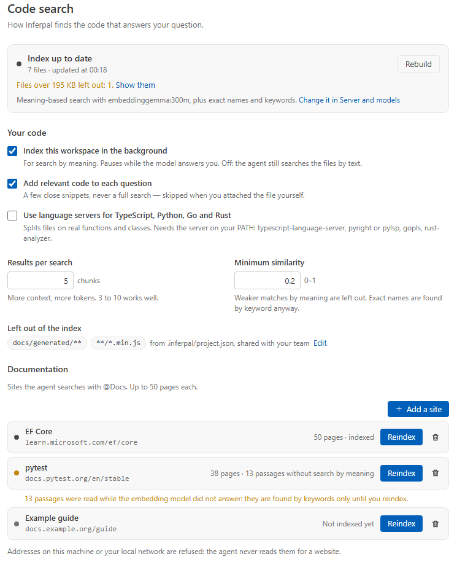
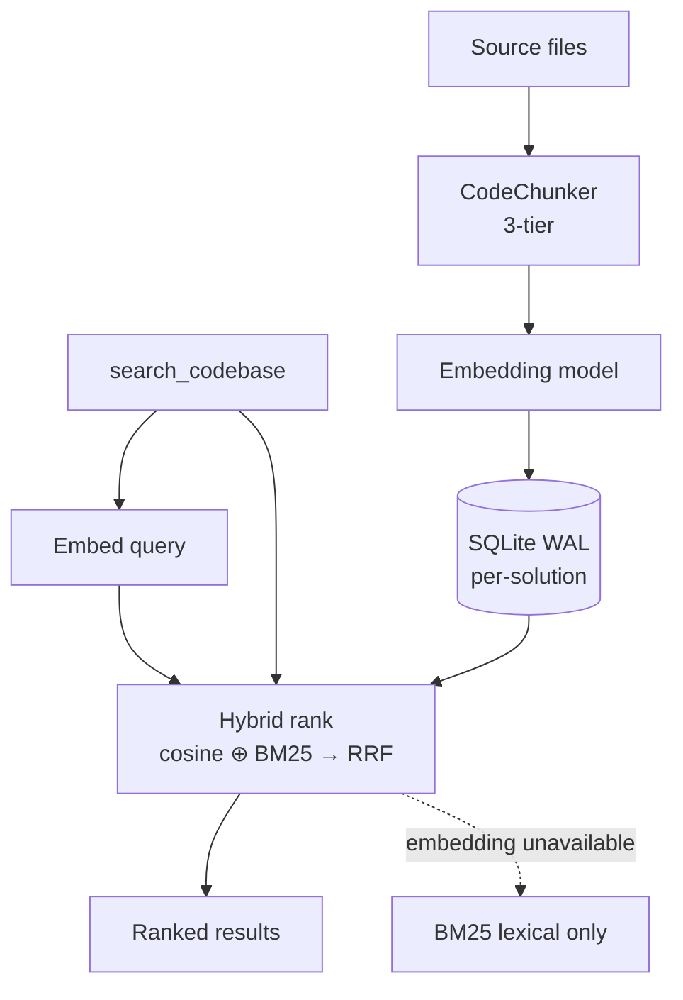

# Search & Indexing

Find code by describing it, and let the agent answer from the documentation of the libraries you use. This page shows
how to search, what you get while you type, and how the indexes stay up to date.

Inferpal builds two semantic indexes that share one embedding engine: a **per-solution code
index** (`search_codebase`) and a **global external-documentation index** (`search_docs`,
the `@Docs` feature).

<p align="center">
  <picture>
    <source media="(prefers-color-scheme: dark)" srcset="assets/features/settings-search-dark.png">
    
  </picture>
  <br><sub>The index, what it leaves out, and the documentation sites the agent can search.</sub>
</p>

## Find code by describing it (semantic search, RAG)

The agent (and you, via `/search-code`) can find code by describing it in plain language:

```
search_codebase "authentication token validation"
search_codebase "database retry with exponential backoff"
```

**Try it**

| Type | What happens |
|---|---|
| `/search-code retry with exponential backoff` | The matching code, with file paths and line numbers |
| `/index` | The index status: chunks, root, embedding model |
| `/index rebuild` | A full rebuild of the index |

Results are ranked by **hybrid search** — semantic cosine similarity *and* lexical BM25, fused
with Reciprocal Rank Fusion — and include file paths and line numbers. The lexical side catches
exact identifiers, symbol names, and file names that weak local embeddings tend to dilute.

The report says which halves produced it — `semantic`, `hybrid` or `keyword` — and shows a
`score` only on results the semantic half ranked, since a BM25 score is not on the same scale as
a cosine similarity.

### What you get while you type

- **Shadow pre-warm**: while you type, results are pre-fetched (debounced) so the tool responds
  instantly.
- **Smart Auto-attach** suggests the top-2 relevant files as dismissable chips before
  you send — in Visual Studio with a 🔮, in VS Code dashed and named with the lines they span; a
  chip holds the file's best passages, and says which lines when that is not the whole file.
- **Auto-context** (`ragAutoContextEnabled`, default on): each code-related turn silently
  injects the most relevant chunks for your message into the prompt — budget-capped and
  deduplicated against anything already attached. Reuses the warm shadow result when available,
  so it is usually free; it still works when you send before the chips fire. It needs an
  embedding model.

### How the index stays up to date

- Indexing runs in the background and **persists** across restarts.
- A `FileSystemWatcher` re-indexes changed files with a 5 s debounce.
- `/index` shows the index status; `/index rebuild` forces a full rebuild.
- Indexing automatically **pauses while a chat/agent request runs** — in this editor or in another
  one on the same machine — and resumes right after: the interactive model always gets the GPU first (see
  [Architecture → GPU scheduling](architecture.md#gpu-scheduling)).

### Supported file types

`.cs` `.ts` `.tsx` `.js` `.jsx` `.py` `.go` `.java` `.cpp` `.c` `.h` `.hpp` `.rs` `.fs`
`.razor` `.vue`

### Settings

`ragEnabled`, `ragAutoContextEnabled`, `ragEmbeddingModel` (empty = the best embedding model installed, or keywords
only), `ragTopK`, `ragSimilarityThreshold`, `lspEnabled` — see
[Configuration](configuration.md#rag--semantic-index).

The embeddings can run on another server than the chat's — `ragEmbeddingRunsOn`: the autocomplete server, or one of its
own (*Code search › Runs on* on the *Server and models* page). Indexing your code then stays on this machine
while the chat answers on a team server; both the index and the questions against it are embedded there, with that
server's key, and an index on another machine than the chat's does not pause while a chat answers.

### How it works



<details>
<summary><b>In detail: chunking, storage, ranking, resilience</b></summary>

- **3-tier chunking** (`CodeChunker`): Roslyn for C# (syntax tree + XML docs), an optional
  LSP tier for TS/JS/Python/Go/Rust (`lspEnabled`), and a regex fallback. Target ~500 tokens
  per chunk with ~100 tokens overlap.
- **Vector store** (`RagDatabase`): SQLite WAL, one database per solution under
  `%LocalAppData%/Inferpal/rag/{hash}.db` on Windows, so it does not travel with a roaming profile
  (`~/.config/Inferpal/rag/` on Linux, `~/Library/Application Support/Inferpal/rag/` on macOS). In-memory map for
  O(1) per-file access. An index from an earlier version is copied there at the next start and nothing is built
  again; the old copy goes after 14 days without a write.
- **Hybrid ranking**: the vector side keeps chunks above `ragSimilarityThreshold` (default
  `0.20`); the lexical side scores chunks with in-memory BM25 (code-aware tokenizer that splits
  camelCase / snake_case / acronyms and keeps whole identifiers). The two rankings are fused
  with **Reciprocal Rank Fusion**, returning `ragTopK` chunks (default `5`). When embeddings are
  unavailable, lexical BM25 alone is used.
- **Resilience**: an embedding **circuit breaker** opens after repeated failures and recovers
  automatically.

</details>

## Search a library's documentation (@Docs)

Index an external documentation site so the agent answers library/framework questions from
the docs themselves, citing the source page and URL.

**Try it**

```
/docs add https://react.dev/learn "React"
/docs list
/docs remove react
/docs reindex
```

- **Crawl**: `/docs add` crawls the site **same-domain** (following links under the start
  URL's path), capped at 50 pages / depth 3, reusing the HTML-to-text converter and the same
  SSRF guard as `fetch_url`.
- **Chunk & embed**: each page is sliced into ~500-token windows and embedded in the
  background (progress shown as chat bubbles). A page that arrives as one long block — a single
  `<p>`, a `<pre>` dump — is cut at word boundaries like any other.
- **Holes are counted**: if the backend goes down mid-crawl, the pages already fetched are kept
  without their vectors, which puts them out of reach of the semantic half of the search. Nothing
  recomputes them on its own, so `/docs list` and `search_docs` say how many there are and name the
  remedy (`/docs reindex <id>`).
- **Storage**: a single **global** SQLite database at `%LocalAppData%/Inferpal/docs/docs.db` on Windows
  (beside the code index on Linux and macOS), so a site you index once is available across every solution.
- **Retrieve**: the `search_docs` tool runs the same hybrid search as the code index (cosine ⊕
  BM25 over the text, the page title and the URL, fused by RRF — BM25 alone when embeddings are
  unavailable) and cites the page title and URL.

Embeddings reuse the configured `ragEmbeddingModel`. Manage `@Docs` with `/docs` or *Settings → Code search →
Documentation* (sources persist in `docSitesJson`).

**Next:** [Rules & AI Checks](rules-and-checks.md) — tell the model how your repository works, and review changes against
your own criteria.
