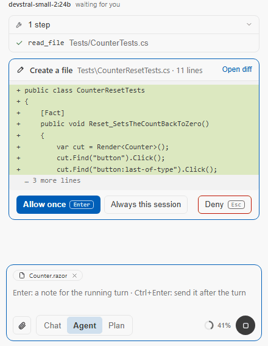
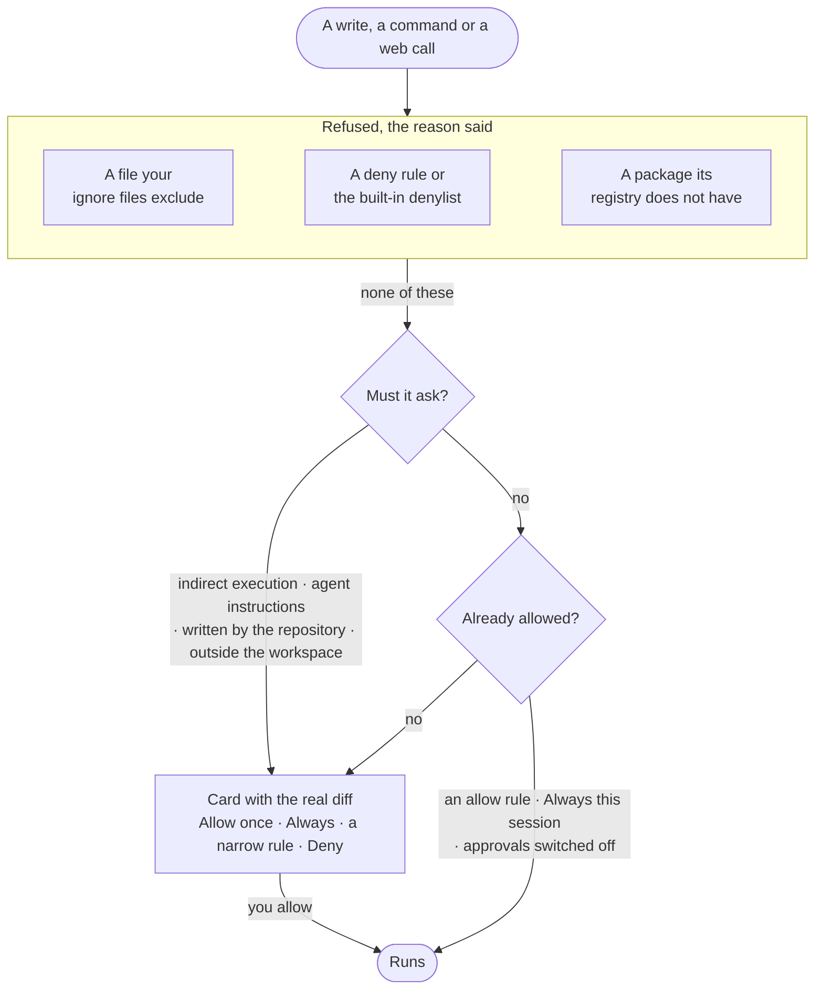
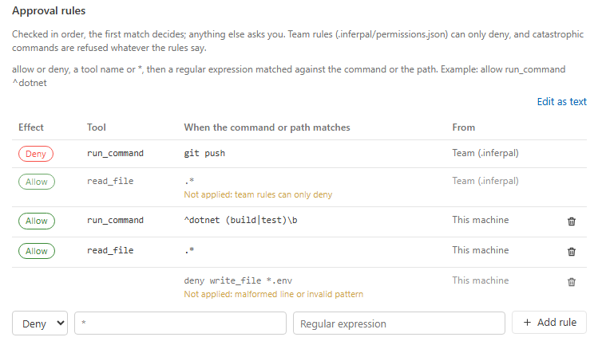

# Tools

This page shows what the agent can do on your machine and what it must ask you first. In short: reading never asks; a
write, a command or a web call waits for your answer on a card, unless a rule of yours already decides.

The agent completes tasks by calling tools. There are **43 built-in tools**, plus any
**user-defined shell tools** and any tools exposed by connected **[MCP](mcp.md) servers**.

## What the agent can do, and what asks first

| To | It calls | Does it ask? |
|---|---|---|
| Read, search, analyze | `read_file`, `ocr`, `search_in_files`, `search_codebase`, `analyze_code`… | Never |
| Change files | `write_file`, `apply_diff`, `apply_edits`, `rename_symbol`, `delete_file`… | Yes, and shows the change |
| Run a command | `run_command` | Yes |
| Build and test | `get_diagnostics`, `run_tests`, `msbuild_property` | The first time in a workspace |
| Go online | `fetch_url`, `web_search` | Yes |
| Call an app or API it runs | `http_request` | Yes; for a local address, once per address if you answer *Always* |
| Look at the page it builds | `view_page` | Not for the app it started itself, nor an HTML file of the workspace; another address of this machine, once — the same agreement as `http_request` |
| Use the page it builds (click, type, choose) and capture the state reached | `interact_page` | Not for the app it started itself, nor an HTML file of the workspace; another address of this machine, once (*Always* for that address) |
| Look at the desktop app it launched | `view_window` | Never: you agreed to the launch |
| Use the debugger | `get_debugger_state`, `debug_control`, `debug_inspect` | To start your program, and to evaluate an expression |
| Use tools you added | [Custom shell tools](#custom-shell-tools), [MCP tools](#mcp-tools) | Yes |

Each tool and its parameters: **[Built-in tools](#built-in-tools)**.

## Approval model

Tools that touch the filesystem, run commands, or reach the network are gated by an approval
card:

> **Allow once** · **Always this session** · **Always: *the narrow rule*** · **Deny**

<p align="center">
  <picture>
    <source media="(prefers-color-scheme: dark)" srcset="assets/features/agent-approval-dark.png">
    
  </picture>
  <br><sub>The card shows the change itself, in the chat, before anything is written.</sub>
</p>

- Default action is *Allow once*; dismissing the prompt denies the call.
- "Always this session" allows that tool **for this session, in this workspace** — it is never written to disk, and
  opening another folder or solution asks again.
- A **forced** card offers only *Allow once* and *Deny*: a command whose text cannot be read for what it runs, a write to
  the agent's own instructions, a write in `.git`, a command outside the workspace, and — once you have declined to run
  the workspace's own code — a build or a test the model starts through the shell (`dotnet test`, `pytest`, also inside
  `cmd /c` or `bash -c`). The next identical call asks again anyway, so "Always" would grant nothing; an editor that still
  sends it gets a one-time *Allow*. Recognising builds and tests is a list of runners, not a boundary: `dotnet run` or
  your own build script still get the ordinary card.
- For file edits (`write_file`, `apply_diff`, `apply_edits`, `delete_file`), the prompt shows
  the **actual diff** so you confirm the change, not just a path.

<details>
<summary><b>In detail: every tool that asks, and why the web ones do</b></summary>

- Gated tools: `write_file`, `apply_diff`, `apply_edits`, `replace_in_files`, `edit_notebook`, `delete_file`,
  `run_command`, `rename_symbol`, `restore_file`, `update_memory`, `insert_at_cursor`, `replace_selection`,
  `fetch_url`, `web_search`, `http_request`, `view_page`, `debug_control` `start` and a breakpoint with a `condition` or `log`, `debug_inspect` `evaluate`, custom shell
  tools, and every MCP tool call. `get_diagnostics`, `run_tests`, `msbuild_property` and `run_notebook` run the
  repository's own code: they ask once per workspace.

`fetch_url` and `web_search` are gated because they are the outbound channel of the *lethal
trifecta*; `fetch_url` additionally passes a hardened SSRF guard (IPv4-mapped IPv6, `0.0.0.0/8`,
loopback/private ranges, the resolved address checked too — best-effort against DNS rebinding, the approval card
being the boundary — with a ReDoS-safe timeout).

`http_request` asks on every call. For a local address (`localhost`, `127.0.0.1`, `::1`) *Always* opens that address
and port only — another local port is asked again — and the connection itself is held to this machine. Any other
address, your local network included, is asked call by call with no *Always*, unless one of your own rules names it in
full: `allow http_request ^GET https://staging\.example\.com:443$` (the rule reads `METHOD scheme://host:port`, and
must match all of it). No redirect is followed, and headers that would reroute the request (`Host`, `Upgrade`,
`Proxy-*`…) are refused.

`view_page` opens a page of this machine in a browser whose network is cut, and its scripts run — they may call your
app as a request would. The pages of an app the agent started itself, and the HTML files of the workspace, are its own
work: no card. Any other address asks like `http_request`, and an *Always* given to one tool for a local address
covers the other.

`interact_page` asks nothing in the pages of an app the agent started itself (a background job of `run_command`) or in
an HTML file of the workspace: that is its own work, and each step it plays is in its result. Any other address of this
machine is another app of yours — a notebook that runs what is typed in it, an admin page — and asks once, *Always* for
that address. Either way the browser is fresh and reaches nothing but the page's own address. A `deny interact_page
<regex>` rule (it reads `GET scheme://host:port`, as for `http_request`, or the file's path) keeps it away from an app.

</details>

### How a call is decided

Every write, command or web call passes the same checks before it can happen.



**Try it**

| Type | What happens |
|---|---|
| `/permissions` | Every rule, in the order it is evaluated, the built-in denylist included |
| `/permissions suggest` | The narrow rules you granted three times and never refused; `/permissions add <n>` saves one |

A file the workspace's ignore files exclude (`.aiignore`, `.cursorignore`… — `ignoreFiles` in
[Configuration](configuration.md)) is neither read nor changed by any tool: a call that names it is refused before it
runs, with the ignore file, the line and the pattern; a walk (`list_files`, `search_in_files`, the analysis) skips it and
says how many files it skipped, above its result.

### Approve a kind of call for good

**Always: …** — when one narrow rule describes the call, the card offers it beside "Always":
*commands that start with `dotnet test`*, *writes under `tests/`*. Picking it writes that rule
to the per-machine **Permission rules** setting (the button's tooltip shows the exact lines), says
so in the conversation, and the calls it covers are then approved without a card — after a
restart too, and in the other editor.

`/permissions` lists it; the settings remove it. An ACP client shows it as one more option.

`/permissions suggest` lists the narrow rules you granted at least three times and never
refused — counted per rule in `approval-history.json`, beside the settings: the prefix or the
folder, never the whole command; a card retired with a stopped run is not a refusal — in the
order they were first counted, and `/permissions add <n>` writes one, named in its reply.
Nothing is written otherwise. A rule is suggested only as a card would offer it now, in this
workspace.

<details>
<summary><b>In detail: what a narrow rule covers, and when none is offered</b></summary>

- A **command** rule covers one command that starts with the same program and subcommands
  (`dotnet test`, `git log`, `npm run build`, `python -m pytest`, `npx eslint`), with any
  arguments that keep it one command: no chain, pipe, substitution or redirection —
  `dotnet test && rm -rf src` still has its card.
- ⚠ The rule does not read the options: one that writes elsewhere or runs a program (`git diff --output=…`, `dotnet
  build -o …`) is covered like any other, as with any prefix rule. Pick it for the commands you would approve with
  whatever options the agent adds.
- A **write** rule covers the folder of the file — of every file of the change, when they share
  one — and what is under it, for `write_file`, `apply_diff` and `apply_edits`; never the
  workspace root, a folder outside the workspace or reached through a link, nor any folder
  whose name starts with a dot (`.inferpal/`, `.git/`, `.github/`, `.vscode/`: settings, hooks
  and workflows run later). Instruction files under it keep their card.

None is offered for:

- a program that runs whatever it is given (`python script.py`, `node`,
  `bash`, `pwsh`, `cmd`, `npx` without a package, `npx tsx`, `uv run`, `docker run`, `sudo`,
  `find`, `sed`…)
- a program that deletes, overwrites, moves or reaches another machine (`rm`,
  `del`, `mv`, `cp`, `tar`, `chmod`, `curl`, `ssh`…)
- a subcommand that rewrites history, throws work away, installs or publishes, or changes what later commands run
  (`git push`, `git reset`, `git checkout`, `npm install`, `pip install`, `npm exec`, `npm publish`, `git config`…)
- a subcommand whose own subcommands the arguments would choose (`git stash`
  covers `git stash drop`, `dotnet nuget` covers `dotnet nuget push`)
- a program alone that needs its subcommand to say what it does (`dotnet`, `git`, `npm`…)
- a first word that is not a program name (a quoted path, `FOO=1 …`)
- a call whose prompt is forced (instruction files, indirect execution, a repository's own commands)

</details>

### When an edit is refused

- An edit that would **leave a syntax error** (`write_file`, `apply_diff`, `apply_edits`) is refused
  before the prompt, and the model is told the file, the line and the error:
  - C# by the compiler's parser (your project's symbols aside),
  - Razor by its braces,
  - Python by the Python of the environment you activated, else the first on your PATH (never a
    `.venv` found in the repository, which this check would run before your approval),
  - `.mjs` and `.cjs` files by `node --check`.

  Only an error the file did not have is refused, never one the
  code only shows once compiled (a type not found yet). A file that did not parse before, a `.js`
  file (whether it parses depends on your project: modules, JSX), and a check that cannot run (no
  Python or Node, past 5 seconds) let the edit through. The same edit sent again after its refusal
  is written: the check may not know a language version your project uses.
- An `apply_diff` or `apply_edits` edit that would **leave lines twice** is refused before the
  prompt: the model matched a part of the file in `old_content` but sent back more in `new_content`
  — typically the whole page for one paragraph of it. The replacement's first lines are the file's
  first lines or the lines just before the matched text, its last lines are the file's last lines or
  the lines just after, or it adds back most of what stays around it. The model is told which lines
  and what to send instead (the matched part only, or the whole file with `write_file`). Lines that
  hold no word (closing braces) do not count, nor what the matched text itself starts or ends with.
  In a conversation, the same edit sent again is written — some code does repeat — and the model
  can be refused for a copy and a syntax error at once, then write the edit at its first resend.
- A file with **unsaved changes** in the editor is never written over, in Visual Studio as in VS
  Code: the edit is refused before the prompt, and checked again after you approve — so what you
  type while the prompt waits is kept. Save the file and ask again. `read_file` shows the unsaved
  text.
- A file **saved** while the prompt waits (by you, by auto-save, by another program) is not
  written over either: the approved change was computed from the file as it was, so it is
  refused and the agent is told to read the file again.
- A **generated** file is never edited by hand (`write_file`, `apply_diff`, `apply_edits`): one
  with an `<auto-generated>` header (XAML and Razor `*.g.cs`, `Resources.Designer.cs`, Entity
  Framework migration metadata and model snapshots, gRPC code) is refused before the prompt,
  naming where the change goes — its `.xaml`, `.resx` or `.proto`, a source generator's input, a
  new migration.
  - A migration's own `Up`/`Down` file is written by hand and stays editable.
  - A Windows Forms `*.Designer.cs` goes to a card that warns, and that no rule or "always" approves: removing a
    handler that no longer exists is fixed there, a change to the form belongs in the designer.

### Permission rules (allow / deny by pattern)

Before the prompt, each call is classified by **permission rules** so an agent can run
unattended without either prompting on every step or opening the door to anything:

```
allow run_command ^\s*(dotnet|git|npm|cargo|go)\b   # auto-approve common dev commands
deny  run_command (Remove-Item|rm\s+-rf)            # block these outright
allow write_file \.(cs|ts|js|py)$                   # auto-approve edits to source files
deny  * \.env$                                       # never write secrets (reads: .inferpalignore)
```

<p align="center">
  <picture>
    <source media="(prefers-color-scheme: dark)" srcset="assets/features/settings-rules-dark.png">
    
  </picture>
  <br><sub>The approval rules in the settings: each says where it comes from, and a rule that does not apply says why.</sub>
</p>

- Format: `allow|deny <tool|*> <regex>`, one per line. The regex is matched against the raw
  command / file path. **First match wins.** A `#` after whitespace starts a comment, as above
  (to match a literal space then `#`, write `\s#`).
- `allow` auto-approves (no prompt); `deny` blocks the call outright (recorded in
  `/diagnostics`); no match falls back to the prompt. A `deny` also matches the file a path
  reaches. A command run outside the workspace and a write under `.git/` always ask.
- Rules judge the calls that ask for approval — writes, commands, fetches, MCP tools. **Reading never asks**, so a
  `deny` rule does not hide a file from `read_file` or a search: to keep a file away from every tool, reads included,
  list it in `.inferpalignore` (or another ignore file).
- A `run_command` line is judged **command by command** (`;`, `&&`, `||`, `|`, `&`): it is
  auto-approved only when every command on it is allowed, and denied when any one of them is —
  `git status; Remove-Item -Recurse src` is not approved by a rule written for `git`. A line with
  `$(…)`, a grouping or a redirection is never auto-approved.
- Sources, evaluated in order: the committable workspace overlay `.inferpal/permissions.json`
  (`{ "rules": ["deny …", …] }`), then the per-machine **Permission rules** setting — where the
  narrow rule an approval card offers is written.
- **The workspace overlay can only restrict, never grant.** It ships inside the repository, so
  `allow` rules found there are ignored (and recorded in `/diagnostics`): a cloned project must
  never be able to switch off your approval prompt. Only the per-machine setting can
  auto-approve. `deny` rules from the overlay are honoured — a project tightening its own
  restrictions is always safe.
- **Writing the overlay or an ignore file always asks**, even after "Always": a rewrite
  that empties one lifts every restriction it held.
- **An overlay that exists but cannot be read is not an empty one.** Held by another program,
  denied to you, or not valid JSON: the deny rules last read from it stay in force; if none was
  ever read, every action asks you before it runs (no `allow` rule, "Always" or switched-off
  approval skips it), you are told once in the conversation, and an `@url` is not fetched. Once
  the file reads again, its rules apply.

<details>
<summary><b>In detail: the built-in denylist, and the calls that always reach the card</b></summary>

- A built-in denylist of catastrophic shell commands (recursive root deletes, disk
  formatting, fork bombs, …) always applies — even with approvals switched off. It is an
  **accident guard, not a security boundary**: it matches submitted text, so obfuscation
  defeats it by construction. The actual boundary is the approval prompt, where the raw
  command is visible.
- **Force-prompt** on indirect execution — PowerShell (`iex`, `-EncodedCommand`,
  `FromBase64String`, `[scriptblock]::Create`, `& $var`) and POSIX (`eval`, piping into a
  shell, `base64 -d`, `sh -c "$var"`, `source`/`exec` on a variable) alike: what runs is
  not the text the rules read, so no auto-approval path applies (allow rule, session grant,
  approvals switched off) — the call is never blocked, it simply always reaches the
  approval prompt.

</details>

See **[Configuration → Permission rules](configuration.md)**.

> [!NOTE]
> Unticking *Ask me before changing files, running commands or going online* (Settings → Agent and approvals) auto-approves the calls that
> would otherwise prompt. The built-in catastrophic-command denylist still applies.

### Packages that do not exist

Local models invent package names — a plausible `Apache.Parquet`, `ibantools` on PyPI.

Before the card, a package a call **adds** — `dotnet add package`, `npm install <name>`, `pip install <name>`, `uv
add`, or a dependency that `write_file`, `apply_diff` or `apply_edits` writes into a `.csproj`,
`Directory.Packages.props`, `package.json`, `requirements*.txt` or `pyproject.toml` — is looked up on its **public
registry**: nuget.org (and the local package folders NuGet is configured with) through `dotnet package search`, the
npm registry through `npm view`, PyPI directly.

A name the registry does not have is **refused before you are asked**, and the model reads the names that do exist
(*Packages that exist with close names: pdf-lib, …*).

- **Only public registries are ever sent a name.** The lookup happens before the card, and the name is the model's, so
  it never goes to a server a configuration chose.
- Untick *Check that a package exists before it is added* (Settings → Agent and approvals) to send nothing: every such
  call then goes to the card unchecked.

<details>
<summary><b>In detail: what lets a call through unchecked, and what is never checked</b></summary>

- Each tool is first asked offline which sources apply (`dotnet nuget list source`, `npm config get registry`, the
  yarn and bun files, the pip and uv configuration — in the workspace and above it, up to its git repository's
  root): a project or a machine that restores from another source — a company feed, a scope registry, a private
  index — is not checked at all, and its calls go to the card as before.
- Only a certain "absent" refuses. The call goes to the card unchecked, and `/diagnostics` keeps why, for:
  - a registry that does not answer, a tool that is not installed, a lookup slower than 20 seconds
  - a command that picks its own source (`--index-url`, `--registry`, `--source`) or changes it (a `PIP_*` or
    `npm_config_*` variable, `dotnet nuget add source`, `npm config set`)
  - a call that also writes a source (`nuget.config`, `.npmrc`, an `--extra-index-url` line, MSBuild `RestoreSources`)
  - what the project serves itself (an npm, pnpm or uv workspace package, `[tool.uv.sources]`, its own name)
- A command is asked from where it runs, with the session's environment: a `cd` or a variable set by an earlier
  `run_command` counts, and so does the project it names (`dotnet add src/App.csproj package`, `npm --prefix web`).
- NuGet's search leaves out unlisted packages and lags behind new ones: an absent name is confirmed on the package's own
  nuget.org index. Prerelease-only packages count as existing.
- Names only: a version that does not exist is reported by the restore itself, and the model repairs it.
- Not checked: a write at the editor's cursor (`insert_at_cursor`, `replace_selection`), your own shell tools, MCP tools,
  and a command you type yourself (`/run npm install …`) — you know whether the name exists. Nor a call your
  [permission rules](#permission-rules-allow--deny-by-pattern) refuse: the rule decides first, and no name leaves.
- A network share among NuGet's sources (`\\server\feed`) counts as a server: the project is not checked.

</details>

## Custom shell tools

Expose your own shell commands as agent tools in **Settings → Tools and MCP servers → Your agent
tools**, one per line:

```
name=command
```

Each becomes a native tool (lower-cased, spaces → `_`) and goes through approval; a call whose arguments add a command (`;`, `|`, `$(…)`) always asks, even after "Always". It runs in the
workspace root.

Write `{args}` where the agent's arguments go (`run_e2e=npm run test:e2e -- {args}`); without it, they are appended
to the command. Built-in tools take priority over a custom tool with the same name, and `context_compact` and `ooda_recap` are taken
by the chat's own notices; prefix a line with `#` to
disable it.

## Turning a tool off

Every tool's definition goes with every request, before the first word of the answer: the built-in ones alone take more
than half of an 8K window.

`/tools` lists every tool with what its definition weighs and what the next request does
with it — sent, on demand, turned off; `/tools off <tool>` turns one off in every conversation, `/tools on <tool>` turns
it back on, and the **Tools** page of the settings has a button per tool.

A built-in or custom tool is named by its own name (`run_command`), an MCP tool as `server/tool` (its name without
the prefix is accepted when one server only has it). The list is the `disabledTools` setting.

- A tool turned off is never offered to the model and counted nowhere (the context gauge, X-Ray, the tenth of the window
  MCP tools may take). If the model calls it anyway, from memory, the call is refused and not run, and the answer names
  `/tools on`. X-Ray names the tools turned off.
- Only the model loses it: your own commands that use the tool — `/diff`, `/git`, `@problems`, `/tdd`'s test run — keep
  working.
- `/tools off` and `/tools on` without a name still switch tool calling for the current conversation only.

**Try it**

| Type | What happens |
|---|---|
| `/tools` | Every tool, with what it weighs and what the next request does with it |
| `/tools off web_search` | The model no longer gets `web_search`, in any conversation |
| `/tools on web_search` | It gets it back |

<details>
<summary><b>In detail: tools that cannot be turned off, and tools not served here</b></summary>

- `tool_search` cannot be turned off: it is how the model reaches the MCP tools on demand.
- A line that names no tool served here — its MCP server is stopped, or only the other editor has the tool — is listed
  apart ("turned off, not available here now") and turned back on the same way.
- A server whose name holds a space: designate its tools by the name the model calls them (`mcp__My_Server__tool`),
  which `/tools` shows for them.
- An MCP server's entry can turn some of its tools off too (`disabledTools`, Roo's field) — see
  **[MCP](mcp.md#large-tool-sets-on-demand)**.

</details>

## MCP tools

When MCP is enabled, every connected server's tools appear as `mcp__<server>__<tool>` and go
through the same approval prompt. When they would take more than a tenth of the context window, the heaviest
servers' tools wait on demand and `tool_search` loads them. See **[MCP](mcp.md)**.

## Built-in tools

You never pick a tool: you ask in plain words and the agent chooses. This section tells, family by family, what each
kind of tool is for and which tools the agent uses for what you want done, so you know what to expect. Under each family, the exact
names and parameters, for when you write a rule (`allow run_command ^dotnet test`) or a prompt. A `?` marks an
optional parameter.

### Read and understand your code

Reading never asks. Before it changes anything, the agent opens files, searches and builds itself a picture of the
code, as you would. A large result comes back in pages, and what it left out is said.

| When you want to | It uses |
|---|---|
| Find where a class, method or text is used | `search_in_files`, `analyze_code` (`callgraph`) |
| Understand how a part of the project works | `search_codebase` (by meaning, not exact words), `generate_project_map` |
| Know what a change to a file would affect | `analyze_code` (`impact`) |
| Know why code is the way it is, or what changed recently | `git_history` (commits, blame), `get_git_status` |
| See a solution's projects, frameworks and packages | `get_solution_info` |
| Read the text of a screenshot or a scanned page | `ocr`, or `read_file` on the image for a model that sees |

<details>
<summary>Every reading tool and its parameters</summary>

| Tool | Required params | Description |
|---|---|---|
| `read_file` | `path`, `start_line?`, `end_line?`, `level?`, `since?`, `until?` | Read a file (a test report reads first as its failed tests, an `.evtx` event log as a log, a `.drawio`/`.vsdx` diagram as its shapes and links); a long one comes back in pages of whole lines, each naming the `start_line` to read on. A log reads filtered: `level` (`trace` to `fatal`) keeps the entries at that level or above, `since` and `until` (`HH:mm[:ss]`, or with a date `yyyy-MM-dd HH:mm[:ss]`) the entries between; an entry keeps the lines under it (a stack trace), each line comes under its number in the file, and the formats read are Serilog, NLog, log4net, Go's `log`, the `ILogger` console, ISO and syslog stamps; a page ends between two entries, and a `start_line` inside an entry starts from its first line. Lines before the first entry, entries with no level or no time under that filter, times compared without their date and a log that goes past midnight are said, never dropped in silence. The level is the first level word near the start of the line: in a log with no level column, a message's "error" can be taken for one. A document reads as its extracted text — PDF, Word `.docx` and `.doc`, Excel `.xlsx`/`.xlsm`/`.xls`/`.xlsb` (each sheet under its name, a row per line), PowerPoint `.pptx` (each slide in order, its notes after it), OpenDocument `.odt`/`.ods`/`.odp`, Outlook `.msg` e-mails (headers, body, attachments named). A scanned PDF (images, no text) is read by OCR on every system, nothing downloaded or installed: on Windows by Windows' own OCR (every language it has installed), elsewhere by the OCR built into Inferpal, which reads the alphabets of Inferpal's ten languages (Latin, Chinese, Cyrillic, Japanese, Korean) — up to 20 pages, a table put back row by row, and the model told the text comes from an OCR. A page in another alphabet is said, and its pictures are shown to a model that sees. A Jupyter notebook, an RTF and an `.eml` are text files: read as they are, so the agent can edit them (attached to a question, they give their cells, their text, their headers and body). A document that opens only with a password asks you for it on a card in the chat: the model gets the text, never the password, which stays in memory for that file until the editor closes; a background `/task` or an ACP client leaves it closed and says so. An image of the workspace (PNG, JPEG, WebP, GIF, BMP) is shown to the model when it reads images, right after the tool's results, reduced like an attached one (10 MB at most); a model that does not gets the text written in it instead, read by Inferpal's OCR (said as such); an image with no text, or a server that does not say, is told the image was not sent rather than left to guess. Another binary file is named, not shown. An entry of an archive — zip, nupkg, vsix, jar, tar, tar.gz — is read in place, never extracted: `logs.zip!/app/log.txt`; at most 8 MB read out per entry whatever the archive declares, the ignore files judging each entry as if the archive were a folder, a nested archive named and not opened. A zip protected by a password (ZipCrypto or AES) lists its entries freely; reading one asks you for the password on the same card as a protected PDF — three tries, kept in memory for that archive until the editor closes, never sent; 7z and RAR are not read |
| `list_files` | `path`, `pattern?` | List files (glob, recursive; at most 300, fewer when their paths would not fit the context — the answer says how many it left out). An archive (`logs.zip`, or a folder in it, `logs.zip!/app`) lists its entries, each ready for `read_file` |
| `search_in_files` | `path`, `pattern`, `file_pattern?` | Regex/text search (at most 100 matches, fewer when they would not fit the context — the answer names the files of those it left out). Documents (the formats `read_file` reads) are searched in their extracted text, at the line numbers `read_file` shows; documents that give no text, or that a search had no time left to read, are counted |
| `get_active_document` | — | Path + content of the file open in the editor; a long one comes back as its first page, naming the `start_line` from which `read_file` reads on |
| `get_open_editors` | — | All open files, active one marked `[active]` |
| `get_git_status` | `path?`, `include_diff?`, `diff_path?` | `git status`, last 20 commits, branches (most recent first, the current one always shown), diff summary with its total; long sections keep what fits and count the rest. The full diff is capped, and a cut names the files it left out — `diff_path` reads one of them |
| `git_history` | `path?`, `start_line?`, `end_line?`, `commit?`, `max_count?` | Read-only history of the code: the commits that touched a file or folder (newest first, `--follow` for a file; whether older ones exist is said), who last changed each line of a range as last committed (`git blame` of `HEAD`, at most 200 lines per call; uncommitted lines are not covered), or one commit with its message and diff (cut like `get_git_status`'s, the files left out named; excluded files' sections dropped). A commit name is resolved to a commit before anything is shown (a file's blob, `HEAD:path`, is refused), one that could be read as an option is refused before git runs, and no program the repository configures runs (`textconv`, external diff, `fsmonitor`). Offered only in a git repository |
| `get_solution_info` | `path?` | Parse `.sln` / `.csproj` — projects, frameworks, packages; a large solution details the projects that fit and names the rest |
| `analyze_code` | `mode`, … | Unified analysis facade (see below) |
| `search_codebase` | `query`, `top_k?` | Semantic search over the indexed project. Offered to the model only while there is an index, or one being built: with semantic search off and no index, the model uses `search_in_files` instead. While the first indexing pass runs, results say how many files it has read so far |
| `search_docs` | `query`, `top_k?` | Semantic search over `@Docs` external documentation. Offered once some documentation is indexed (`/docs add`) |
| `generate_project_map` | `refresh?` | C# only: namespace tree, types, dependencies, hotspots — on a large solution the largest namespaces, the rest counted; past 10 000 source files the shallowest are read, and the map says how many of how many (cached for two minutes; `refresh=true` rescans) |
| `ocr` | `path` | The text written in an image of the workspace (PNG, JPEG, BMP, GIF: a screenshot of an error, a photo of a page) or in a scanned PDF, read by the OCR built into Inferpal — on every system, nothing installed, the alphabets of Inferpal's ten languages (Latin, Chinese, Cyrillic, Japanese, Korean), a table put back row by row, and the model told it comes from an OCR and can hold misreadings. For a model that does not read images, and for one that does when it needs the exact words (an error to search for, a value to copy). Never asks: it only reads |
| `tool_search` | `query` | Load MCP tools that wait on demand: keywords (matched against tool names and descriptions) or `select:name1,name2`; at most 5 per call, each returned with its schema and declared from the next request on, for the rest of the conversation. Offered only while an MCP server's tools are on demand — see **[MCP → Large tool sets](mcp.md#large-tool-sets-on-demand)** |
| `read_skill_file` | `skill`, `path`, `start_line?`, `end_line?` | Read a file of a skill invoked with `/skill` — confined to that skill's folder (a `..` path or a link that leaves it is refused), which may lie outside the workspace (`~/.claude/skills`). Paged like `read_file`. Offered only while the repository or the user has a skill |

</details>

### Logs, data files and notebooks

A file too big to read whole is queried instead: a log filtered by level and time, a data file answered by SQL, an
archive read in place. A notebook is changed one cell at a time and run on a copy.

| When you want to | It uses |
|---|---|
| Find the errors of a log within a time range | `read_file` with `level`, `since` and `until` |
| Count, filter or sum the rows of a large data file | `query_data` (one read-only SQL query) |
| Look at the data of the project's development database | `query_database` (its tables, a table's columns, one read-only SELECT) |
| Look inside an archive without extracting it | `list_files`, then `read_file` on `archive.zip!/path` |
| Fix a notebook cell and check its output | `edit_notebook`, then `run_notebook` |

<details>
<summary>The data and notebook tools and their parameters</summary>

| Tool | Required params | Description |
|---|---|---|
| `query_data` | `path`, `sql` | A read-only SQL query (SQLite) on a data file of the workspace: a `.db` / `.sqlite` database, a CSV or TSV file loaded in memory as the table `data` (columns from its header, numbers typed when a whole column is numeric; a semicolon CSV is recognised), a JSON array or JSONL file loaded as `data` (columns from the keys, nested values as JSON text), or an Excel workbook with one table per sheet (merged cells filled, dates as `yyyy-MM-dd`). To count, filter, sum or group rows a file too large to read holds. As many rows as the answer holds are shown, the cut said; a query that writes is refused, another database cannot be attached, and a query running past 20 s is stopped. A spreadsheet (XLSX) is not loaded: read it with `read_file` or export it as CSV |
| `query_database` | `connection`, `action?`, `table?`, `sql?`, `engine?` | Reads a development database the project declares — PostgreSQL, SQL Server, MySQL or MariaDB: its tables, a table's structure (columns, keys and constraints, indexes, a view's definition), or the rows of one read — `SELECT`/`WITH`, `EXPLAIN` without `ANALYZE`, `SHOW`, `DESCRIBE`, or SQL Server's system procedures that only read (`sp_help`, `sp_helptext`, `sp_helpindex`…) — as many rows as the answer holds, the cut said; 30 s at most. Inferpal stores no connection: `connection` names where the project declares it — a settings file's key (`appsettings.Development.json#ConnectionStrings:Default`), a `.env` key (`.env#DATABASE_URL`), `env:DATABASE_URL`, or the project's .NET user secrets (`secrets:Shop.Api/Shop.Api.csproj#ConnectionStrings:Shop`) — and the string itself never reaches the model. Read-only by three locks: the query is read in its engine's dialect and refused unless it is one read of the database (no write, no DDL, no second statement, nothing that reads the server's files or another server), it runs in a transaction that keeps nothing, and the card says whether the account can write. **Approval**: on this machine, the first read of each database (its engine, server and account on the card; "Always" for that database); a server elsewhere is asked before it is reached, every time. `engine` only when the string's form does not say it. A server is refused for good by a rule: `deny query_database prod` |
| `edit_notebook` | `path`, `cell`, `action?`, `cell_type?`, `source?` | Change ONE cell of a Jupyter notebook by its id or number — replace its source, insert a cell before or after it, or delete it. The other cells, their outputs and the notebook's settings stay byte for byte as Jupyter wrote them; a changed code cell's old outputs are cleared. **Approval**: the card shows the cell's lines, never the notebook's JSON |
| `run_notebook` | `path`, `cell?`, `timeout_seconds?` | Run a notebook from its first cell in the project's own Python (its `.venv`), and read each code cell's output and the first failing cell's traceback. Runs on a copy: the notebook file is not changed. Jupyter (`nbconvert`, `ipykernel`) missing from that Python is said with the command that installs it, never installed. Runs the repository's code: asked like a build |

</details>

### Change files

Every change waits on a card that shows the real diff: Enter allows, Esc refuses. Each file is backed up before it
changes, and **Undo run** puts the whole run back. An edit that would break a file's syntax is refused before you are
asked, and a build runs after each one (Smart Fix).

| When you want to | It uses |
|---|---|
| Change code in one place, or create a file | `apply_diff`, `write_file` |
| Make related changes in several files together | `apply_edits`, all or nothing |
| Rename a class, method or variable everywhere it is used | `rename_symbol`: the compiler's references, not a text search |
| Replace a text — a configuration key, a namespace — across the project | `replace_in_files`: one approval for every file |
| Put a file back as it was before a change | `restore_file` |

<details>
<summary>Every editing tool and its parameters</summary>

| Tool | Required params | Description |
|---|---|---|
| `write_file` | `path`, `content` | Write/overwrite a file. **Approval** + snapshot + Smart Fix |
| `apply_diff` | `path`, `old_content`, `new_content`, `occurrence?` | Find-and-replace (exact, then whitespace-tolerant fuzzy fallback). `occurrence`: `unique` (default) / `first` / `all`. When `old_content` matches nothing, the refusal quotes the closest line of the file and where it differs. **Approval** (shows the diff) + snapshot + Smart Fix |
| `apply_edits` | `edits[]` (`path`, `old_content`, `new_content`, `occurrence?`) | **Atomic** multi-file edit — all edits resolved first; nothing is written unless every edit matches. One approval (combined diff) + snapshot per file + Smart Fix |
| `rename_symbol` | `old_name`, `new_name`, `root?`, `file_pattern?`, `dry_run?`, `declaring_file?`, `declaring_line?` | Project-wide rename. On C# it renames the **symbol**, not the spelling: a method called `Handle` is renamed without touching the dozen unrelated `Handle` methods that share the name (compiler-resolved; falls back to syntax when no workspace is known). When the name designates several symbols, it lists them and renames nothing until `declaring_file` (and `declaring_line`) says which one. Other languages use a word-boundary regex. **Markup** (`.razor`, `.cshtml`, `.xaml`, `.axaml`) is matched by name, never compiled, and rewritten only where it binds the symbol: a `{Binding}` or `x:Bind` under an `x:DataType` that has the member (derived view models included), a type through the `clr-namespace` its prefix maps to, `Model.X` and `asp-for` under an `@model T` whose type has it, `@inject T Name` names, a component's own code, expressions and route parameter (`{itemId:int}`, in its case) and its attributes on `<X …>` elsewhere. A type or component written without its namespace is looked up as the compiler does, through the namespaces the file sees (`@using X`, `_Imports.razor`, `_ViewImports.cshtml`, `@namespace X`, the project's root namespace and folders): two `IndexModel`s or two `CatalogSearch` components in one workspace are told apart, and a name the file's usings do not tell apart is listed. Every other occurrence of the name — text, a comment, another component's member of the same name, a binding whose source is not declared — is left and **listed** with why, in the report and on the card. A member declared in a component's `@code` is found by its declaration (two components declaring the name are listed, like two C# symbols, and `declaring_file` can name the `.razor`); the name of a component is its file's, so renaming it is refused. A generated file the rename touches (`Resources.Designer.cs`, gRPC code) is renamed and named with its source, which keeps the old name. All-or-nothing: a file that cannot be written puts every other one back unchanged. **Approval** + snapshot — the approval shows every changed line, so it applies in one call; `dry_run=true` only previews. When `apply_edits` or `apply_diff` is used to rename by hand, a refusal names `rename_symbol` with its arguments, and a write that leaves the old name in other files says which |
| `replace_in_files` | `find`, `replace`, `path?`, `file_pattern?`, `regex?`, `dry_run?` | Replace a text in every file of a folder that holds it, in one call: exact and case-sensitive by default, `regex=true` for a regular expression (`$1` in the replacement). The files are `search_in_files`'s — ignore files, size cap; binaries, images and documents are not searched, and a generated file is left as it is; each is said. **Approval** shows the diff of the first files and counts the rest; every file is backed up before any is written, and a write that fails puts back the files already written. Past 64 files (what the approval judges path by path) nothing is written: the call is narrowed, never cut |
| `delete_file` | `path` | Delete a file. **Approval** + snapshot before deletion |
| `restore_file` | `path`, `snapshot?` | Restore a file from the backups Inferpal kept of it (`.inferpal/history/`, or your user folder with `historyStorage: user`) |
| `insert_at_cursor` | `text` | Insert text at the cursor in the active editor |
| `replace_selection` | `text` | Replace the active selection |
| `update_memory` | `content?`, `mode?` | Update `.inferpal/memory.md` (`append` default / `replace` / `clear`, which takes no `content`). Writing it changes the system prompt of every later session, so the prompt is **always** shown even if a rule would allow it + snapshot; a snapshot that cannot be saved leaves the memory untouched |

</details>

### Build, run and test

A command asks first. A build or a test run asks once per workspace, because it runs the code the repository wrote.
A test or build that failed is said as failed, whatever the answer claims.

| When you want to | It uses |
|---|---|
| Check that the project builds | `get_diagnostics` |
| Make failing tests pass | `run_tests`, an edit, `run_tests` again |
| Fix a build error that comes from a project setting | `msbuild_property`: where the setting is defined |
| Make a program faster, and prove it | `run_command` with `repeat`: several runs, medians compared |
| Start a server or an app and keep it running | `run_command` with `background` |

<details>
<summary>The build, run and test tools and their parameters</summary>

| Tool | Required params | Description |
|---|---|---|
| `run_command` | `command?`, `working_directory?`, `background?`, `action?`, `id?`, `until?`, `timeout_seconds?`, `repeat?` | Run a shell command — PowerShell on Windows, and on Linux/macOS when `pwsh` is on the PATH; bash otherwise (`sh` on a host without bash); cwd and `env` overrides persist across calls. **Approval**, configurable timeout. With `repeat` (2–20), the command is measured: one approval, a warm-up run left out, then each run's time, the median and the spread, and — against the same command's previous measure in the session — whether the difference is beyond the noise (the runs' ranges do not overlap) or within it; a failed run is no time, a failing warm-up measures nothing. `background=true` starts a detached job and returns its `id`; `action` `poll` / `wait` / `stop` / `list` reads, waits on, ends or lists jobs (`command` is required otherwise); `wait` returns at the first line holding `until`, at the job's end, or after `timeout_seconds` (1-300, default 60) |
| `get_diagnostics` | `path?` | `dotnet build` → MSBuild errors/warnings (90 s timeout). In VS Code, without `path`, the Problems panel's errors when it has any. A build runs the project's own targets: the first one the assistant starts in a workspace asks you once |
| `run_tests` | `path?`, `filter?`, `runner?`, `timeout_seconds?` | Runs the project's own code — the first run the assistant starts in a workspace asks you once (a `/build` or `/tdd` you run does not). `dotnet test` / `pytest` (under the project's `.venv` or `venv` when there is one; a test file runs alone, from its project's root) / `npm test` / `cargo test` / `go test` (auto-detected; a `path` that does not exist is refused; a folder with no single .NET solution or project in it runs the one `get_diagnostics` would build, said above the report). `runner` also takes `jest`, `vitest`, `mocha`, `node` (run through npm); an unknown one is refused by name. `timeout_seconds` 1–1800 (0 or less = the maximum: there is no unlimited run), the clamp said |
| `msbuild_property` | `name`, `project?` | The value an MSBuild property has for a .NET project and where it comes from — the file and line that set it, then each file that changed it (a `Directory.Build.props`, an import, a NuGet package's build files, the SDK). For the build errors whose message names a symptom (`C# 7.3`, `no static Main`) and not the file that decided it; `get_diagnostics` points to it under those errors. Runs an MSBuild evaluation (nothing built or written): asked like a build |

</details>

### Look at and call the app you build

On this machine only. The agent looks at what the code produces instead of guessing from the source: the page your
app serves, the window of the desktop app it launched, the answer of your API.

| When you want to | It uses |
|---|---|
| Fix an error your web service returns | `run_command` (`background`), then `http_request` |
| Fix how a web page looks | `view_page`, at desktop and phone widths |
| Capture a page in a given state for a README (a cart with two items, a filled form) | `interact_page` |
| Understand what a desktop app shows | `view_window`: the window and every control's state |

<details>
<summary>The tools that look at your app and their parameters</summary>

| Tool | Required params | Description |
|---|---|---|
| `http_request` | `url`, `method?`, `headers?`, `body?`, `wait_seconds?`, `timeout_seconds?` | Send one HTTP request — any method — and read the status, headers and body (1 MB read at most, the cut said): to call the app you just started and read its 500. **Approval** on every call; *Always* for one local address and port; any other address asked each time unless a rule of yours names it. No redirect followed; `wait_seconds` (local only) keeps trying while the server starts |
| `view_page` | `url?`, `path?`, `width?` | Look at a page of the app you build as a browser renders it — served on this machine (`http://localhost:5173/cart`) or an HTML file of the workspace — captured at 1280 px and at 390 px (a phone), or at the one width you give: what the source does not show (a button that cannot be seen, a layout that overflows on a phone, an element over another, a total cut off). A model that sees gets the pictures; one that does not gets the text read on them by OCR. The browser: WebKit on macOS (built in), Edge on Windows, Firefox on Linux, else any Chrome, Chromium, Brave or Firefox found; none → it says what to install. The page cannot reach the Internet (its fonts or images from outside are missing on purpose). **Approval**, as `http_request` |
| `interact_page` | `steps`, `url?`, `path?` | Use a page of the app you build as a person does — served on this machine (`http://localhost:5173/`) or an HTML file of the workspace — and capture the state reached: each step is an `action` (`goto`, `click`, `type`, `select`, `press`, `wait_for`, `capture`) with a CSS `selector` or a visible `text`, a `value` to choose, a `key`, a `url` or a `timeout_ms`. A click is a real mouse click at the element's centre (an element covering it is said), typing goes into the focused field, a click on a list's entry chooses it, a page's `confirm()` is answered OK and said. The steps stop at the first one not done. Returns each step done or why not, the page's address, its visible controls with a selector that finds each one, its console (errors first) and a capture at 1280 × 800. The page stays open for the next call of the same run (without `url`, it continues from there); a call of another run opens a fresh browser, an idle one closes after 10 minutes. Needs Chrome, Edge or Chromium; none → it says what to install. **Approval** only for an address no app the agent started serves, once (*Always* for that address) |
| `view_window` | `job`, `wait?` | Look at the desktop app launched with `run_command` (`background: true`) — WPF, WinForms, MAUI, WinUI, AppKit, GTK, Qt: a picture of each window of that job and of the processes it started, and their accessibility tree (each control's role, name, value, disabled or not, place in the window) — for what the source does not show: a button greyed out, a field a binding leaves empty, a control outside the window or covered by another. A model that sees gets the picture; one that does not gets the text read on it by OCR, and every model gets the tree. Never a window of another process. Windows: built in. macOS: the app that runs Inferpal needs Screen Recording for the picture and Accessibility for the tree — without them it says so and how to allow them. Linux: X11 or XWayland with `xprop` and `xwd` for the picture, AT-SPI (`python3-gi`) for the tree; a native Wayland window gives its tree only; what is missing is named. Waits up to 20 s (at most 60) for a first window, and says what the job printed when none comes. Offered only while a background job runs |

</details>

### Use the debugger

Instead of guessing what the running code does, the agent sets a breakpoint, starts the program (you approve the
start), then reads the call stack and the locals.

| When you want to | It uses |
|---|---|
| Find out why a value is wrong while the program runs | `debug_control` (breakpoint, start), `debug_inspect`, `get_debugger_state` |

<details>
<summary>The debugger tools and their parameters</summary>

| Tool | Required params | Description |
|---|---|---|
| `get_debugger_state` | — | Break state when paused: reason, exception, call stack (`file:line`), locals (backs `@debugger`) |
| `debug_control` | `action`, `file?`, `line?`, `condition?`, `hit_count?`, `log?` | Drives the debugger: `set_breakpoint` / `clear_breakpoint` / `list_breakpoints` / `start` / `continue` / `step_over` / `step_into` / `step_out` / `stop`. A breakpoint can stop only when `condition` holds, only at pass `hit_count`, or write `log` at each pass without stopping (a tracepoint); what tracepoints wrote comes back with the next start, continue or step, and from `get_debugger_state`. **Approval on `start`**, which runs your program, and on a breakpoint with a `condition` or `log`, whose expressions the program evaluates at each pass; the steps that follow observe an execution you already consented to. Finite step budget, and running out is reported. The breakpoints it sets are removed when the session stops; yours are never removed |
| `debug_inspect` | `action?` (`state` \| `evaluate`), `expression?` | Reads a paused debugger: stop reason, user call stack, locals, and arbitrary expression evaluation in the current frame. Values are the debugger's own rendering — read, never parsed. **Approval on `evaluate`** — an expression can call your program's code |

</details>

### Go online

Every page fetched and every search asks first. Documentation you indexed with `/docs add` is searched without
going online.

| When you want to | It uses |
|---|---|
| Check a library's documentation | `search_docs` (your `@Docs`), `fetch_url` |
| Look up an error or an answer online | `web_search`, then `fetch_url` |

<details>
<summary>The web tools and their parameters</summary>

| Tool | Required params | Description |
|---|---|---|
| `fetch_url` | `url`, `max_chars?`, `start_char?` | Fetch a page as text; a long one comes back in windows, each naming the `start_char` to read on. **Approval**, SSRF-guarded |
| `web_search` | `query`, `max_results?` | DuckDuckGo search. **Approval** |

</details>

### When it is not sure

When a request could mean several things, the agent asks you on a card with the answers it proposes, instead of
picking one; let it decide and it says what it assumed. In Visual Studio and VS Code.

<details>
<summary>Its parameters</summary>

| Tool | Required params | Description |
|---|---|---|
| `ask_question` | `question`, `options?` | Ask you ONE question on a card in the chat, with up to 4 proposed answers and a box for your own words — when a request has several plausible meanings the workspace cannot settle ("the form" when there are three). You answer, or let the agent decide; it then says what it assumed. Only you answer; offered only where a card can be drawn (not in a background `/task` nor in an ACP client). How often it asks depends on the model: some ask on most ambiguous requests, others rarely |

</details>

### `analyze_code` modes

One tool, three analyses, selected by `mode`:

| `mode` | Does |
|---|---|
| `callgraph` | Methods in a file and what they call (`direction`: callees / callers / both) |
| `impact` | Blast radius of changing a file — dependent files, tests, entry points. `symbol` names one **type** the file declares (a method name is refused, naming the types and pointing to `callgraph`). When you pass `symbol` on a **C#** file, the report adds an **exact references** section resolved by the compiler and labelled as such: the other sections match names, this one resolves them (on this code base a name shared by a dozen types matched 61 places for 3 real uses). A **Markup** section lists the `.razor`, `.cshtml` and `.xaml` files that name the type where markup references one (a prefixed XAML tag `<local:X …>`, a component's tag `<X …>` in Razor, `x:DataType`, `@model T`, `@inject T Name`, `typeof`) — matched by name, not compiled, and counted in the risk: a component used only as a tag is not "safe to refactor freely" |
| `nexus` | Cross-language bridges between C# and TS/JS (REST endpoints, JS interop, SignalR) |

Other parameters, all optional: `path?`, `root?`, `symbol?`, `depth?`, `direction?`, `focus?`, `bridges?`.

## Adding a built-in tool

See **[Development → Adding a tool](development.md#adding-a-built-in-tool)**.

**Next:** [MCP](mcp.md) — connect the tools of other servers, under the same approvals.
