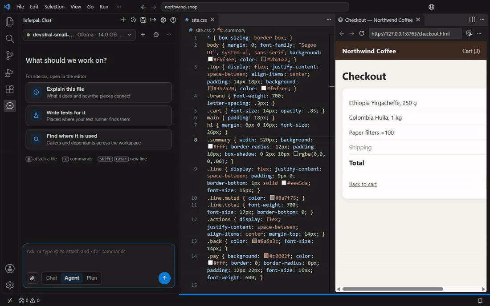
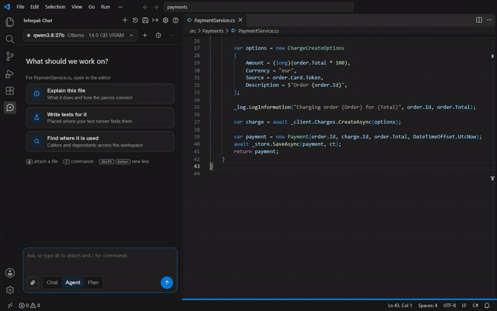
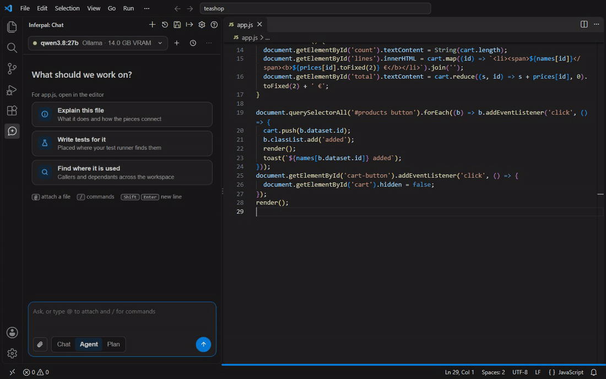

# Your local AI agent, inside your editor

**For VS Code, VSCodium and Cursor**

**Give it a task. It reads your code, changes it, runs your app, looks at the result and checks its own work — on your own hardware, with every change waiting for your approval.**

**No account · No telemetry · No API key · Works offline · Free and open source**

With [Ollama](https://ollama.com), [LM Studio](https://lmstudio.ai), llama.cpp, vLLM or any OpenAI-compatible server, on this computer or a GPU machine you own. Windows, Linux and macOS.

*"Capture the cart with two teas in it, for the README." It starts the app, clicks through it and saves the picture. Replayed in VS Code.*

> **1.9.2 · 20 Nov 2026** — the agent clicks through the page or the desktop app it builds and captures the state reached · it works on a copy of your repository, and you keep or drop each change · it reads your development database, read-only. [Full changelog](https://github.com/EstaxNet/Inferpal/releases/tag/v1.9.2)

## See it work

| | | |
|---|---|---|
|  |  |  |
| **It looks at what it builds** | **It drives your desktop app** | **It reads your database** |
|  |  |  |
| **It works while you code** | **On a copy, if you prefer** | **You approve, you undo** |

| It sees | It acts | It checks |
|---|---|---|
| The page your app serves, at a phone's width; the desktop app it launched; screenshots, PDFs, logs, spreadsheets | Edits across files, runs commands, clicks through your app, calls your API, reads your database | Builds and tests after each change, looks at the page again, measures before it says faster |

## It goes all the way

**Plan → Read → Change → Run your app → Look at it → Check, then answer.**

Up to 40 steps on one request (*Steps per request* in the settings), in Agent mode or in the background while you keep coding (`/task`). On a copy of your repository if you prefer (`/run-copy`), and **Undo run** puts every file back in one click.

## Your code stays here

The model runs on a server you choose, on this computer or a GPU machine you own. There is no account, no telemetry and no hosted service. Nothing else leaves your machine unless you set it up or approve it: the MCP servers you add, a site you index, a web search the agent asks for, and the name of a package it wants to add, checked on its public registry (one setting turns that off).

## Which model for your graphics card

| Your card | Agent model |
|---|---|
| 24 GB | Qwen3.8 27B |
| 12 – 16 GB | Gemma 4 12B, or Ternary Bonsai 2 27B (slower) |
| 8 GB | Granite 4.2 8B |

Any model that calls tools works. [Every measurement](https://github.com/EstaxNet/Inferpal/blob/v1.9.2/docs/models.md#by-graphics-card)

## Get started

1. Install a model server — [Ollama](https://ollama.com) or [LM Studio](https://lmstudio.ai).
2. Open **Inferpal** from the activity bar. It finds your server and picks a model, or offers to install one.

[Getting started](https://github.com/EstaxNet/Inferpal/blob/v1.9.2/docs/getting-started.md) · Right-click a test, a problem, a debugger stop or a file for a ready-made action · [Everything it can do](https://github.com/EstaxNet/Inferpal/blob/v1.9.2/docs/features.md): 44 built-in tools, 50+ commands, 10 languages

## Right-click, and it's on it

| Where you are | Choose | What you get |
|---|---|---|
| **Test view** | Make This Test Pass · Explain the Failure | `/tdd` on that test, or its failure explained |
| **Problems, light bulb** | Fix with Inferpal | The problem is fixed with the code around it |
| **Debugger, stopped** | Analyze with Inferpal | The stop is explained from the stack and locals, and nothing is stepped or run |
| **Explorer** | Explain · Review Changes · Attach to Chat | A file or folder explained, or its uncommitted changes reviewed |
| **Source Control** | Propose a Commit Message | The message is written into the commit box, and nothing is committed |
| **Editor** | Edit with AI | Your instruction applied to the selection, shown in Refactor Preview first |
| **While you type** | Tab, or Alt+' (Ctrl+Option+' on macOS) | Ghost-text completions, either after a pause or only when you ask |

Open the chat from the **Inferpal** icon in the activity bar. Every change waits for your approval.

## Show it what you are looking at

The spec is a PDF, the test data lives in a spreadsheet, the error is on a screenshot. Hand them over as they are.

| You have | Do | The model gets |
|---|---|---|
| A PDF, a Word or Excel file, a deck | `@file`, Browse, or drop it on the chat with Shift held | Its text, read on your machine: each sheet under its name, each slide with its notes |
| A screenshot of an error, a mock-up or a phone photo (TIFF, and HEIC with your system's decoder) | paste it in the chat, or drop it on the chat | The image itself, for a model that sees images (Qwen3.8, Ornith, Gemma 4) |
| A file protected by a password | Attach it as usual | A card asks you for the password; the model gets the text, never the password |
| A question about a flow or a design | Ask for a diagram | A Mermaid diagram drawn in the chat, its code one click away |

Word (`.docx`, `.doc`), Excel (`.xlsx`, `.xls`, `.xlsb`), PowerPoint, OpenDocument, RTF, Jupyter notebooks, e-mails (`.eml`, `.msg`), Windows event logs (`.evtx`) and diagrams (`.drawio`, `.vsdx`) are read too, by you and by the agent's `read_file` and `search_in_files`. Nothing is installed for it and nothing leaves your machine. A scanned PDF is read by OCR; a file too large to read says so instead of sending noise. Every format, in one table: [File formats](https://github.com/EstaxNet/Inferpal/blob/v1.9.2/docs/file-formats.md).

When the model that will answer does not see images, the text written in the image goes instead, read on your computer by Inferpal's OCR; only a picture with no text gets a card that offers one of your server that does, or sending without it. A large image is scaled down to 1920 × 1080 first, and said.

## It looks, it measures, it checks

A model that only reads source code has to imagine what the program does. Inferpal's agent can check instead: it
looks at what the code produces, measures it, and reads the files developers deal with every day.

| The agent can | What you get |
|---|---|
| Open a page of the web app you build, at desktop and phone widths, in a browser with no network access (`view_page`) | Layout and styling problems the source does not show — an invisible element, a layout that breaks on a phone — seen, not guessed |
| Click, type and choose in a page of your app, then capture the state reached (`interact_page`) | A screenshot of the cart with two items or the filled form for your README, taken by the agent, each step shown |
| Type, click and choose in the desktop app the agent launched (`interact_window`) | The order form filled in and sent, its window checked and captured for your README, without touching your mouse or keyboard |
| Look at the window of a desktop app it started, with every control's type, text, value and state (`view_window`) | A disabled button or an empty field noticed, even by a model that cannot read images |
| Start your web service, send it real HTTP requests and read the answers (`http_request`) | An error reproduced, fixed, then confirmed by calling the service again |
| Run a command several times after a warm-up and compare medians (`run_command` with `repeat`) | A change kept as "faster" only when the gain is beyond the normal variation between runs |
| Read a log by level and time range (`read_file`) | Only the entries that matter, each with its stack trace and line number |
| Answer one read-only SQL query on a CSV, TSV, JSON, Excel or SQLite file (`query_data`) | Counts, filters and sums on files too large to read |
| Read your development database, found where your project declares it (`query_database`) | Why an order shows no total, answered from the data — PostgreSQL, SQL Server, MySQL or MariaDB, reads only, no connection string stored |
| Read inside zip, 7z, RAR and tar archives and NuGet packages without extracting them | Logs and packages inspected where they are |
| Change one cell of a Jupyter notebook, then run the notebook on a copy (`edit_notebook`, `run_notebook`) | The failing cell fixed and its output checked, the rest of the notebook untouched |
| Ask MSBuild where a build setting is defined (`msbuild_property`) | A build error that comes from a setting fixed in the file that sets it |
| Change a text across many files in one approval (`replace_in_files`) | A rename across a project, all files or none, each backed up first |
| Read which commits touched a file and who last changed each line (`git_history`) | Code understood before it is changed |

The text of a screenshot or a scanned PDF is read by Inferpal's own OCR, in its ten languages, on Windows, Linux and
macOS, with nothing to install. When a request could mean several things, the agent asks you on a card instead of
guessing. Calling your app and running a command still ask you first; an *Always* covers one local address and port.
Looking at a desktop app's window works on Windows, on macOS once you allow screen recording and accessibility, and
on Linux under X11 (a native Wayland window gives its controls, not its picture).

## A failing test? It reads the debugger, not just the log

`/tdd` runs your tests (dotnet, pytest, npm, cargo, go), patches the code and runs them again, for up to five rounds. On the first red round, a failing .NET test is run again under the debugger, with no `launch.json` needed. The real exception, call stack and local values then go into the fix. We tested this on a fixed set of 12 failing C# tests with a local 27B model. It fixed **12 with the debugger's view and 10 without**.

## Hand it a task. You stay in control.

Ask in plain words, for example *"add argument validation to this method and cover it with tests"*. The agent plans the work, then reads, edits, builds and tests, and shows every step live.

- **Every write, delete and command waits for you**, with the real diff. Press Enter to allow or Esc to deny. You can also allow a narrow rule you choose, such as *commands that start with `npm test`*.
- **Every file the agent edits is backed up first.** **Undo run** puts them all back in one click.
- **You can steer it while it works.** Type a correction and press Enter, and the agent reads it before its next step. Ctrl+Enter queues a message for after the turn instead.
- **It checks its own work.** It builds or typechecks after each edit (.NET, TypeScript, Rust, Go) and feeds the errors straight back.
- **It refuses invented packages before asking you.** Local models make up package names. Before a package is added, its name is looked up on nuget.org, npm or PyPI.
- **It can work on a copy of your repository.** `/run-copy` lets it build, test and edit on a branch of its own while your files stay as they are; you keep or drop each change before it reaches them.
- **Long runs announce themselves.** If a run takes more than 30 seconds while you look elsewhere, a notification says when it is done.

## Also in the box

- **44 built-in tools**: files, text and semantic search, build and tests, shell with background jobs, git, the editor, the debugger, compiler-backed analysis and symbol rename, web search and page fetch. Add any **MCP** server's tools and your own shell commands. See the [reference](https://github.com/EstaxNet/Inferpal/blob/v1.9.2/docs/tools.md).
- **Semantic code search** across your workspace, with an embedding model installed (keyword search without one). The most relevant code is added to each question, and suggested as chips while you type.
- **Reviews and Git text.** `/check` reviews your diff, a branch or a commit, and anchors every finding to a line. `/commit` drafts the commit message, and `/pr-description` writes the pull request description.
- **Typed mentions**: `@file` `@folder` `@code` `@diff` `@commit` `@problems` `@debugger` `@clipboard` `@tree` `@url` `@terminal`, or drop files from your file manager on the chat with Shift held. **@Docs** indexes a documentation site with `/docs add <url>`.
- **A model server behind a reverse proxy.** Caddy or nginx with a password, an access token, Cloudflare Access, or headers of your own: *Settings → Server and models → Access through a reverse proxy* builds the headers, shows what will be sent and to whom, and its **Test** says where a request stopped. Only that server receives them.
- **Modes, yours or your repository's.** Beside Chat, Agent and Plan, pick a mode found for the workspace: your own, GitHub Copilot's custom agents or Roo Code's custom modes. It brings its instructions, model, tools and effort, and adds no permission.
- **Your repository's agent setup, read as it is.** It reads `AGENTS.md`, `CLAUDE.md`, the Copilot and Cursor instruction files, and your project rules. It honours `.aiignore`-style files.
- **Background and debug sessions.** `/task` investigates in the background while you work. `/debug` drives a debug session once you approve it.
- **Context you can see.** A gauge shows how full the model's window is, and `/xray` shows what fills it.
- **One engine, every editor.** The same agent runs in [Visual Studio](https://marketplace.visualstudio.com/items?itemName=EstaxNet.inferpal-vs), with shared settings and conversations, so you can start in one editor and finish in the other. It is also an [Agent Client Protocol](https://github.com/EstaxNet/Inferpal/blob/v1.9.2/docs/acp.md) agent for Zed, the JetBrains IDEs, Qt Creator, Neovim and Emacs.
- **50+ slash commands** and an interface in 10 languages. See the [slash commands](https://github.com/EstaxNet/Inferpal/blob/v1.9.2/docs/slash-commands.md).

---

## FAQ

**Does my code leave my machine?** Not with a model server on your machine. There is no account, no telemetry and no hosted service. Only these go out:

- the model server address you choose
- the MCP servers you add
- a site you index
- the agent's web searches and page fetches, each of which asks you first
- the name of a package the agent wants to add, looked up on its public registry. Only the name is sent, and one setting turns this off.

**Will my model work?** Any model that calls tools will. That includes tool calls a server leaves as plain text (Qwen, Mistral, GLM, Gemma, gpt-oss). It also includes a model whose chat template refuses tools. Each known model family gets the sampling settings its vendor recommends.

**Which server should I use?** Ollama gets every feature, including per-model memory figures, downloads from the chat and unloading idle models. LM Studio runs everything except per-model memory figures, unloading idle models and `/models delete`. Other OpenAI-compatible servers (llama-server, vLLM) run the chat, the agent and the search. They also run inline completions if the server can complete around the cursor.

**Can the model run on another machine?** Yes. Point the server address at it, as described in [Remote inference](https://github.com/EstaxNet/Inferpal/blob/v1.9.2/docs/remote-inference.md). Behind a reverse proxy that asks for a password or a token, give it its credentials in *Settings → Server and models*.

**Does it work with Remote - WSL, Remote - SSH or Dev Containers?** Yes, when the other side is x64 Linux (there is no build for ARM Linux or Alpine): Inferpal runs on the other side, next to your files. There, `localhost` is WSL, the remote machine or the container — Inferpal says so when a local address does not answer, with the address to use instead ([details](https://github.com/EstaxNet/Inferpal/blob/v1.9.2/docs/remote-inference.md#5-vs-code-connected-to-wsl-ssh-or-a-container)).

**Does it work offline?** Yes, with a local server. Only web search and page fetch need the internet.

## Requirements

| | |
|---|---|
| VS Code | 1.100 or later, with a folder open in a trusted workspace |
| Platforms | Windows x64, Linux x64 and macOS 12 or later (Apple Silicon and Intel). Each build ships its own backend, and all are on the [GitHub releases](https://github.com/EstaxNet/Inferpal/releases) page. |
| Model server | Ollama, LM Studio or any OpenAI-compatible server, local or on another machine, with a model that calls tools |

## Official sources

Inferpal is an independent open-source project (GPL v3) by EstaxNet. It has no hosted version and no account, and is not affiliated with any cloud or API provider. The official sources are the [GitHub releases](https://github.com/EstaxNet/Inferpal/releases) and the Marketplace listings for [Visual Studio](https://marketplace.visualstudio.com/items?itemName=EstaxNet.inferpal-vs) and [VS Code](https://marketplace.visualstudio.com/items?itemName=EstaxNet.inferpal-vscode), and [Open VSX](https://open-vsx.org/extension/EstaxNet/inferpal-vscode) for VSCodium, Cursor and the other editors built on VS Code. Questions and bug reports go on [GitHub](https://github.com/EstaxNet/Inferpal/issues).

**Finding Inferpal useful?** [A rating](https://marketplace.visualstudio.com/items?itemName=EstaxNet.inferpal-vscode&ssr=false#review-details) helps other developers find it.

## License

GPL-3.0. The source is at [github.com/EstaxNet/Inferpal](https://github.com/EstaxNet/Inferpal).
