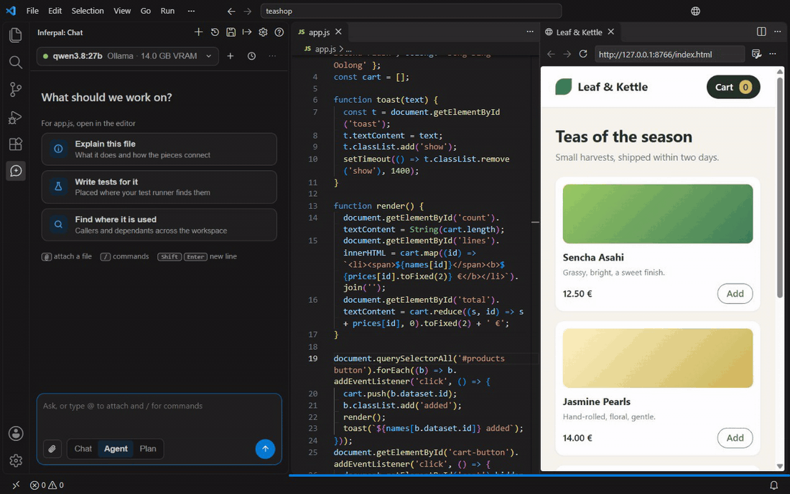
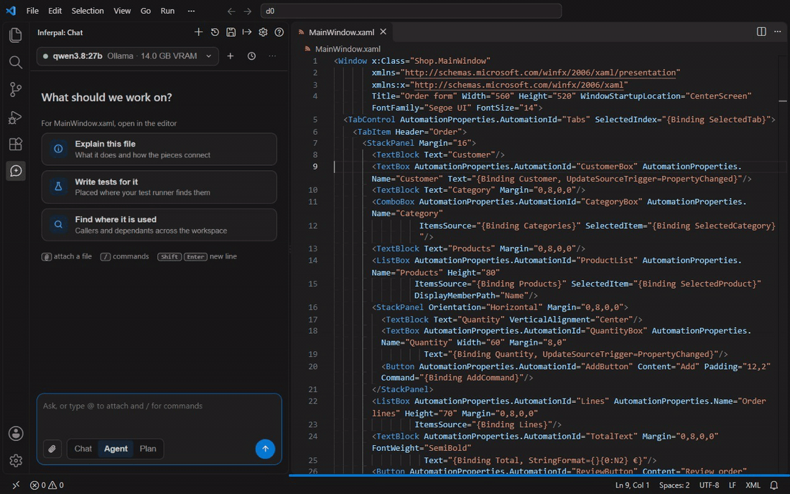
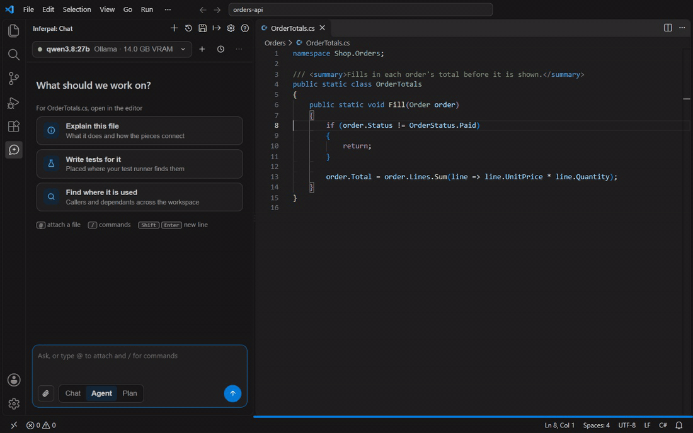
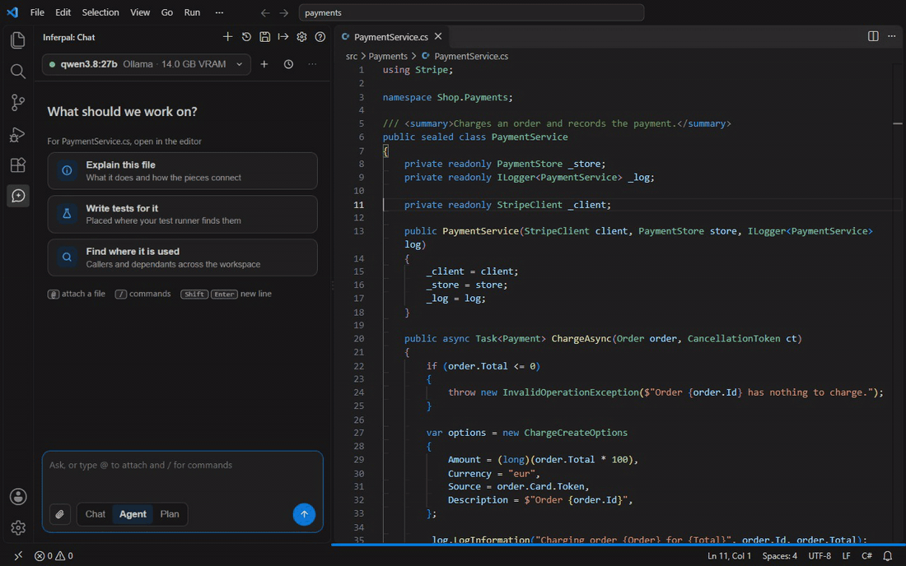

# Your local AI agent, inside your editor

**For VS Code, VSCodium and Cursor**

**Give it a task. It reads your code, changes it, runs your app, looks at the result and checks its own work — on your own hardware, with every change waiting for your approval.**

**No account · No telemetry · No API key · Works offline · Free and open source**

With [Ollama](https://ollama.com), [LM Studio](https://lmstudio.ai), llama.cpp, vLLM or any OpenAI-compatible server, on this computer or a GPU machine you own. Windows, Linux and macOS.

*"Capture the cart with two teas in it, for the README." It starts the app, clicks through it and saves the picture. Replayed in VS Code.*

> **1.9.2 · 20 Nov 2026** — the agent clicks through the page or the desktop app it builds and captures the state reached · it works on a copy of your repository, and you keep or drop each change · it reads your development database, read-only. [Full changelog](https://github.com/EstaxNet/Inferpal/releases/tag/v1.9.2)

## See it work

| | | |
|---|---|---|
|  |  |  |
| **It looks at what it builds** | **It drives your desktop app** | **It reads your database** |
|  |  |  |
| **It works while you code** | **On a copy, if you prefer** | **You approve, you undo** |

| It sees | It acts | It checks |
|---|---|---|
| The page your app serves, at a phone's width; the desktop app it launched; screenshots, PDFs, logs, spreadsheets | Edits across files, runs commands, clicks through your app, calls your API, reads your database | Builds and tests after each change, looks at the page again, measures before it says faster |

## It goes all the way

**Plan → Read → Change → Run your app → Look at it → Check, then answer.**

Up to 40 steps on one request (*Steps per request* in the settings), in Agent mode or in the background while you keep coding (`/task`). On a copy of your repository if you prefer (`/run-copy`), and **Undo run** puts every file back in one click.

## Your code stays here

The model runs on a server you choose, on this computer or a GPU machine you own. There is no account, no telemetry and no hosted service. Nothing else leaves your machine unless you set it up or approve it: the MCP servers you add, a site you index, a web search the agent asks for, and the name of a package it wants to add, checked on its public registry (one setting turns that off).

## Which model for your graphics card

| Your card | Agent model |
|---|---|
| 24 GB | Qwen3.8 27B |
| 12 – 16 GB | Gemma 4 12B, or Ternary Bonsai 2 27B (slower) |
| 8 GB | Granite 4.2 8B |

Any model that calls tools works. [Every measurement](https://github.com/EstaxNet/Inferpal/blob/v1.9.2/docs/models.md#by-graphics-card)

## Get started

1. Install a model server — [Ollama](https://ollama.com) or [LM Studio](https://lmstudio.ai).
2. Open **Inferpal** from the activity bar. It finds your server and picks a model, or offers to install one.

[Getting started](https://github.com/EstaxNet/Inferpal/blob/v1.9.2/docs/getting-started.md) · Right-click a test, a problem, a debugger stop or a file for a ready-made action · [Everything it can do](https://github.com/EstaxNet/Inferpal/blob/v1.9.2/docs/features.md): 44 built-in tools, 50+ commands, 10 languages

## Questions

**Will my model work?** Any model that calls tools, including those that write their tool calls as text (Qwen, Mistral, GLM, Gemma, gpt-oss).

**Can the model run on another machine?** Yes: point the server address at it ([remote inference](https://github.com/EstaxNet/Inferpal/blob/v1.9.2/docs/remote-inference.md)).

**Remote - WSL, SSH or Dev Containers?** Yes, when the other side is x64 Linux: Inferpal runs there, next to your files.

## Requirements

| | |
|---|---|
| Editor | VS Code 1.100 or later, or an editor built on it (VSCodium, Cursor), with a folder open in a trusted workspace |
| Platforms | Windows x64, Linux x64, macOS 12 or later (Apple Silicon and Intel). The backend is bundled |
| Model server | Ollama, LM Studio or any OpenAI-compatible server, with a model that calls tools |

## Official sources

Inferpal is an independent open-source project (GPL v3) by EstaxNet, with no hosted version and no account. The official sources are the [GitHub releases](https://github.com/EstaxNet/Inferpal/releases) and the listings for [Visual Studio](https://marketplace.visualstudio.com/items?itemName=EstaxNet.inferpal-vs), [VS Code](https://marketplace.visualstudio.com/items?itemName=EstaxNet.inferpal-vscode) and [Open VSX](https://open-vsx.org/extension/EstaxNet/inferpal-vscode). **Finding it useful?** [A rating](https://marketplace.visualstudio.com/items?itemName=EstaxNet.inferpal-vscode&ssr=false#review-details) helps other developers find it.

## License

GPL-3.0. The source is at [github.com/EstaxNet/Inferpal](https://github.com/EstaxNet/Inferpal).
